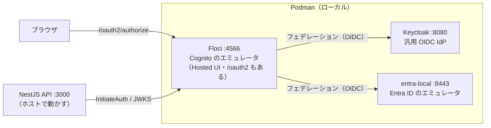

# アウトライン: Podman + Floci で Cognito 認証を練習する

この書類は、各レクチャーの本文を書く前に構成を確認するためのもの。見出しと、各節で書く内容だけを載せる。
教材は handson-builder の形（`sections/<セクション>/<レクチャー>/LECTURE.md` ＋ Starlight サイト）で作る。

## 全体像

| 練習 | 使うコンテナ | ローカルで完結する部分 | 実 AWS / 実テナントが要る部分 |
| --- | --- | --- | --- |
| 1. cognito | Floci | User Pool・ユーザー・パスワード認証・トークン・JWKS | なし |
| 2. app-with-cognito | Floci, NestJS API | サインアップ・ログイン・JWT 検証・グループ認可・e2e | なし |
| 3. cognito-with-other-idp | Floci, Keycloak | Hosted UI ログイン、Cognito 経由の Keycloak フェデレーション | なし |
| 4. cognito-with-entra-id | Floci, entra-local | Cognito 経由の Entra ID（OIDC）フェデレーション | SAML、MFA・条件付きアクセス |

**一番大事な前提**: Floci には Hosted UI（`/cognito-idp/login`）と `/oauth2/authorize`・`/oauth2/idpresponse`・`/oauth2/token` がある。このため「Cognito が外部 IdP にログインを任せる」流れが、OIDC ならローカルで最後まで通る（Keycloak・entra-local とも動作確認済み）。SAML は Floci も entra-local も対応していない。

### 動かして分かった Floci 2.4.0 の性質（教材に書く）

- ポートは 4566。moto の 5000 番のような macOS の AirPlay との衝突は無い
- ID トークンの `iss` は `http://localhost:4566/<pool_id>`。discovery・JWKS と同じホストなので、検証側で URL を分ける必要が無い
- 署名鍵はプールごと（`kid` がプール ID）。ID トークンに `email` が入る
- 外部 IdP は `ProviderDetails` に `authorize_url` / `token_url` / `attributes_url` / `jwks_uri` を明示する。Floci は登録時に discovery を読みに行かない（本物は読みに行き、届かなければ登録を拒否する）
- Floci は IdP のトークン・userinfo をコンテナの中から呼ぶ。`token_url` などは `host.containers.internal` に向け、ブラウザが通る `authorize_url` は `localhost` のままにする
- Keycloak は呼ばれたホスト名で `iss` を変えるので、`KC_HOSTNAME=http://localhost:8080` で固定する（しないと userinfo が拒否され、Floci は `Identity provider claims request failed` を返す）
- 連携ユーザーの名前は `<プロバイダ名>_`、ID トークンに `identities` クレームが付く
- データは既定でメモリ。コンテナを作り直すと消える

---

## README.md（ルート / サイトのトップ）

### この教材について
- 目的と、4 つの練習の順番と関係（上の図と表）
- 「このハンズオンで作るもの」: セクションごとに図と 200 字程度の説明

## sections/README.md（進め方）
- レクチャーごとに `cd` して動かす進め方、ポートの一覧（4566 / 8080 / 8443 / 3000）

---

## 00-setup — 準備

### 01-tools: 道具をそろえる
- Podman: `podman machine init` / `podman machine start`（macOS）、`podman compose` が呼ぶ docker-compose / podman-compose の違い
- aws CLI v2、Node.js 24 以上
- 共通の環境変数: `AWS_ENDPOINT_URL=http://localhost:4566`、ダミーの `AWS_ACCESS_KEY_ID` / `AWS_SECRET_ACCESS_KEY`、`AWS_REGION`（`env.sh` を `source` する）

### 02-floci: Floci を起動する
- `floci/floci:2.4.0`（バージョンを固定）、compose.yaml、ポート 4566、ヘルスチェック
- データはメモリにあり、作り直すと消える。やり直すときは `podman compose down && up`
- Floci の Cognito で使えるもの・使えないもの（動かして確かめた表）
- コラム: moto と比べると（Hosted UI の有無、`iss`、鍵、ID トークンの email）

---

## 01-cognito — Cognito 単体（aws CLI だけ）

### 01-user-pool: User Pool と App Client を作る
- パスワードポリシー、`ALLOW_USER_PASSWORD_AUTH`、シークレットなしのクライアント、ID を `.cognito.env` に残す

### 02-users: ユーザーを作る
- 管理者が作る: `admin-create-user` → `initiate-auth` → `NEW_PASSWORD_REQUIRED` → `respond-to-auth-challenge`
- 自分でサインアップする: `sign-up` → 確認コード（Floci の SES に届いたメールから読む／`admin-confirm-sign-up`）→ `initiate-auth`

### 03-tokens-and-groups: トークンを読む・グループ
- ID トークンとアクセストークンの違い、デコード、主なクレーム
- `create-group` → `admin-add-user-to-group` → `cognito:groups`

### 04-jwks-and-refresh: 署名を確かめる・更新する
- discovery と JWKS、`jose` で署名・`iss`・`exp` を確かめる、改ざんしたトークンが弾かれる
- `REFRESH_TOKEN_AUTH`
- 本物の Cognito との違い（`iss` のホスト、メール送信、ここで見つけた差分）

---

## 02-app-with-cognito — NestJS API から使う

NestJS は TypeScript（NestJS 12 の標準構成）。API はホストで `npm run start:dev`、Floci は Podman。

### 01-auth-api: 認証 API
- `ConfigModule`（`COGNITO_ENDPOINT`・`COGNITO_USER_POOL_ID`・`COGNITO_CLIENT_ID`）
- `AuthService`: SDK の `endpoint` 上書き
- `POST /auth/signup`・`/auth/confirm`・`/auth/login`・`/auth/refresh`
- Cognito の例外を HTTP に変換（存在しないユーザーとパスワード違いは同じ 401）

### 02-protect-routes: トークンの検証とグループ認可
- `CognitoJwtGuard`（`jose` の `createRemoteJWKSet`、`token_use`・`client_id`）、`@CurrentUser()`
- `@Roles('admin')` と `RolesGuard`、401 と 403 の使い分け、グループ変更は新しいトークンから効く

### 03-e2e-test: e2e テスト
- Vitest + supertest を Floci に向けて流す、テストごとに User Pool を作り直す

### 04-frontend-and-container: フロントとコンテナ
- 最小のフロント（fetch のみ）
- Containerfile、API もコンテナで動かすときの `iss` と JWKS の URL（`FLOCI_HOSTNAME`）
- 本番の Cognito に切り替える: 環境変数を差し替えるだけで済むことの確認

---

## 03-cognito-with-other-idp — Hosted UI と外部 IdP（Keycloak）

### 01-hosted-ui: Cognito の Hosted UI でログインする
- フェデレーションの前に、自前ユーザーで Authorization Code + PKCE（`/oauth2/authorize` → Floci のログイン画面 → `/oauth2/token`）
- App Client の Callback URL・`AllowedOAuthFlows`・スコープ
- フロントを「パスワードを API に送る」から「Hosted UI にリダイレクトする」に変える

### 02-keycloak: Keycloak を用意する
- compose.yaml（Floci + Keycloak）、realm のインポート（ユーザー・`cognito` クライアント）、`KC_HOSTNAME` を固定する理由
- discovery・JWKS の確認

### 03-federation: Cognito 経由で Keycloak にログインする
- フェデレーションの仕組み（シーケンス図: ブラウザ → Cognito → Keycloak → `/oauth2/idpresponse` → アプリ）
- `create-identity-provider`（OIDC、エンドポイントの明示、`AttributeMapping`）、`SupportedIdentityProviders`
- `identity_provider=Keycloak` でログイン → Cognito のトークン（`identities`、`Keycloak_`）
- API は 02 の Guard のまま動く（アプリは Cognito のトークンだけを見ればよい）
- コラム: アプリが Keycloak に直結する場合との比較（Cognito が肩代わりしていること）

---

## 04-cognito-with-entra-id — Entra ID（entra-local）

### Entra ID はローカルで再現できるか（セクション冒頭のレクチャー本文で扱う）
- OIDC の範囲なら [cmaneu/entra-local](https://github.com/cmaneu/entra-local) で再現できる
- できないもの: SAML、MFA、条件付きアクセス、マルチテナント、同意画面

### 01-entra-local: entra-local を用意する
- `ghcr.io/cmaneu/entra-local:0.1.1`（amd64 のみ。Apple Silicon ではエミュレーションで動く）
- `TLS_ENABLED=false`・`PUBLIC_ORIGIN`・`REQUIRE_PASSWORD=true`、`/app/data` ボリューム
- 管理 API でアプリ登録・シークレット発行、シードユーザー、discovery と JWKS
- ID トークンのクレーム（`tid`・`oid`・`preferred_username`・`email`）を実際の出力で確認

### 02-federation: Cognito 経由で Entra ID にログインする
- `oidc_issuer` に v2.0 の issuer、エンドポイントの明示、`AttributeMapping`
- `identity_provider=EntraID` でログイン → Cognito のトークン（`EntraID_`）
- Entra の `sub` はアプリごとに変わる（pairwise）。ユーザーを特定するなら `oid`

### 03-real-tenant:（任意・未検証）本物の Entra テナント + 実 Cognito
- アプリ登録、リダイレクト URI `https://<domain>.auth.<region>.amazoncognito.com/oauth2/idpresponse`
- SAML で登録する場合の差分

### Entra 固有の落とし穴（03 の末尾）
- テナントごとの issuer と `common`、`email` が来ないことがある、groups の overage、シークレットの期限切れ

---

## 実装中に確かめたこと（2026-11-15〜16）

- Floci の確認コードは SES（`/_aws/ses`）に届き、間違ったコードは `CodeMismatchException` で拒否される。ただし User Pool に `AutoVerifiedAttributes: email` が無いと、どんなコードでも通る
- API をコンテナで動かすと、トークンの `iss` は `http://localhost:4566/...` のまま。`COGNITO_ISSUER` と `COGNITO_JWKS_URL` を分けて渡して解決（`FLOCI_HOSTNAME` は使っていない）
- Floci も compose に入れたので、外部 IdP の `token_url` などは `host.containers.internal` ではなくサービス名（`keycloak` / `entra-local`）で書く
- entra-local の userinfo には `oid` が入り、`custom:entra_oid=oid` で Cognito の属性に移せる。同じユーザーでもアプリごとに `sub` が変わることも確かめた
- Hosted UI の `/oauth2/token` は PKCE を確かめる。ブラウザから呼ぶには `FLOCI_SECURITY_EXTRA_CORS_ALLOWED_ORIGINS` が要る
- 未確認のまま: entra-local を HTTPS のまま Floci からつなぐこと、本物の Entra テナント + 本物の Cognito（04-03 は手順のまとめだけ）
