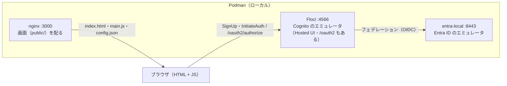

# アウトライン: Podman + Floci で Cognito 認証を練習する

この書類は、各レクチャーの本文を書く前に構成を確認するためのもの。見出しと、各節で書く内容だけを載せる。
教材は handson-builder の形（`sections/<セクション>/<レクチャー>/LECTURE.md` ＋ Starlight サイト）で作る。

## 全体像

| 練習 | 使うコンテナ | ローカルで完結する部分 | 実 AWS / 実テナントが要る部分 |
| --- | --- | --- | --- |
| 1. cognito | Floci | User Pool・ユーザー・パスワード認証・トークン・JWKS | なし |
| 2. login-page | Floci | HTML からのサインアップ・ログイン、Hosted UI | なし |
| 3. cognito-with-entra-id | Floci, entra-local | Cognito 経由の Entra ID（OIDC）フェデレーション | SAML、MFA・条件付きアクセス |

方針: 設定の方法とローカルのコンテナの用意に絞る。API・E2E テスト・汎用 IdP（Keycloak）は扱わない（2026-11-19 に絞った。#31）。

**一番大事な前提**: Floci には Hosted UI（`/cognito-idp/login`）と `/oauth2/authorize`・`/oauth2/idpresponse`・`/oauth2/token` がある。このため「Cognito が外部 IdP にログインを任せる」流れが、OIDC ならローカルで最後まで通る（entra-local で動作確認済み）。SAML は Floci も entra-local も対応していない。

### 動かして分かった Floci 2.4.0 の性質（教材に書く）

- ポートは 4566。moto の 5000 番のような macOS の AirPlay との衝突は無い
- ID トークンの `iss` は `http://localhost:4566/<pool_id>`。discovery・JWKS と同じホストなので、検証側で URL を分ける必要が無い
- 署名鍵はプールごと（`kid` がプール ID）。ID トークンに `email` が入る
- 外部 IdP は `ProviderDetails` に `authorize_url` / `token_url` / `attributes_url` / `jwks_uri` を明示する。Floci は登録時に discovery を読みに行かない（本物は読みに行き、届かなければ登録を拒否する）
- Floci は IdP のトークン・userinfo をコンテナの中から呼ぶ。`token_url` などはサービス名（`entra-local`）に向け、ブラウザが通る `authorize_url` は `localhost` のままにする
- 連携ユーザーの名前は `<プロバイダ名>_`、ID トークンに `identities` クレームが付く
- データは既定でメモリ。コンテナを作り直すと消える

---

## README.md（ルート / サイトのトップ）

### この教材について
- 目的と、3 つの練習の順番と関係（上の図と表）
- 進め方（1 つのフォルダを育てる・差分の読み方・節の最後のディレクトリと ZIP・途中の節から始める方法・前提）
- 「このハンズオンで作るもの」: セクションごとに図と 200 字程度の説明

## sections/RELATED.md（関連するハンズオン）
- NestJS の 3 本（REST API・認証と認可・テスト）と、それぞれとのつながり

---

## 01-setup — 準備

### 01-environment: 準備
- Podman: `podman machine init` / `podman machine start`（macOS）、`podman compose` が呼ぶ docker-compose / podman-compose の違い
- aws CLI v2、jq

---

## 02-cognito — Cognito を用意する（Floci の起動・User Pool・App Client・作り直すスクリプト）

### 01-floci: Floci を起動する
- `handson/` を作り、compose.yaml・env.sh を 1 つずつ作って Floci を起動する: `floci/floci:2.4.0`（バージョンを固定）、compose.yaml、ポート 4566、起動したかは curl で health を見る
- 共通の環境変数: `AWS_ENDPOINT_URL=http://localhost:4566`、ダミーの `AWS_ACCESS_KEY_ID` / `AWS_SECRET_ACCESS_KEY`、`AWS_REGION`（`env.sh` を `source` する）
- データはメモリにあり、作り直すと消える。やり直すときは `podman compose down && up`
- Floci の Cognito で使えるもの・使えないもの（動かして確かめた表）
- コラム: moto と比べると（Hosted UI の有無、`iss`、鍵、ID トークンの email）

### 02-user-pool: User Pool を作る
- パスワードポリシー、確認コードをメールで送る設定

### 03-app-client: App Client を作る
- `ALLOW_USER_PASSWORD_AUTH`、シークレットなしのクライアント

### 04-reusable: 再利用可能にする
- User Pool と App Client を作るスクリプト（create-user-pool.sh）、ID を `.cognito.env` に残す、作り直すスクリプト（setup.sh）、.gitignore

## 03-login-page — HTML でログインする

画面は HTML と JavaScript だけ。Podman の nginx のコンテナで配る。ログインは画面（ブラウザ）から Cognito に直接行う。

### 01-web: Web の用意
- nginx のコンテナ（`web`）で `public/` を配る。`setup` が `public/config.json`（issuer・クライアント ID）を書き出す
- Floci の CORS（`FLOCI_SECURITY_EXTRA_CORS_ALLOWED_ORIGINS`）
- 共通の cognito.js・style.css。トップは Cognito の API の入口を出すだけ

### 02-mailbox: メールボックス
- Floci の `/_aws/ses` にたまったメールを表で出す（mail.html）

### 03-signup: サインアップ
- AWS SDK v3 を CDN（esm.sh）から読み込み、`SignUp`・`ConfirmSignUp`（署名なし）。signup.html → confirm.html

### 04-signin: サインイン
- `InitiateAuth` でサインインし、トークンを sessionStorage に保存する（signin.html）
- `PreventUserExistenceErrors`（Floci では効かない）、トークンの置き場所

### 05-login: ログイン
- ログイン中の画面（home.html）。ID トークンの中身、`RevokeToken` でサインアウト

### 06-hosted-ui: Hosted UI について（説明だけ）
- Floci の Hosted UI はログイン画面だけ。03 では使わず、04-04 で Entra ID のサインインに同じ仕組み（認可コード + PKCE）を使う

---

## 04-cognito-with-entra-id — Entra ID（entra-local）

### Entra ID はローカルで再現できるか（セクション冒頭のレクチャー本文で扱う）
- OIDC の範囲なら [cmaneu/entra-local](https://github.com/cmaneu/entra-local) で再現できる
- できないもの: SAML、MFA、条件付きアクセス、マルチテナント、同意画面

### 01-entra-local: コンテナの用意
- `ghcr.io/cmaneu/entra-local:0.1.1`（amd64 のみ。Apple Silicon ではエミュレーションで動く）
- `TLS_ENABLED=false`・`PUBLIC_ORIGIN`・`REQUIRE_PASSWORD=true`、`/app/data` ボリューム、discovery を curl で見る

### 02-app-registration: アプリの登録
- 管理 API に curl でアプリ登録・シークレット発行。`.entra.env` に控える

### 03-users: ユーザーの作成
- curl でユーザーを作り、token-preview で ID トークンのクレーム（`tid`・`oid`・`preferred_username`・`email`）を見る
- Entra の `sub` はアプリごとに変わる（pairwise）。ユーザーを特定するなら `oid`

### 04-federation: Entra ID にあるユーザーで Cognito にログイン
- aws CLI でカスタム属性・IdP の登録（`oidc_issuer` に v2.0 の issuer、エンドポイントの明示、`AttributeMapping`）・App Client の設定を手で打つ
- 画面に認可コード + PKCE を足し、「Entra ID でサインイン」→ Cognito のトークン（`EntraID_`）、`custom:entra_oid`

### 05-reusable: 再利用可能にする
- entra-register-app.sh・entra-create-user.sh・update-client.sh・register-entra.sh、setup.sh に足す

### 06-real-tenant:（任意・未検証）本物の Entra テナント + 実 Cognito
- アプリ登録、リダイレクト URI `https://<domain>.auth.<region>.amazoncognito.com/oauth2/idpresponse`
- SAML で登録する場合の差分

### Entra 固有の落とし穴（04 の末尾）
- テナントごとの issuer と `common`、`email` が来ないことがある、groups の overage、シークレットの期限切れ

---

## 05-cli — コマンドで確かめる

### 01-users: ユーザーを作る
- 管理者が作る: `admin-create-user` → `initiate-auth` → `NEW_PASSWORD_REQUIRED` → `respond-to-auth-challenge`
- 自分でサインアップする: `sign-up` → 確認コード（Floci の SES に届いたメールから読む／`admin-confirm-sign-up`）→ `initiate-auth`

### 02-tokens-and-groups: トークンを読む・グループ
- ID トークンとアクセストークンの違い、デコード、主なクレーム
- `create-group` → `admin-add-user-to-group` → `cognito:groups`

### 03-jwks-and-refresh: 署名を確かめる・更新する
- discovery と JWKS、curl・jq・openssl のシェルスクリプトで署名・`iss`・`exp` を確かめる、改ざんしたトークンが弾かれる
- `REFRESH_TOKEN_AUTH`
- 本物の Cognito との違い（`iss` のホスト、メール送信、ここで見つけた差分）

---

---

## 実装中に確かめたこと（2026-11-15〜16）

- Floci の確認コードは SES（`/_aws/ses`）に届き、間違ったコードは `CodeMismatchException` で拒否される。ただし User Pool に `AutoVerifiedAttributes: email` が無いと、どんなコードでも通る
- Floci も compose に入れたので、外部 IdP の `token_url` などは `host.containers.internal` ではなくサービス名（`entra-local`）で書く
- entra-local の userinfo には `oid` が入り、`custom:entra_oid=oid` で Cognito の属性に移せる。同じユーザーでもアプリごとに `sub` が変わることも確かめた
- Hosted UI の `/oauth2/token` は PKCE を確かめる。ブラウザから Cognito の API・トークンエンドポイントを呼ぶには `FLOCI_SECURITY_EXTRA_CORS_ALLOWED_ORIGINS` が要る
- Floci は署名なしの `SignUp`・`InitiateAuth`・`RevokeToken` を受け付ける。`PreventUserExistenceErrors: ENABLED` は保存するが効かない
- 未確認のまま: entra-local を HTTPS のまま Floci からつなぐこと、本物の Entra テナント + 本物の Cognito（04-06 は手順のまとめだけ）
