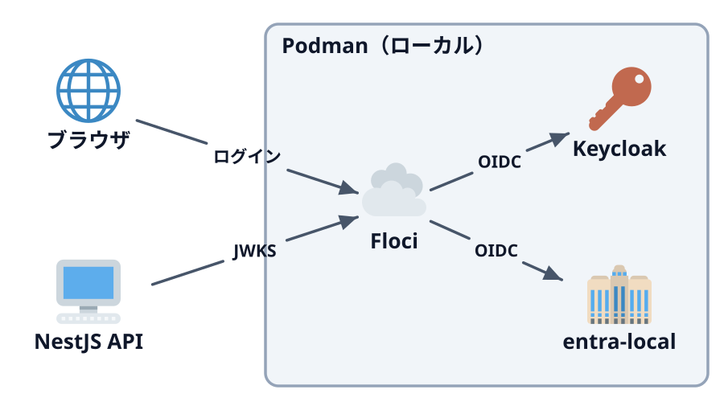
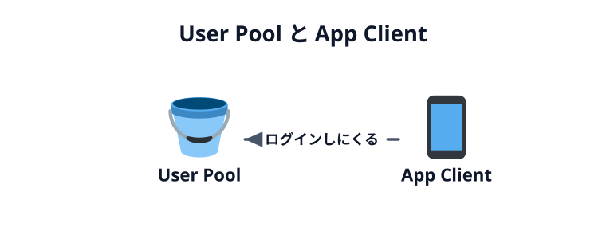
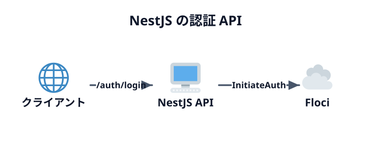
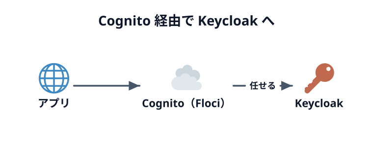
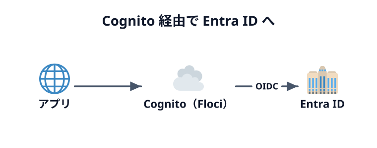

# Podman + Floci で Cognito 認証を練習する

Amazon Cognito の認証を、AWS アカウントも Entra テナントも使わずに、**自分のパソコンの中だけで** 手を動かして学ぶハンズオンです。Cognito は [Floci](https://floci.io/)、外部の IdP は [Keycloak](https://www.keycloak.org/) と [entra-local](https://github.com/cmaneu/entra-local) を、すべて Podman のコンテナで動かします。

ユーザーを作ってトークンを読むところから始めて、NestJS の API を守り、最後は「Cognito が Keycloak や Entra ID にログインを任せる」フェデレーションまで、ローカルで最後まで通します。

手元では **`handson/` という 1 つのフォルダ** を、レクチャーごとに少しずつ育てていきます。User Pool を作るスクリプト 1 つから始まり、API・画面・Keycloak・Entra ID と、どのファイルをいつ足すかを追いながら進めます。



| セクション | 使うコンテナ | ローカルで完結すること | 本物が要ること |
|---|---|---|---|
| 01. Cognito 単体 | Floci | User Pool・ユーザー・トークン・JWKS | なし |
| 02. NestJS API から使う | Floci | サインアップ・ログイン・JWT 検証・グループ認可・e2e | なし |
| 03. Hosted UI と Keycloak | Floci・Keycloak | Hosted UI ログイン、Cognito 経由の Keycloak ログイン | なし |
| 04. Entra ID | Floci・entra-local | Cognito 経由の Entra ID（OIDC）ログイン | SAML、MFA・条件付きアクセス |

## このハンズオンで作るもの

### 01. Cognito 単体



aws CLI だけで、User Pool と App Client を作り、管理者が作るユーザーとサインアップするユーザーの両方を通します。返ってきた ID トークン・アクセストークンを開いて中身を読み、グループがトークンに載ることを確かめます。最後に JWKS の公開鍵で署名を確かめ、書き換えたトークンが弾かれること、サインアウトしてもトークン自体は期限まで使えてしまうことを見ます。

### 02. NestJS API から使う



NestJS で、サインアップ・ログインの API と、アクセストークンを確かめる Guard、グループで認可する Guard を作ります。Cognito の SDK はエンドポイントを差し替えるだけで Floci に向くので、コードは本番と同じです。Floci に向けた e2e テストを書き、最小の画面と、API をコンテナで動かすときの `iss` のずれまで扱います。

### 03. Hosted UI と Keycloak



ログイン画面ごと Cognito に任せる Hosted UI を、認可コードフロー + PKCE で通します。続けて Keycloak を外部 IdP として Cognito に登録し、「Keycloak でログイン」で入れるようにします。アプリが受け取るのは Cognito のトークンなので、API は何も変えずに動くことを確かめます。

### 04. Entra ID



entra-local で Entra ID を手元に再現し、アプリの登録・シークレット・`tid` や `oid` といった Entra 特有のクレームを確かめます。Cognito の外部 IdP として登録し、アプリごとに値が変わる `sub` の代わりに、変わらない `oid` を Cognito の属性に持ち込みます。本物のテナントにつなぐ手順と SAML との違いもまとめます。

## 始め方

1. [道具をそろえる](./sections/00-setup/01-tools/LECTURE.md)
2. [進め方](./sections/README.md) を読む
3. [Floci を起動する](./sections/00-setup/02-floci/LECTURE.md) で `handson/` をダウンロードして、最初のレクチャーに進む

## リポジトリの構成

```text
project/                 04 を終えた状態の handson/（ここが元。ファイルの中の @since で、いつ足す行かを書く）
  lectures.json          どのファイルがどのレクチャーで増えるか
sections/<sec>/<lec>/
  LECTURE.md             教材の本文
  handson/               そのレクチャーを終えた状態（project/ から生成。直接編集しない）
site/                    解説サイト（sections/ を取り込む）
```

`project/` を直したら、`cd site && pnpm run build-snapshots` で各レクチャーの `handson/` を作り直します。

## 過去のハンズオン

これまでに作ったハンズオンの一覧は [過去のハンズオン](./sections/PAST-HANDSON.md) にあります。

## 注意

- 学習用のリポジトリです。Floci・Keycloak（`start-dev`）・entra-local は、どれもローカルでの開発・練習のための設定で動かしています。そのまま外部に公開しないでください
- 確認した版: Floci 2.4.0、Keycloak 26.8.2、entra-local 0.1.1、NestJS 12、Node.js 24 以上
