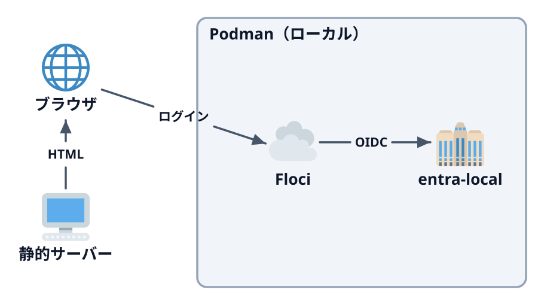
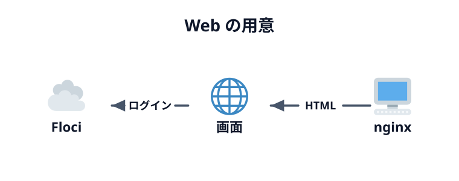
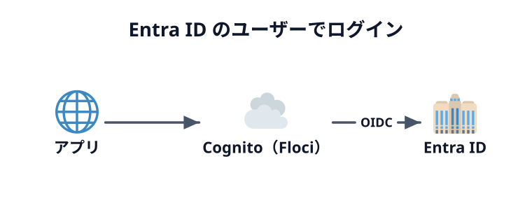

# Podman + Floci で Cognito 認証を練習する

Amazon Cognito の認証を、AWS アカウントも Entra テナントも使わずに、**自分のパソコンの中だけで** 手を動かして学ぶハンズオンです。Cognito は [Floci](https://floci.io/)、Entra ID は [entra-local](https://github.com/cmaneu/entra-local) で、どちらも Podman のコンテナで動かします。

やることは 4 つです。

1. ローカルのコンテナで Cognito（Floci）を起動し、User Pool と App Client を作って、いつでも作り直せるようにする
2. シンプルな HTML の画面から、サインアップとログインをする
3. Cognito に Entra ID をつなぎ、「Entra ID でログイン」で入れるようにする
4. ユーザー・トークン・グループ・署名を、コマンドで操作して確かめる

手元では **`handson/` という 1 つのフォルダ** を、レクチャーごとに少しずつ育てていきます。User Pool を作るスクリプト 1 つから始まり、画面・Entra ID と、どのファイルをいつ足すかを追いながら進めます。



| セクション | 使うコンテナ | ローカルで完結すること | 本物が要ること |
|---|---|---|---|
| 01. 準備 | なし | 道具を入れる | なし |
| 02. Cognito を用意する | Floci | Floci の起動、User Pool と App Client、作り直すスクリプト | なし |
| 03. HTML でログインする | Floci | メールボックス・サインアップ・ログイン・ログイン中の画面 | なし |
| 04. Entra ID と連携する | Floci・entra-local | Cognito 経由の Entra ID（OIDC）ログイン | SAML、MFA・条件付きアクセス |
| 05. コマンドで確かめる | Floci | ユーザー・トークン・グループ・JWKS での署名の確認 | なし |

## このハンズオンで作るもの

### 02. Cognito を用意する


`handson/` を作って Floci を起動し、aws CLI で User Pool と App Client を作ります。Floci のデータはコンテナを止めると消えるので、作ったものをいつでも作り直せるスクリプト（`scripts/setup.sh`）も用意します。

### 03. HTML でログインする



HTML と JavaScript だけの画面を、Podman の nginx のコンテナで配ります。画面から AWS SDK（CDN から読み込む）で Cognito を直接呼び、サインアップ・確認・ログインをします。Floci に届いた確認コードのメールを読むメールボックスと、ID トークンの中身を出すログイン中の画面も作ります。Cognito が用意するログイン画面（Hosted UI）は説明だけにして、04 の Entra ID で使います。

### 04. Entra ID と連携する



entra-local で Entra ID を手元に再現し、アプリの登録・シークレット・`tid` や `oid` といった Entra 特有のクレームを確かめます。Cognito の外部 IdP として登録し、画面の「Entra ID でログイン」で入れるようにします。アプリごとに値が変わる `sub` の代わりに、変わらない `oid` を Cognito の属性に持ち込みます。本物のテナントにつなぐ手順と SAML との違いもまとめます。

### 05. コマンドで確かめる


aws CLI で、管理者が作るユーザーとサインアップするユーザーの両方を通します。返ってきた ID トークン・アクセストークンを開いて中身を読み、グループがトークンに載ることを確かめます。最後に JWKS の公開鍵で署名を確かめ、書き換えたトークンが弾かれることを見ます。

## 進め方

- [Floci を起動する](./sections/02-cognito/01-floci/LECTURE.md) で作る `handson/` という 1 つのフォルダを、レクチャーごとに育てます。
- 各レクチャーの最初に、そのレクチャーで作成・変更するファイルの表があります。本文にはファイルの全文を載せ、前のレクチャーから足した行に色を付けています。コピーして作ってください。
- 各レクチャーの最後に、そのレクチャーを終えたときの `handson/` と、その状態の ZIP（「コードをダウンロード」）があります。途中のレクチャーから始めるときは、ひとつ前のレクチャーの ZIP を展開し、`podman compose up -d` と `bash scripts/setup.sh` を実行します。
- Floci のデータはコンテナを止めると消えます。`bash scripts/setup.sh` で、前のレクチャーを終えた状態に作り直せます。

前提:

- macOS / Windows 10・11（WSL2 の Ubuntu）/ Linux のどれか
- ターミナルの基本的な操作（`cd`・`ls`）ができる
- JavaScript を書いたことがある

### 練習用のアカウント

どれも練習用の値です。本物のパスワードに使わないでください。

| どこ | ユーザー | パスワード | 作られる所 |
|---|---|---|---|
| Cognito | `alice`（admin グループ）/ `bob` | `Passw0rd!` | 05-01・05-02（`bash scripts/setup.sh` で作り直せる） |
| Cognito | `carol` | `Passw0rd!` | 03-03 で画面からサインアップして確認（setup では作られない） |
| entra-local | `taro@entralocal.dev` | `Passw0rd!` | 04-03（`bash scripts/entra-create-user.sh`） |

## 関連するハンズオン

NestJS のハンズオン 3 本とつながっています。どれから始めても進められます。つながりは [関連するハンズオン](./sections/RELATED.md) にまとめています。

- Cognito と Entra ID をローカルで練習する（このハンズオン）
- [NestJS で作る REST API](https://seekseep.github.io/nestjs-rest-api-handson/)
- [NestJS と Cognito で認証と認可](https://seekseep.github.io/nestjs-cognito-auth-handson/)
- [NestJS のテスト](https://seekseep.github.io/nestjs-testing-handson/)

## リポジトリの構成

```text
project/                 05 を終えた状態の handson/（ここが元。ファイルの中の @since で、いつ足す行かを書く）
  lectures.json          どのファイルがどのレクチャーで増えるか
sections/<sec>/<lec>/
  LECTURE.md             教材の本文
  handson/               そのレクチャーを終えた状態（project/ から生成。直接編集しない）
site/                    解説サイト（sections/ を取り込む）
```

`project/` を直したら、`cd site && pnpm run build-snapshots` で各レクチャーの `handson/` を作り直します。

## 注意

- 学習用のリポジトリです。Floci・entra-local は、どちらもローカルでの開発・練習のための設定で動かしています。そのまま外部に公開しないでください
- 確認した版: Floci 2.4.0、entra-local 0.1.1、nginx 1.27
