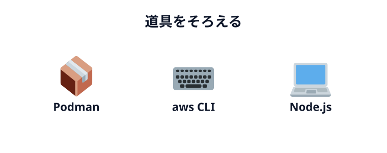

# 道具をそろえる



このハンズオンでは、Cognito・Keycloak・Entra ID をすべて自分のパソコンの中のコンテナで動かします。AWS のアカウントも Entra のテナントも要りません。使う道具は Podman・aws CLI・Node.js の 3 つです。

## どの OS で進めるか

まず、お使いの OS を選んでください。選んだ OS は、このブラウザに保存されます。これ以降のページでは、OS で手順が分かれる所に、選んだ OS の手順だけが表示されます。あとから変えるときは、画面上部の選択欄を使います。

::platform-choice

コマンドはすべて **bash** で打つ前提です（`npm run setup` の中身も bash のスクリプトです）。

:::::platform
::::macos
ターミナル（zsh でも構いません）で作業します。コンテナは、`podman machine` が作る Linux の仮想マシンの中で動きます。
::::
::::windows
**WSL2 の Ubuntu の中** で作業します。PowerShell やコマンドプロンプトでは進められません。Podman も WSL2 の Ubuntu の中に入れて、そこで直接動かします。
::::
::::linux
ふだんのシェルで作業します。仮想マシンは使わず、コンテナはそのまま動きます。ここでは Ubuntu / Debian のコマンドで書きます。
::::
:::::

:::notice[動作を確かめた環境]
教材のコマンドは macOS（Apple Silicon）+ Podman 5 + docker-compose v2 で、最初から最後まで確かめています。Windows（WSL2）と Linux の手順は、公式の手順に沿って書いたもので、通しでは確かめていません。うまくいかなかったら、イシューで教えてください。
:::

## Podman

コンテナを動かす道具です。Docker と同じイメージ・同じ compose ファイルがそのまま使えます。

:::::platform
::::macos
```bash
brew install podman docker-compose
podman machine init    # 初回だけ。仮想マシンを作る
podman machine start   # パソコンを再起動したら、その都度
```

`podman compose` が使う docker-compose も、ここで一緒に入ります（Docker Desktop は要りません）。
::::
::::windows
PowerShell を管理者で開いて WSL2 の Ubuntu を入れます。

```powershell
wsl --install -d Ubuntu
```

ここから先は、すべて Ubuntu のターミナルで作業します。まず systemd を有効にします（Podman の API ソケットに使います）。

```bash
printf '[boot]\nsystemd=true\n' | sudo tee /etc/wsl.conf
```

PowerShell で `wsl --shutdown` を実行し、Ubuntu のターミナルを開き直してから、Podman を入れます。

```bash
sudo apt-get update
sudo apt-get install -y podman
```

Windows 版の Podman（Podman Desktop）を使う方法もありますが、その場合も `npm run ...` は WSL2 の中で打つことになり、ポートの届き方が分かりにくくなるので、ここでは WSL2 の中に Podman を入れる方法にそろえます。
::::
::::linux
```bash
sudo apt-get update
sudo apt-get install -y podman
```

Fedora などでは `sudo dnf install -y podman` です。仮想マシンは使わないので、`podman machine` は要りません。
::::
::::windows-linux
`podman compose` に docker-compose を使わせるため、docker-compose v2 を入れ、Podman の API ソケットを有効にします（macOS では `podman machine` が自動で用意するので、この手順はありません）。

```bash
# docker-compose v2（単体のバイナリ）を入れる
sudo curl -fL -o /usr/local/bin/docker-compose \
  "https://github.com/docker/compose/releases/latest/download/docker-compose-linux-$(uname -m)"
sudo chmod +x /usr/local/bin/docker-compose

# root を使わない Podman の API ソケットを有効にする
systemctl --user enable --now podman.socket
```
::::
:::::

### 動いているか確かめる

```bash
podman info --format '{{.Host.Arch}} {{.Version.Version}}'   # arm64 5.x.x や amd64 5.x.x などと出る
podman compose version                                       # Docker Compose version v2.x.x と出ること
```

### `podman compose` について

このハンズオンでは、各レクチャーの `compose.yaml` を `podman compose` で起動します。`podman compose` は自分では compose ファイルを解釈せず、インストールされている **docker-compose** か **podman-compose** に処理を渡します。

| 渡す先 | 特徴 |
|---|---|
| docker-compose（v2） | Docker 公式の実装。`--wait` や `profiles` など、このハンズオンで使う機能が全部そろう。**こちらを使ってください** |
| podman-compose | Python で書かれた Podman 向けの実装。古い版（Ubuntu 24.04 の apt で入る 1.0 系など）は `--wait` を知らず、`npm run up` が `unrecognized arguments: --wait` で止まる |

`podman compose version` が `Docker Compose version v2...` と出れば docker-compose が使われています。`podman-compose version ...` と出る場合は、上の手順で docker-compose を入れてください。両方入っているときは docker-compose が優先されます。

### 同じポートを使うほかのプログラム

Docker Desktop・LocalStack・別の Floci などが同じポート（4566・8080・8443・3000）を使っていると、`localhost` へのアクセスの一部がそちらに流れます。`localhost` が IPv6（`::1`）にも IPv4（`127.0.0.1`）にも解決されるため、エラーにならず「ときどき別のサーバーにつながる」という分かりにくい壊れ方をします。始める前に、待ち受けているプログラムを確かめてください。

:::::platform
::::macos
```bash
lsof -nP -iTCP -sTCP:LISTEN | grep -E ':(4566|3000|8080|8443) '
```

コンテナを起動する前に何も出なければ大丈夫です。起動したあとに出るのは `gvproxy`（Podman）だけのはずです。
::::
::::windows-linux
```bash
ss -ltnp | grep -E ':(4566|3000|8080|8443) '
```

コンテナを起動する前に何も出なければ大丈夫です。起動したあとに出るのは `rootlessport`（Podman）だけのはずです。
::::
:::::

## aws CLI

Cognito を操作する公式のコマンドです。バージョン 2 を使います。

:::::platform
::::macos
```bash
brew install awscli
```
::::
::::windows-linux
```bash
# uname -m で x86_64 / aarch64 のどちらかが入る
sudo apt-get install -y unzip
curl -fsSL "https://awscli.amazonaws.com/awscli-exe-linux-$(uname -m).zip" -o awscliv2.zip
unzip -q awscliv2.zip && sudo ./aws/install && rm -rf aws awscliv2.zip
```
::::
:::::

```bash
aws --version   # aws-cli/2.x.x
```

## Node.js

NestJS の API と、トークンを確かめる小さなスクリプトで使います。**24 以上**を入れてください（`fetch` や `--env-file` を前提にしています）。入れ方は何でも構いません。

:::::platform
::::macos
```bash
brew install node
```
::::
::::windows-linux
[nvm](https://github.com/nvm-sh/nvm) で入れる例です（インストールのコマンドは nvm の README にある最新のものを使ってください）。

```bash
nvm install 24
```
::::
::::windows
Windows 側に入れた Node.js ではなく、**WSL2 の Ubuntu の中** に入れてください。
::::
:::::

```bash
node --version   # v24.x.x 以上
```

## 当日より前にやっておくこと

コンテナのイメージと npm のパッケージは、合わせて 1.5GB ほどになります。勉強会の会場で全員が同時に取得すると時間がかかるので、道具を入れたら、ネットワークのよい所で先に取得しておいてください。

```bash
# コンテナのイメージ（展開後で合わせて約 1.3GB）
podman pull docker.io/floci/floci:2.4.0
podman pull quay.io/keycloak/keycloak:26.8.2
podman pull --platform linux/amd64 ghcr.io/cmaneu/entra-local:0.1.1
podman pull docker.io/library/node:24-slim
```

npm のパッケージ（約 140MB）は、01-04 と 02 で `handson/` に入れていきます。会場のネットワークが心配なら、最後のレクチャー（[04-02](../../04-cognito-with-entra-id/02-federation/LECTURE.md)）のページの一番下にある「コードをダウンロード」で完成形の `handson/` を取り、一度 `npm install` しておいてください。npm のキャッシュに残るので、当日の `npm install` が速くなります（試したフォルダは消して構いません）。

## エディタとブラウザ

エディタは何でも構いません。ブラウザの開発者ツール（`F12`）の **Network** タブで、ログインのリダイレクトやトークンのやり取りを追いかけます。

:::faq

### Docker Desktop ではだめですか？

だめではありません。npm scripts は環境変数 `COMPOSE` があればそれを使うので、先に設定しておけば `npm run up` などがそのまま Docker で動きます。

```bash
export COMPOSE="docker compose"
```

本文に出てくる `podman compose ...` や `podman ...` のコマンドは、`docker compose ...`・`docker ...` に読み替えてください。本文の中のコンテナ名やネットワークの説明は Podman で確かめたもので、Docker では通しで確かめていません。

### WSL2 の中で起動したのに、Windows のブラウザから `localhost:3000` が開けません

WSL2 は既定で、中で待ち受けたポートを Windows の `localhost` に転送します。届かないときは、Windows 側の `%UserProfile%\.wslconfig` に `[wsl2]` と `networkingMode=mirrored` を書き、`wsl --shutdown` してから開き直してください。

### `podman machine start` で止まってしまいます

仮想マシンのイメージを取得している最中のことがあります。初回は数分かかります。それでも進まないときは `podman machine stop` → `podman machine start` を試してください。

:::
