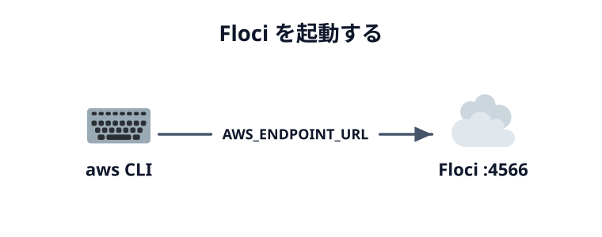
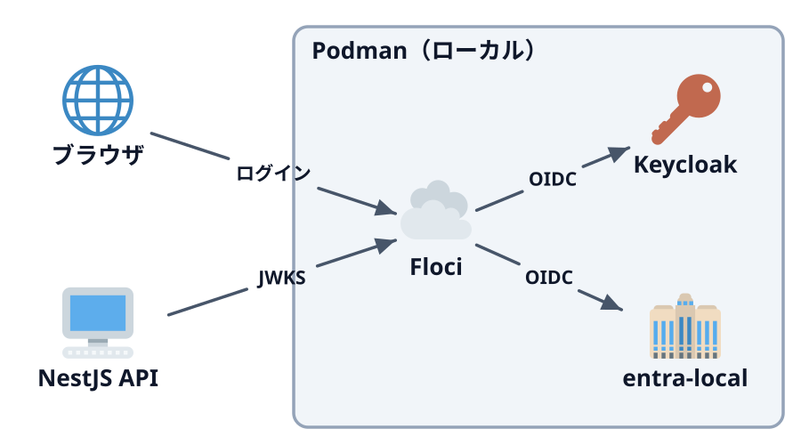

# Floci を起動する



[Floci](https://floci.io/) は、AWS のサービスを手元で真似するエミュレータです。MIT ライセンスで無料、アカウント登録も要りません。このハンズオンでは Floci の **Cognito** を使います。



Floci の Cognito は、User Pool・ユーザー・パスワード認証・グループ・JWKS に加えて、**Hosted UI（ログイン画面）と `/oauth2/authorize`・`/oauth2/token`** も持っています。このおかげで「Cognito が外部の IdP（Keycloak や Entra ID）にログインを任せる」流れまで、ローカルで最後まで通せます。

:::download
[サンプルコードをダウンロード](./project.zip)
:::

## 起動する

このレクチャーのフォルダには、Floci だけを起動する [compose.yaml](./compose.yaml) があります。

```yaml
services:
  floci:
    image: docker.io/floci/floci:2.4.0
    ports:
      - "127.0.0.1:4566:4566"
    healthcheck:
      test: ["CMD", "bash", "-c", "exec 3<>/dev/tcp/127.0.0.1/4566 && ..."]
```

- イメージは `2.4.0` に固定しています。`latest` だと、ある日から挙動が変わることがあります
- ポートは **4566** です。`127.0.0.1:` を付けて、自分のパソコンからだけ届くようにしています。Floci は認証なしで API を受け付けるので、ほかのマシンから触られないようにするためです
- ヘルスチェックは `/_floci/health` を叩きます。イメージに `curl` も `grep` も入っていないので、bash の `/dev/tcp` で HTTP を手書きしています

```bash
cd sections/00-setup/02-floci
npm run floci:up        # podman compose up -d --wait
curl -s http://localhost:4566/_floci/health | head -c 120
```

`--wait` はヘルスチェックが通るまで待ってから戻ります。`Container ... Healthy` と出れば準備完了です。

## aws CLI を Floci に向ける

aws CLI と AWS SDK は、環境変数 `AWS_ENDPOINT_URL` があればそこに話しかけます。各レクチャーに同じ [env.sh](./env.sh) を置いてあるので、ターミナルを開いたら最初に読み込みます。

```bash
source ./env.sh
cat ./env.sh
```

```bash
export AWS_ENDPOINT_URL=http://localhost:4566
export AWS_ACCESS_KEY_ID=test
export AWS_SECRET_ACCESS_KEY=test
export AWS_REGION=ap-northeast-1
export AWS_PAGER=""
```

Floci はキーの中身を確かめないので、ダミーの `test` で構いません。**本物の AWS のキーを入れないでください**（向き先を間違えたときに本物を触ってしまいます）。

```bash
aws cognito-idp list-user-pools --max-results 10
# { "UserPools": [] }
```

## データは消える

Floci は既定でデータをメモリに持ちます。コンテナを作り直すと、User Pool もユーザーも消えます。やり直したいときは作り直すのがいちばん早いです。

```bash
npm run floci:reset     # podman compose down && podman compose up -d --wait
```

レクチャーごとに `npm run setup` で必要な User Pool を作り直せるようにしてあるので、消えても困りません。

## Floci の Cognito で使えるもの・使えないもの

このハンズオンを作るときに、実際に動かして確かめた結果です（Floci 2.4.0）。

| 機能 | 結果 |
|---|---|
| User Pool・App Client・グループ | 使える |
| パスワード認証（`USER_PASSWORD_AUTH`）・初回のパスワード変更（`NEW_PASSWORD_REQUIRED`） | 使える |
| サインアップと確認コード | 使える。確認メールは Floci の SES に届き、`http://localhost:4566/_aws/ses` で読める。違うコードは拒否される |
| パスワードポリシー・`SECRET_HASH`・許可していない認証フローの拒否 | 本物と同じように拒否される |
| `PreventUserExistenceErrors` | 受け付けるが保存されず、効かない。存在しないユーザーは常に `UserNotFoundException` |
| discovery・JWKS | 使える。`iss` は `http://localhost:4566/<プール ID>` |
| Hosted UI（ログイン画面）・`/oauth2/authorize`・`/oauth2/token` | 使える。PKCE も確かめる |
| 外部 IdP（OIDC）経由のログイン | 使える。登録のしかたに本物と違う点がある（[03-federation](../../03-cognito-with-other-idp/03-federation/LECTURE.md) で扱う） |
| 外部 IdP（SAML）・Facebook・Apple | 使えない |

:::faq

### `npm run floci:up` が `exit status 1` で終わります

ヘルスチェックが通らなかったときの表示です。`podman compose ps` で状態を、`podman compose logs floci` でログを見てください。ポート 4566 をほかのプログラム（LocalStack や別の Floci など）が使っていると起動できません。

### LocalStack や moto ではだめですか？

moto（Motoserver）でも User Pool やトークンの練習はできますが、Hosted UI と `/oauth2/*` が無いため、外部 IdP 経由のログインが通りません。また moto のトークンは `iss` が本物の AWS の URL のまま、署名鍵は全プール共通、ID トークンに `email` が入らない、と本物との差が大きいです。このハンズオンでは Floci に統一しています。

:::
