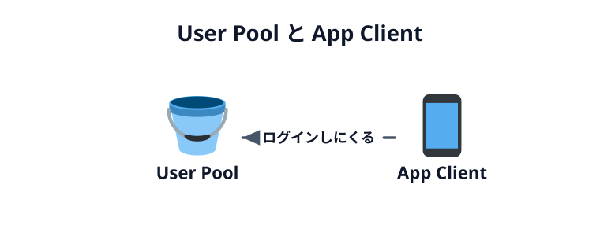

# User Pool と App Client を作る



Cognito でユーザーを管理する入れ物が **User Pool**、そこにログインしにくるアプリの登録が **App Client** です。このセクションでは aws CLI だけを使い、User Pool を作るところから、トークンを受け取って署名を確かめるところまでを一通りやります。

:::download
[サンプルコードをダウンロード](./project.zip)
:::

## Floci を起動する

```bash
npm run floci:up
source ./env.sh
```

## User Pool を作る

パスワードポリシーを決めて User Pool を作ります。

```bash
aws cognito-idp create-user-pool \
  --pool-name practice \
  --policies 'PasswordPolicy={MinimumLength=8,RequireUppercase=true,RequireLowercase=true,RequireNumbers=true,RequireSymbols=false}' \
  --auto-verified-attributes email \
  --query UserPool.Id --output text
# ap-northeast-1_bba540037
```

- `--policies` … 8 文字以上・大文字・小文字・数字を必須にします
- `--auto-verified-attributes email` … サインアップしたらメールに確認コードを送る、という設定です。次のレクチャーで使います

返ってきた ID をシェル変数に入れておきます。

```bash
export POOL_ID=ap-northeast-1_bba540037   # 自分の出力に置き換える
```

## App Client を作る

```bash
aws cognito-idp create-user-pool-client \
  --user-pool-id "$POOL_ID" \
  --client-name practice-cli \
  --no-generate-secret \
  --explicit-auth-flows ALLOW_USER_PASSWORD_AUTH ALLOW_REFRESH_TOKEN_AUTH \
  --query UserPoolClient.ClientId --output text
```

- `--no-generate-secret` … クライアントシークレットを作りません。ブラウザやスマホのアプリは秘密を隠しておけないので、シークレットを持たせないのが基本です
- `--explicit-auth-flows` … このクライアントに許すログインの方法です。`ALLOW_USER_PASSWORD_AUTH` はユーザー名とパスワードをそのまま送る方法、`ALLOW_REFRESH_TOKEN_AUTH` はトークンの更新です

```bash
export CLIENT_ID=708d6652cba84996a62ac8cdde   # 自分の出力に置き換える
```

## 作ったものを確かめる

```bash
aws cognito-idp describe-user-pool --user-pool-id "$POOL_ID" \
  --query 'UserPool.{Name:Name,Policy:Policies.PasswordPolicy,AutoVerified:AutoVerifiedAttributes}'
aws cognito-idp describe-user-pool-client --user-pool-id "$POOL_ID" --client-id "$CLIENT_ID" \
  --query 'UserPoolClient.{Name:ClientName,Flows:ExplicitAuthFlows,Secret:ClientSecret}'
```

## スクリプトでまとめて作る

ここまでの操作は [scripts/create-user-pool.sh](./scripts/create-user-pool.sh) にまとめてあります。ID を `.cognito.env` に書き出すので、ターミナルを開き直しても `source` すれば戻せます。

```bash
npm run setup
source ./.cognito.env
```

この先のレクチャーも、最初に `npm run setup` で「前のレクチャーを終えた状態」を作ってから始めます。

:::faq

### シークレットありのクライアントにするとどうなりますか？

ログインのたびに `SECRET_HASH`（ユーザー名・クライアント ID・シークレットから作るハッシュ）を送る必要があります。送らないと `InvalidParameterException: ... SECRET_HASH is required` になります。Floci もこれを本物どおりに拒否します。サーバーの中だけで使うクライアントなら、シークレットありにする意味があります。

### `ALLOW_USER_PASSWORD_AUTH` を付け忘れるとどうなりますか？

`initiate-auth` が `USER_PASSWORD_AUTH flow not enabled for this client` で拒否されます。本物の Cognito の既定は SRP（パスワードそのものを送らない方式）だけを許す設定です。

:::
