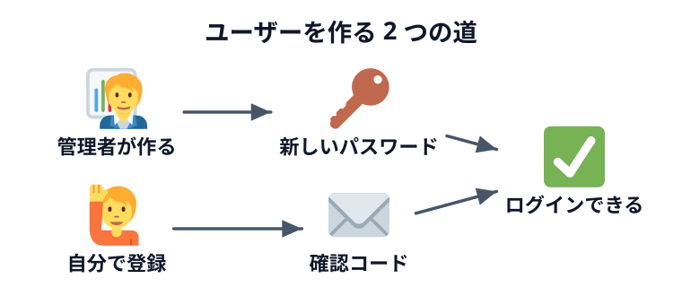

# ユーザーを作る



Cognito のユーザーの作り方は 2 通りあります。**管理者が作る**か、**ユーザーが自分でサインアップする**かです。どちらも、すぐにはログインできず、途中に 1 段階はさまります。その段階を実際に通ってみます。

:::download
[サンプルコードをダウンロード](./project.zip)
:::

## 準備

```bash
npm run floci:up
npm run setup              # 前のレクチャーの User Pool と App Client を作る
source ./env.sh && source ./.cognito.env
```

## 管理者がユーザーを作る

```bash
aws cognito-idp admin-create-user \
  --user-pool-id "$POOL_ID" \
  --username alice \
  --temporary-password 'Temp1234' \
  --user-attributes Name=email,Value=alice@example.com Name=email_verified,Value=true \
  --message-action SUPPRESS \
  --query User.UserStatus
# "FORCE_CHANGE_PASSWORD"
```

状態が `FORCE_CHANGE_PASSWORD` になりました。一時パスワードでログインしても、トークンは返らず **チャレンジ** が返ります。

```bash
aws cognito-idp initiate-auth \
  --client-id "$CLIENT_ID" \
  --auth-flow USER_PASSWORD_AUTH \
  --auth-parameters USERNAME=alice,PASSWORD=Temp1234 \
  --query '{Challenge:ChallengeName,Session:Session}'
```

`NEW_PASSWORD_REQUIRED` は「新しいパスワードを決めてください」という意味です。返ってきた `Session` を付けて、新しいパスワードで答えます。

```bash
SESSION=...   # 上の出力の Session
aws cognito-idp respond-to-auth-challenge \
  --client-id "$CLIENT_ID" \
  --challenge-name NEW_PASSWORD_REQUIRED \
  --session "$SESSION" \
  --challenge-responses USERNAME=alice,NEW_PASSWORD='Passw0rd!' \
  --query 'keys(AuthenticationResult)'
```

今度はトークン（`IdToken`・`AccessToken`・`RefreshToken`）が返ります。ポリシーを満たさないパスワード（`short` など）を送ると `InvalidPasswordException` になります。

## ユーザーが自分でサインアップする

```bash
aws cognito-idp sign-up \
  --client-id "$CLIENT_ID" \
  --username bob \
  --password 'Passw0rd!' \
  --user-attributes Name=email,Value=bob@example.com
```

`UserConfirmed: false` と、確認コードをメールで送ったこと（`CodeDeliveryDetails`）が返ります。このままログインすると `UserNotConfirmedException` で断られます。

### 確認コードを読む

本物の Cognito なら bob の受信箱にメールが届きます。Floci では、送ったメールが Floci の SES にたまっていて、HTTP で読めます。

```bash
curl -s http://localhost:4566/_aws/ses | head -c 600
# ... "Subject":"Your verification code","Body":{"text_part":"Your verification code is 821375." ...
```

6 桁のコードを抜き出す [scripts/read-code.sh](./scripts/read-code.sh) も用意しています。

```bash
CODE=$(npm run -s read-code bob@example.com)
aws cognito-idp confirm-sign-up --client-id "$CLIENT_ID" --username bob --confirmation-code "$CODE"
```

違うコード（`000000` など）を送ると `CodeMismatchException` になります。確認が済めば、bob もログインできます。

```bash
aws cognito-idp list-users --user-pool-id "$POOL_ID" \
  --query 'Users[].{Username:Username,Status:UserStatus}' --output table
```

ここまでの操作は [scripts/create-users.sh](./scripts/create-users.sh) にまとめてあります（`npm run users`）。手で打つ代わりに使うか、やり直すときに使います。alice と bob を新しく作るので、上の手順を打ち終えたあとに実行すると `UsernameExistsException` で止まります。やり直すときは、User Pool から作り直してから実行してください。

```bash
npm run floci:reset   # Floci を作り直す（User Pool も消える）
npm run setup         # User Pool と App Client を作り直す
npm run users         # alice と bob を作る
```

:::faq

### 管理者が「確認済み」にしてしまうことはできますか？

できます。`aws cognito-idp admin-confirm-sign-up --user-pool-id "$POOL_ID" --username bob` で、コードなしで確認済みになります。テストデータを作るときに便利です。

### 存在しないユーザーでログインすると、何が返りますか？

Floci は `UserNotFoundException` を返します。本物の Cognito では、App Client の `PreventUserExistenceErrors` が `ENABLED` なら、パスワード違いと同じ `NotAuthorizedException` が返り、ユーザーが存在するかを漏らしません。

ただし既定値は作り方で変わります。**コンソールで作ったクライアントは `ENABLED`、API や aws CLI で値を渡さずに作ったクライアントは `LEGACY`**（存在しなければ `UserNotFoundException`）です。本物に向けて CLI でクライアントを作るときは、`--prevent-user-existence-errors ENABLED` を付けてください。Floci はこの設定を受け付けますが、保存せず、付けても `UserNotFoundException` を返します。どちらにしても、アプリ側でも 2 つを区別しないように作ります（次のセクションで扱います）。

:::
