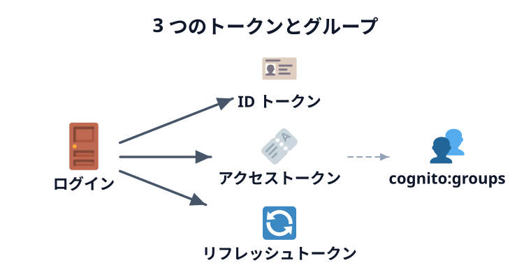

# トークンを読む・グループを使う



ログインに成功すると、Cognito は 3 つのトークンを返します。中身を開いて、それぞれ何のためのものかを確かめます。後半では **グループ** を作り、トークンにグループが載ることを確かめます。

:::download
[サンプルコードをダウンロード](./project.zip)
:::

## 準備

```bash
npm run floci:up
npm run setup              # User Pool・App Client・alice・bob を作る
source ./env.sh && source ./.cognito.env
```

## 3 つのトークン

| トークン | 誰が読むか | 用途 |
|---|---|---|
| ID トークン | アプリ（ログインした画面） | 「誰がログインしたか」を知る。名前やメールが入る |
| アクセストークン | API | 「この API を呼んでよいか」を判断する |
| リフレッシュトークン | アプリ → Cognito | ID・アクセストークンの期限が切れたら、新しいものをもらう |

ID トークンとアクセストークンは **JWT** です。`.` で区切った 3 つの部分（ヘッダー・ペイロード・署名）からなり、前の 2 つは base64url で符号化した JSON です。

## トークンを開く

alice でログインし、結果を `.tokens.json` に保存します。

```bash
npm run login alice 'Passw0rd!'
node -e "console.log(require('./.tokens.json').IdToken)" | npm run -s decode
```

[scripts/decode-jwt.mjs](./scripts/decode-jwt.mjs) は、ヘッダーとペイロードを読むだけの小さなスクリプトです（署名は確かめません）。

```json
header: { "alg": "RS256", "typ": "JWT", "kid": "ap-northeast-1_1644239d1" }
payload: {
  "sub": "e1f9945e-1e10-4577-a0eb-2ec360231189",
  "token_use": "id",
  "iss": "http://localhost:4566/ap-northeast-1_1644239d1",
  "aud": "299bc23b813f4b93ac5a7165e6",
  "cognito:username": "alice",
  "email": "alice@example.com",
  "email_verified": true,
  "exp": 1794554293
}
```

主なクレーム:

- `sub` … ユーザーの変わらない ID。ユーザー名は変えられることがあるので、データベースで人を指すときは `sub` を使います
- `iss` … 発行者。どの User Pool が出したトークンかを表します
- `aud` … 宛先。ID トークンでは App Client の ID です
- `token_use` … `id` か `access`。ID トークンとアクセストークンを取り違えないための印です
- `exp` … 有効期限（UNIX 秒）。スクリプトが読める形を横に添えています

アクセストークンも開いてみます。

```bash
node -e "console.log(require('./.tokens.json').AccessToken)" | npm run -s decode
```

アクセストークンには `aud` がありません。代わりに `client_id` と `scope` が入ります。`email` も入りません。API に渡すのはこちらなので、API は「誰か」を `sub` と `username` で知ることになります。

## グループを作る

グループは、ユーザーをまとめて権限を付けるための仕組みです。admin グループを作って alice を入れます。

```bash
aws cognito-idp create-group --user-pool-id "$POOL_ID" --group-name admin --description '管理者'
aws cognito-idp admin-add-user-to-group --user-pool-id "$POOL_ID" --username alice --group-name admin
aws cognito-idp admin-list-groups-for-user --user-pool-id "$POOL_ID" --username alice --query 'Groups[].GroupName'
```

もう一度ログインして、トークンを開きます。

```bash
npm run login alice 'Passw0rd!'
node -e "console.log(require('./.tokens.json').AccessToken)" | npm run -s decode
```

ID トークンにもアクセストークンにも `"cognito:groups": ["admin"]` が入りました。API はこれを見て「管理者だけが使える操作」を許すかを決めます（次のセクションで実装します）。

:::notice[グループの変更が効くのは、次のトークンから]
グループを変えても、すでに配ったトークンの中身は変わりません。トークンは「発行したときの情報」の写しだからです。新しいグループが効くのは、ログインし直すかトークンを更新したあとです。
:::

:::faq

### トークンの中身はだれでも読めるのですか？

はい。JWT のペイロードは暗号化されておらず、base64url を戻せば誰でも読めます。署名は「改ざんされていない」ことを保証するだけです。パスワードや秘密の情報をクレームに入れてはいけません。

### カスタム属性はトークンに入りますか？

App Client の「読み取りを許す属性」に含めていれば、ID トークンに `custom:xxx` の形で入ります。Entra ID のセクションで実際に使います。

:::
