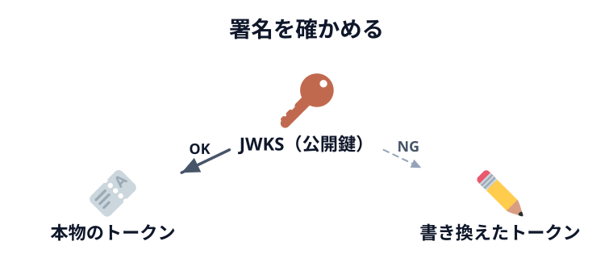

# 署名を確かめる・トークンを更新する



トークンの中身は誰でも書き換えられます。API が受け取ったトークンを信じてよいかは、**署名** で判断します。Cognito がどの鍵で署名したかは JWKS（公開鍵の一覧）で公開されています。この鍵でトークンを確かめ、書き換えたトークンが弾かれることを見ます。最後にリフレッシュトークンでトークンを更新します。

:::download
[サンプルコードをダウンロード](./project.zip)
:::

## 準備

```bash
npm install
npm run floci:up
npm run setup              # User Pool・App Client・alice・bob・admin グループ
source ./env.sh && source ./.cognito.env
npm run login alice 'Passw0rd!'
```

## discovery と JWKS

トークンの `iss` の後ろに `/.well-known/openid-configuration` を付けると、その発行者の情報（discovery）が読めます。

```bash
curl -s "$AWS_ENDPOINT_URL/$POOL_ID/.well-known/openid-configuration"
```

```json
{
  "issuer": "http://localhost:4566/ap-northeast-1_57965a023",
  "jwks_uri": "http://localhost:4566/ap-northeast-1_57965a023/.well-known/jwks.json",
  "authorization_endpoint": "http://localhost:4566/cognito-idp/oauth2/authorize",
  "token_endpoint": "http://localhost:4566/cognito-idp/oauth2/token"
}
```

`jwks_uri` を開くと公開鍵が並んでいます。トークンのヘッダーの `kid` と同じ `kid` の鍵が、そのトークンの署名を確かめる鍵です。

```bash
curl -s "$AWS_ENDPOINT_URL/$POOL_ID/.well-known/jwks.json"
```

## 署名を確かめる

[scripts/verify-jwt.mjs](./scripts/verify-jwt.mjs) は、[jose](https://github.com/panva/jose) を使って次の 3 つを確かめます。

1. JWKS の鍵で署名が正しいか
2. `iss` が自分の User Pool か
3. `exp` を過ぎていないか

```bash
npm run verify "$(node -e "console.log(require('./.tokens.json').AccessToken)")"
# OK: 署名と iss と exp を確かめました
```

### 書き換えたトークンを送る

ペイロードの `cognito:groups` に `root` を足したトークンを作って、同じように確かめます。

```bash
TAMPERED=$(node -e "
const t = require('./.tokens.json').AccessToken.split('.');
const p = JSON.parse(Buffer.from(t[1], 'base64url'));
p['cognito:groups'] = ['admin', 'root'];
t[1] = Buffer.from(JSON.stringify(p)).toString('base64url');
console.log(t.join('.'));")
npm run verify "$TAMPERED"
# NG: ERR_JWS_SIGNATURE_VERIFICATION_FAILED: signature verification failed
```

中身を 1 文字でも変えると署名が合わなくなります。API が「トークンの中身を信じてよい」のは、この確認を通したときだけです。

### 別の User Pool のトークンを送る

```bash
OTHER=$(aws cognito-idp create-user-pool --pool-name other --query UserPool.Id --output text)
POOL_ID=$OTHER npm run verify "$(node -e "console.log(require('./.tokens.json').AccessToken)")"
# NG: ERR_JWKS_NO_MATCHING_KEY: no applicable key found in the JSON Web Key Set
```

Floci は User Pool ごとに別の鍵を使います（本物も同じです）。別の User Pool の鍵では確かめられません。

## トークンを更新する

```bash
npm run refresh
```

```json
{ "ExpiresIn": 3600, "HasIdToken": true, "HasRefreshToken": false }
```

新しい ID トークンとアクセストークンが返ります。**リフレッシュトークンは返りません**。手元のリフレッシュトークンを、期限まで使い続けます。

## サインアウトしても、トークンの署名は正しいまま

```bash
AT=$(node -e "console.log(require('./.tokens.json').AccessToken)")
aws cognito-idp global-sign-out --access-token "$AT"
aws cognito-idp get-user --access-token "$AT"   # NotAuthorizedException: Access Token has been revoked
npm run verify "$AT"                             # OK: 署名と iss と exp を確かめました
```

Cognito に問い合わせれば「取り消し済み」と分かりますが、JWKS で署名を確かめるだけの API には分かりません。JWT は API が Cognito に問い合わせずに済むことと引き換えに、期限までは使えてしまいます。アクセストークンの有効期限を短めにするのはこのためです。

## 本物の Cognito との違い

このセクションで見つけた違いをまとめます。

| 項目 | Floci 2.4.0 | 本物の Cognito |
|---|---|---|
| `iss` のホスト | `http://localhost:4566` | `https://cognito-idp.<region>.amazonaws.com` |
| 確認メール | 送らずに SES にためる（`/_aws/ses`） | 実際に送る（送信数に上限がある） |
| 存在しないユーザーでログイン | `PreventUserExistenceErrors` を無視し、いつも `UserNotFoundException` | `ENABLED` なら `NotAuthorizedException`（存在を漏らさない）。既定はコンソールで作ると `ENABLED`、API・CLI で値を渡さないと `LEGACY`（`UserNotFoundException`） |
| Lambda トリガー | Floci は Lambda をコンテナで動かすので、コンテナエンジンへの接続が要る（このハンズオンでは試していない） | 動く |

後のセクションで見つけた違いも、ここにまとめておきます。

| 項目 | Floci 2.4.0 | 本物の Cognito | 見つけた所 |
|---|---|---|---|
| 確認コードの照合 | `AutoVerifiedAttributes` に `email` が無いと、どんなコードでも確認が通る | 違うコードは `CodeMismatchException` | [02-03](../../02-app-with-cognito/03-e2e-test/LECTURE.md) |
| どこから呼んでも `iss` | いつも `http://localhost:4566/<プール ID>`。コンテナの中から `floci:4566` で呼んでも変わらない | いつも `https://cognito-idp.<region>.amazonaws.com/<プール ID>` | [02-04](../../02-app-with-cognito/04-frontend-and-container/LECTURE.md) |
| ブラウザからトークンエンドポイントを呼ぶ | `FLOCI_SECURITY_EXTRA_CORS_ALLOWED_ORIGINS` で CORS を許す必要がある | 最初から CORS に対応している | [03-01](../../03-cognito-with-other-idp/01-hosted-ui/LECTURE.md) |
| 外部 IdP から入ったユーザーの名前 | `Keycloak_<別の UUID>`。`identities` の `userId` とは違う値 | `Keycloak_<IdP の sub>`（`identities` の `userId` と同じ） | [03-03](../../03-cognito-with-other-idp/03-federation/LECTURE.md) |
| 外部 IdP（OIDC）の登録 | discovery を読みに行かないので、エンドポイントを全部明示する | `oidc_issuer` だけでよく、discovery が届かないと登録を拒否する | [03-03](../../03-cognito-with-other-idp/03-federation/LECTURE.md) |

それ以外の、このセクションで試したこと（パスワードポリシー、確認コードの照合、`SECRET_HASH`、許可していない認証フロー、グループ、署名、更新、サインアウト）は本物と同じ振る舞いでした。

:::faq

### `jwks.json` を毎回取りに行くのは遅くないですか？

jose の `createRemoteJWKSet` は取った鍵を覚えておき、知らない `kid` のトークンが来たときだけ取り直します。鍵が入れ替わったときも自然に追従します。

### 鍵の取得先は `iss` から決めてよいのですか？

決め打ちしてよいのは、`iss` を自分の User Pool と照らし合わせたあとです。トークンの中の `iss` をそのまま信じて鍵を取りに行くと、攻撃者が自分の鍵の在りかを書いたトークンを送ってくるかもしれません。このスクリプトは、自分の User Pool の `iss` を先に組み立て、そこから鍵を取りに行っています。

:::
