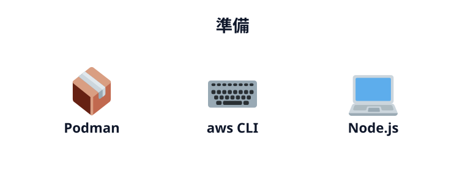
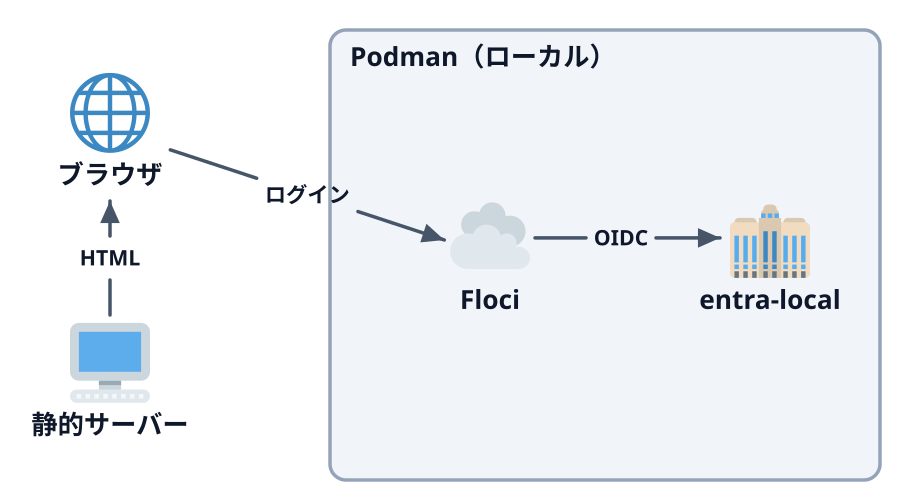

# 準備



このハンズオンでは、Cognito と Entra ID をどちらも自分のパソコンの中のコンテナで動かします。AWS のアカウントも Entra のテナントも要りません。この節では、使う道具（Podman・aws CLI・jq・Node.js）を入れ、`handson/` フォルダを作って Cognito のエミュレータ（Floci）を起動するところまでを済ませます。

## どの OS で進めるか

まず、お使いの OS を選んでください。選んだ OS は、このブラウザに保存されます。これ以降のページでは、OS で手順が分かれる所に、選んだ OS の手順だけが表示されます。あとから変えるときは、画面上部の選択欄を使います。

::platform-choice

コマンドはすべて **bash** で打つ前提です（`npm run setup` の中身も bash のスクリプトです）。

:::::platform
::::macos
ターミナル（zsh でも構いません）で作業します。コンテナは、`podman machine` が作る Linux の仮想マシンの中で動きます。
::::
::::windows
**WSL2 の Ubuntu の中** で作業します。PowerShell やコマンドプロンプトでは進められません。Podman も WSL2 の Ubuntu の中に入れて、そこで直接動かします。
::::
::::linux
ふだんのシェルで作業します。仮想マシンは使わず、コンテナはそのまま動きます。ここでは Ubuntu / Debian のコマンドで書きます。
::::
:::::

:::notice[動作を確かめた環境]
教材のコマンドは macOS（Apple Silicon）+ Podman 5 + docker-compose v2 で、最初から最後まで確かめています。Windows（WSL2）と Linux の手順は、公式の手順に沿って書いたもので、通しでは確かめていません。うまくいかなかったら、イシューで教えてください。
:::

## Podman

コンテナを動かす道具です。Docker と同じイメージ・同じ compose ファイルがそのまま使えます。

:::::platform
::::macos
```bash
brew install podman docker-compose
podman machine init    # 初回だけ。仮想マシンを作る
podman machine start   # パソコンを再起動したら、その都度
```

`podman compose` が使う docker-compose も、ここで一緒に入ります（Docker Desktop は要りません）。
::::
::::windows
PowerShell を管理者で開いて WSL2 の Ubuntu を入れます。

```powershell
wsl --install -d Ubuntu
```

ここから先は、すべて Ubuntu のターミナルで作業します。まず systemd を有効にします（Podman の API ソケットに使います）。

```bash
printf '[boot]\nsystemd=true\n' | sudo tee /etc/wsl.conf
```

PowerShell で `wsl --shutdown` を実行し、Ubuntu のターミナルを開き直してから、Podman を入れます。

```bash
sudo apt-get update
sudo apt-get install -y podman
```

Windows 版の Podman（Podman Desktop）を使う方法もありますが、その場合もコマンドは WSL2 の中で打つことになり、ポートの届き方が分かりにくくなるので、ここでは WSL2 の中に Podman を入れる方法にそろえます。
::::
::::linux
```bash
sudo apt-get update
sudo apt-get install -y podman
```

Fedora などでは `sudo dnf install -y podman` です。仮想マシンは使わないので、`podman machine` は要りません。
::::
::::windows-linux
`podman compose` に docker-compose を使わせるため、docker-compose v2 を入れ、Podman の API ソケットを有効にします（macOS では `podman machine` が自動で用意するので、この手順はありません）。

```bash
# docker-compose v2（単体のバイナリ）を入れる
sudo curl -fL -o /usr/local/bin/docker-compose \
  "https://github.com/docker/compose/releases/latest/download/docker-compose-linux-$(uname -m)"
sudo chmod +x /usr/local/bin/docker-compose

# root を使わない Podman の API ソケットを有効にする
systemctl --user enable --now podman.socket
```
::::
:::::

### 動いているか確かめる

```bash
podman info --format '{{.Host.Arch}} {{.Version.Version}}'   # arm64 5.x.x や amd64 5.x.x などと出る
podman compose version                                       # Docker Compose version v2.x.x と出ること
```

### `podman compose` について

このハンズオンでは、各レクチャーの `compose.yaml` を `podman compose` で起動します。`podman compose` は自分では compose ファイルを解釈せず、インストールされている **docker-compose** か **podman-compose** に処理を渡します。

| 渡す先 | 特徴 |
|---|---|
| docker-compose（v2） | Docker 公式の実装。このハンズオンはこちらで確かめています。**こちらを使ってください** |
| podman-compose | Python で書かれた Podman 向けの実装。このハンズオンでは確かめていません |

`podman compose version` が `Docker Compose version v2...` と出れば docker-compose が使われています。`podman-compose version ...` と出る場合は、上の手順で docker-compose を入れてください。両方入っているときは docker-compose が優先されます。

### 同じポートを使うほかのプログラム

このハンズオンで使うポートは次の 3 つです。

| ポート | 中身 | 使うセクション |
|---|---|---|
| 4566 | Floci（Cognito） | すべて |
| 3000 | 画面（`npm start` の静的サーバー） | 03・04 |
| 8443 | entra-local | 04 |

Docker Desktop・LocalStack・別の Floci などが同じポート（4566・8443・3000）を使っていると、`localhost` へのアクセスの一部がそちらに流れます。`localhost` が IPv6（`::1`）にも IPv4（`127.0.0.1`）にも解決されるため、エラーにならず「ときどき別のサーバーにつながる」という分かりにくい壊れ方をします。始める前に、待ち受けているプログラムを確かめてください。

:::::platform
::::macos
```bash
lsof -nP -iTCP -sTCP:LISTEN | grep -E ':(4566|3000|8443) '
```

コンテナを起動する前に何も出なければ大丈夫です。起動したあとに出るのは `gvproxy`（Podman）だけのはずです。
::::
::::windows-linux
```bash
ss -ltnp | grep -E ':(4566|3000|8443) '
```

コンテナを起動する前に何も出なければ大丈夫です。起動したあとに出るのは `rootlessport`（Podman）だけのはずです。
::::
:::::

## aws CLI

Cognito を操作する公式のコマンドです。バージョン 2 を使います。

:::::platform
::::macos
```bash
brew install awscli
```
::::
::::windows-linux
```bash
# uname -m で x86_64 / aarch64 のどちらかが入る
sudo apt-get install -y unzip
curl -fsSL "https://awscli.amazonaws.com/awscli-exe-linux-$(uname -m).zip" -o awscliv2.zip
unzip -q awscliv2.zip && sudo ./aws/install && rm -rf aws awscliv2.zip
```
::::
:::::

```bash
aws --version   # aws-cli/2.x.x
```

## jq

JSON を読む道具です。セクション 02 のスクリプト（トークンを開く・署名を確かめるなど）は、jq と、最初から入っている `curl`・`openssl` だけで書いています。

:::::platform
::::macos
macOS 15 以降は最初から入っています（`/usr/bin/jq`）。`jq --version` で何も出ないときだけ入れてください。

```bash
brew install jq
```
::::
::::windows-linux
```bash
sudo apt-get install -y jq curl openssl
```
::::
:::::

```bash
jq --version      # jq-1.6 以上
openssl version   # OpenSSL 3.x か LibreSSL 3.x
```

## Node.js

画面を配る静的サーバーで使います。**24 以上**を入れてください（`fetch` や `--env-file` を前提にしています）。入れ方は何でも構いません。

:::::platform
::::macos
```bash
brew install node
```
::::
::::windows-linux
[nvm](https://github.com/nvm-sh/nvm) で入れる例です（インストールのコマンドは nvm の README にある最新のものを使ってください）。

```bash
nvm install 24
```
::::
::::windows
Windows 側に入れた Node.js ではなく、**WSL2 の Ubuntu の中** に入れてください。
::::
:::::

```bash
node --version   # v24.x.x 以上
```

## コンテナのイメージを取得する

使うコンテナのイメージを取得しておきます。展開後で合わせて約 530MB あります。

```bash
podman pull docker.io/floci/floci:2.4.0
podman pull --platform linux/amd64 ghcr.io/cmaneu/entra-local:0.1.1
```

npm のパッケージは 1 つも入れません。スクリプトは bash と jq で、画面を配る静的サーバーは Node の標準の機能だけで書きます。

## エディタとブラウザ

エディタは何でも構いません。ブラウザの開発者ツール（`F12`）の **Network** タブで、ログインのリダイレクトやトークンのやり取りを追いかけます。

## Floci を起動する

[Floci](https://floci.io/) は、AWS のサービスを手元で真似するエミュレータです。MIT ライセンスで無料、アカウント登録も要りません。このハンズオンでは Floci の **Cognito** を使います。



Floci の Cognito は、User Pool・ユーザー・パスワード認証・グループ・JWKS に加えて、**Hosted UI（ログイン画面）と `/oauth2/authorize`・`/oauth2/token`** も持っています。このおかげで「Cognito が外部の IdP（Entra ID）にログインを任せる」流れまで、ローカルで最後まで通せます。

### 作業用のフォルダを作る

このハンズオンでは、**`handson/` という 1 つのフォルダに、レクチャーごとにファイルを足していきます**。好きな場所に作って、その中に移ります。

```bash
mkdir handson
cd handson
```

### 起動するコンテナを書く

起動するコンテナを書く **`compose.yaml`** を作ります。いまは Floci だけです。

::file{path="compose.yaml"}

- イメージは `2.4.0` に固定しています。`latest` だと、ある日から挙動が変わることがあります
- ポートは **4566** です。`127.0.0.1:` を付けて、自分のパソコンからだけ届くようにしています。Floci は認証なしで API を受け付けるので、ほかのマシンから触られないようにするためです

### 起動する

`handson/` で、コンテナを起動します。`-d` は、コンテナを裏で動かし続ける指定です。

```bash
podman compose up -d
```

次のように出れば起動できています。初回はイメージの取得（`Pulled`）に少し時間がかかります。

```text
>>>> Executing external compose provider "/opt/homebrew/bin/docker-compose". Please see podman-compose(1) for how to disable this message. <<<<

[+] up 10/10
 ✔ Image docker.io/floci/floci:2.4.0 Pulled          9.6s
 ✔ Network handson_default           Created         0.0s
 ✔ Container handson-floci-1         Started         0.3s
```

1 行目の `>>>> Executing external compose provider ...` は、`podman compose` が docker-compose に処理を渡したという知らせで、エラーではありません。

### 動作確認する

Floci の health に問い合わせ、返ってきた JSON から Cognito（`cognito-idp`）の状態だけを `jq` で取り出します。

```bash
curl -s http://localhost:4566/_floci/health | jq '.services["cognito-idp"]'
# "running"
```

`"running"` と出れば起動しています。何も出ないときは、数秒待ってからもう一度打ってください。

### aws CLI の向き先を書く

aws CLI は、環境変数 `AWS_ENDPOINT_URL` があればそこに話しかけます。aws CLI を Floci に向ける設定を **`env.sh`** にまとめます。

::file{path="env.sh"}

Floci はキーの中身を確かめないので、ダミーの `test` で構いません。**本物の AWS のキーを入れないでください**（向き先を間違えたときに本物を触ってしまいます）。

### aws CLI で確かめる

`env.sh` を読み込み、Floci の Cognito に話しかけられるかを確かめます。ターミナルを開き直したときも、最初に `source ./env.sh` を打ちます。

```bash
source ./env.sh
aws cognito-idp list-user-pools --max-results 10
# { "UserPools": [] }
```

### データは消える

Floci は既定でデータをメモリに持ちます。コンテナを作り直すと、User Pool もユーザーも消えます。やり直したいときは作り直すのがいちばん早いです。

```bash
podman compose down
podman compose up -d
```

次のレクチャーから、作ったものを作り直すスクリプト（`scripts/setup.sh`）を 1 行ずつ育てていきます。消えても `npm run setup` で、前のレクチャーを終えた状態に戻せます。

| コマンド | すること |
|---|---|
| `podman compose up -d` | `compose.yaml` にあるコンテナを全部起動する（Floci、04 からは entra-local も） |
| `podman compose down` | 止める。Floci のデータは消える |
| `npm run setup` | `scripts/setup.sh` を流し、ここまでのレクチャーで Floci に作ったもの（User Pool・ユーザー・グループ・IdP の登録）を作り直す（02-01 から） |

`setup` をやり直したら、開いている画面を読み込み直してください（User Pool の ID が変わるため）。entra-local（04）のデータだけはボリュームに残り、`podman compose down` でも消えません（消すときは `podman compose down -v`）。

### Floci の Cognito で使えるもの・使えないもの

このハンズオンを作るときに、実際に動かして確かめた結果です（Floci 2.4.0）。

| 機能 | 結果 |
|---|---|
| User Pool・App Client・グループ | 使える |
| パスワード認証（`USER_PASSWORD_AUTH`）・初回のパスワード変更（`NEW_PASSWORD_REQUIRED`） | 使える |
| サインアップと確認コード | 使える。確認メールは Floci の SES に届き、`http://localhost:4566/_aws/ses` で読める。違うコードは、User Pool の `AutoVerifiedAttributes` に `email` があるときだけ拒否される。無いと、どんなコードでも確認が通る |
| パスワードポリシー・`SECRET_HASH`・許可していない認証フローの拒否 | 本物と同じように拒否される |
| `PreventUserExistenceErrors` | 受け付けるが保存されず、効かない。存在しないユーザーは常に `UserNotFoundException` |
| discovery・JWKS | 使える。`iss` は `http://localhost:4566/<プール ID>` |
| Hosted UI（ログイン画面）・`/oauth2/authorize`・`/oauth2/token`・`/oauth2/revoke` | 使える。PKCE も確かめる。ブラウザから呼ぶには `FLOCI_SECURITY_EXTRA_CORS_ALLOWED_ORIGINS` で CORS を許す |
| 外部 IdP（OIDC）経由のログイン | 使える。登録のしかたに本物と違う点がある（[04-02](../../04-cognito-with-entra-id/02-federation/LECTURE.md) で扱う） |
| 外部 IdP（SAML）・Facebook・Apple | 使えない |


## この節を終えた handson/

::codeview{download="false"}

:::faq

### Docker Desktop ではだめですか？

だめではありません。本文に出てくる `podman compose ...` や `podman ...` のコマンドは、`docker compose ...`・`docker ...` に読み替えてください。本文の中のコンテナ名やネットワークの説明は Podman で確かめたもので、Docker では通しで確かめていません。

### WSL2 の中で起動したのに、Windows のブラウザから `localhost:3000` が開けません

WSL2 は既定で、中で待ち受けたポートを Windows の `localhost` に転送します。届かないときは、Windows 側の `%UserProfile%\.wslconfig` に `[wsl2]` と `networkingMode=mirrored` を書き、`wsl --shutdown` してから開き直してください。

### `podman machine start` で止まってしまいます

仮想マシンのイメージを取得している最中のことがあります。初回は数分かかります。それでも進まないときは `podman machine stop` → `podman machine start` を試してください。

### 待っても `curl` に何も返りません

`podman compose ps` で状態を、`podman compose logs floci` でログを見てください。ポート 4566 をほかのプログラム（LocalStack や別の Floci など）が使っていると起動できません。

### LocalStack や moto ではだめですか？

moto（Motoserver）でも User Pool やトークンの練習はできますが、Hosted UI と `/oauth2/*` が無いため、外部 IdP 経由のログインが通りません。また moto のトークンは `iss` が本物の AWS の URL のまま、署名鍵は全プール共通、ID トークンに `email` が入らない、と本物との差が大きいです。このハンズオンでは Floci に統一しています。

:::
