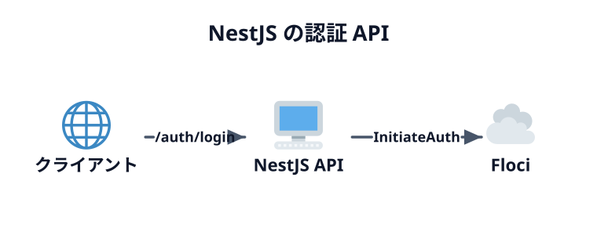

# 認証 API を作る



前のセクションで aws CLI から打っていた操作を、NestJS の API にします。`POST /auth/signup`・`/auth/confirm`・`/auth/login`・`/auth/refresh` の 4 つです。Cognito の SDK は **エンドポイントを差し替えるだけで Floci に向く** ので、コードは本番の Cognito に向けるときとまったく同じです。

このレクチャーで、`handson/` は aws CLI の練習場から **API のプロジェクト** になります。足すファイルが一気に増えるので、先に全体を見ておきます。

::changes

増えるファイルは 3 つのまとまりに分かれます。

- **NestJS を動かすための設定**（`tsconfig.json`・`tsconfig.build.json`・`nest-cli.json`）… どの NestJS のプロジェクトにもある土台で、中身を覚える必要はありません。そのままコピーします
- **API 本体**（`src/`）… このレクチャーの本題です。上から順に作ります
- **API に User Pool を教える仕組み**（`scripts/write-api-env.sh`・`.env.example`）… 01 で作った User Pool とクライアントを、API が読む `.env` に書き出します

新しい User Pool は作りません。**01 で作った User Pool と App Client を、そのまま API から使います**。

## 準備

`handson/` で作業します。前のレクチャーから続けているなら、`source` の行だけで構いません。Floci を止めていたときは、起動してから `npm run setup` で前のレクチャーを終えた状態を作り直します。

```bash
npm run up
npm run setup              # 前のレクチャーまでに作ったものを作り直す
source ./env.sh && source ./.cognito.env
```

## NestJS を入れる

API に要るパッケージと、開発の道具を入れます。

```bash
npm install @nestjs/common @nestjs/core @nestjs/platform-express @nestjs/config \
  @aws-sdk/client-cognito-identity-provider reflect-metadata rxjs
npm install -D @nestjs/cli @nestjs/schematics typescript @types/node @types/express source-map-support
```

TypeScript と NestJS の CLI の設定ファイルを 3 つ置きます。中身は NestJS の標準の構成そのままなので、そのままコピーしてください。

::file{path="tsconfig.json"}

::file{path="tsconfig.build.json"}

::file{path="nest-cli.json"}

`package.json` には、起動とビルドのコマンド（`start:dev` など）と、あとで使う `write-env` を足します。ビルドした `dist/` と、手元の値を入れる `.env` は `.gitignore` に足します。

::file{path="package.json"}

::file{path=".gitignore"}

## API 本体を作る

作る順に並べると、こうなります。

```text
src/
  config/cognito.config.ts    1. 環境変数 → 設定
  auth/auth.service.ts        2. Cognito SDK を呼ぶ
  auth/cognito-error.filter.ts 3. Cognito の例外 → HTTP のステータス
  auth/auth.controller.ts     4. /auth/* の 4 つ
  auth/auth.module.ts         5. 2〜4 をまとめる
  app.module.ts               6. ConfigModule と AuthModule を組み立てる
  main.ts                     7. 起動
```

NestJS は TypeScript で書きます（NestJS 12 の標準の構成）。

## 設定（ConfigModule）

[src/config/cognito.config.ts](./handson/src/config/cognito.config.ts) は、環境変数から設定を組み立てます。

```ts
const endpoint = process.env.COGNITO_ENDPOINT || undefined;
const issuer = process.env.COGNITO_ISSUER
  ?? `${endpoint ?? `https://cognito-idp.${region}.amazonaws.com`}/${userPoolId}`;
```

`COGNITO_ENDPOINT` があれば Floci、無ければ本物の Cognito です。トークンの発行者（`iss`）は「エンドポイント/プール ID」の形で、Floci も本物も同じ組み立て方で決まります。`iss` と `jwksUrl` は次のレクチャーでトークンを確かめるときに使います。

::file{path="src/config/cognito.config.ts"}

API が読む `.env` は、手で書かずにスクリプトで作ります。**`scripts/write-api-env.sh`** が `.cognito.env`（01 で作った User Pool とクライアントの ID）を読み、`.env` を書き出します。見本として `.env.example` も置いておきます。

::file{path="scripts/write-api-env.sh"}

::file{path=".env.example"}

書き出される `.env` はこうなります。

```bash
AWS_REGION=ap-northeast-1
AWS_ACCESS_KEY_ID=test
AWS_SECRET_ACCESS_KEY=test
COGNITO_ENDPOINT=http://localhost:4566
COGNITO_USER_POOL_ID=ap-northeast-1_xxxxxxxxx
COGNITO_CLIENT_ID=xxxxxxxxxxxxxxxxxxxxxxxxxx
```

`AWS_ACCESS_KEY_ID`・`AWS_SECRET_ACCESS_KEY` の `test` は Floci 用のダミーです。この API が呼ぶ `SignUp`・`InitiateAuth` などは認証情報なしで呼べますが、`AdminAddUserToGroup` のような管理者向けの呼び出しには認証情報が要るので、形だけ入れています。Floci は値を確かめません。本物の Cognito に切り替えるときは消します（[04-frontend-and-container](../04-frontend-and-container/LECTURE.md) で扱います）。

`setup.sh` の最後に 1 行足して、`npm run setup` のたびに `.env` も書き直されるようにします。Floci を作り直すとプール ID が変わるので、`.env` もそれに合わせる必要があるからです。

::file{path="scripts/setup.sh"}

```bash
npm run write-env      # いまの User Pool で .env を書き出す
```

## Cognito SDK を呼ぶ（AuthService）

[src/auth/auth.service.ts](./handson/src/auth/auth.service.ts) で、SDK のクライアントを作るときに `endpoint` を渡します。

```ts
this.client = new CognitoIdentityProviderClient({
  region: config.region,
  endpoint: config.endpoint,   // undefined なら本物の Cognito
});
```

ログインは CLI と同じ `InitiateAuth` です。管理者が作ったユーザーの初回ログインでは、トークンの代わりにチャレンジが返るので、そのまま返しています。

```ts
if (result.ChallengeName) {
  return { challenge: result.ChallengeName, session: result.Session };
}
```

::file{path="src/auth/auth.service.ts"}

## Cognito のエラーを HTTP にする

SDK は Cognito のエラーを `NotAuthorizedException` などの名前付きの例外で投げます。そのままでは 500 になってしまうので、[src/auth/cognito-error.filter.ts](./handson/src/auth/cognito-error.filter.ts) の例外フィルターで HTTP のステータスに変えます。

| Cognito の例外 | HTTP |
|---|---|
| `NotAuthorizedException`・`UserNotFoundException` | 401（どちらも同じ文言） |
| `UserNotConfirmedException` | 403（登録済みだと分かる） |
| `UsernameExistsException` | 409（登録済みだと分かる） |
| `InvalidPasswordException`・`CodeMismatchException` など | 400 |
| `ResourceNotFoundException`（User Pool やクライアントが無い） | 500 |
| それ以外 | 502 |

パスワード違いと、存在しないユーザーを **同じ 401・同じ文言** にしているのが大事なところです。分けて返すと「このユーザー名は登録されている」ことが外から分かってしまいます。例外の名前も応答には含めず、ログにだけ残します。

::file{path="src/auth/cognito-error.filter.ts"}

## /auth/* を受ける

[src/auth/auth.controller.ts](./handson/src/auth/auth.controller.ts) は、リクエストの本文が文字列で来ているかだけを確かめて、`AuthService` に渡します。

::file{path="src/auth/auth.controller.ts"}

3 つを `AuthModule` にまとめ、例外フィルターをアプリ全体にかけます（`APP_FILTER`）。

::file{path="src/auth/auth.module.ts"}

`AppModule` で設定（`ConfigModule`）と `AuthModule` を組み立て、`main.ts` で起動します。

::file{path="src/app.module.ts"}

::file{path="src/main.ts"}

## 動かす

```bash
npm run start:dev      # http://localhost:3000
```

別のターミナルから、サインアップ → 確認 → ログインと呼んでみます。

```bash "{直前の結果で出た 6 桁の確認コード}"
curl -s -X POST localhost:3000/auth/signup -H 'content-type: application/json' \
  -d '{"username":"carol","email":"carol@example.com","password":"Passw0rd!"}'
# {"userSub":"...","confirmed":false}

npm run -s read-code carol@example.com   # 01-02 で作った道具で確認コードを読む
# 123456

export CODE={直前の結果で出た 6 桁の確認コード}
curl -s -X POST localhost:3000/auth/confirm -H 'content-type: application/json' \
  -d "{\"username\":\"carol\",\"code\":\"$CODE\"}"

curl -s -X POST localhost:3000/auth/login -H 'content-type: application/json' \
  -d '{"username":"carol","password":"Passw0rd!"}'
# {"idToken":"eyJ...","accessToken":"eyJ...","refreshToken":"...","expiresIn":3600}
```

01 で作った alice と bob も、同じ User Pool にいるのでログインできます。

```bash
curl -s -X POST localhost:3000/auth/login -H 'content-type: application/json' \
  -d '{"username":"bob","password":"Passw0rd!"}'
```

エラーの返り方も確かめます。

```bash
curl -s -X POST localhost:3000/auth/login -H 'content-type: application/json' -d '{"username":"carol","password":"wrong"}'
curl -s -X POST localhost:3000/auth/login -H 'content-type: application/json' -d '{"username":"nobody","password":"wrong"}'
# どちらも {"statusCode":401,"message":"ユーザー名かパスワードが違います"}
```

:::warning[ログインを 401 にそろえても、サインアップでは存在が分かる]
`POST /auth/signup` に既にあるユーザー名を送ると 409 が返るので、ログインとは別の入口から「登録されているか」を確かめられてしまいます。未確認のユーザーでのログインに返す 403 も同じです。Cognito の `PreventUserExistenceErrors` もサインアップには効きません。

このハンズオンでは分かりやすさを優先して 409 を返しています。ユーザー名を探られたくないサービスでは、次のような対策を組み合わせます。

- メールアドレスをユーザー名にし、サインアップの応答は登録済みでもいつも同じにする。登録済みの人には「既に登録されています」というメールを送る
- サインアップ・ログインの API に回数制限をかける（API Gateway のスロットリングや AWS WAF のレートベースのルールなど）
:::

carol は手で作ったユーザーなので、`setup.sh` には足しません（`npm run setup` で作り直されるのは alice と bob です）。

## このレクチャーを終えた handson/

::codeview

:::faq

### `.env` が無いと言われて起動しません

`npm run write-env`（または `npm run setup`）を先に実行してください。Floci を作り直すと User Pool は消えるので、そのときは `npm run setup` をやり直します（プール ID が変わるので `.env` も書き直されます）。

### setup をやり直したら、API が 500 や 401 を返すようになりました

API を起動し直してください。`.env` は API を起動したときに一度だけ読まれ、`npm run start:dev` の自動再起動も `src/` の変更しか見ていません。起動し直すまで、API は消えた古い User Pool に問い合わせ続けます。ログインは 500（`API の Cognito の設定が正しくありません`）、`/me` はトークンの `iss` が合わずに 401 になります。

### パスワードの強さは API でも確かめるべきですか？

この API では形（文字列かどうか）だけを見て、強さの判定は Cognito のパスワードポリシーに任せています。同じ規則を 2 か所に書くと、片方だけ変えてずれる原因になるからです。

:::
