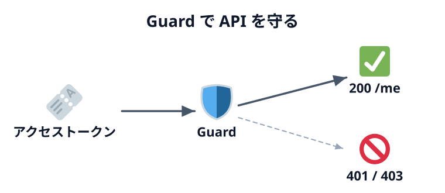

# トークンを確かめて API を守る



ログインして受け取ったアクセストークンを、API が確かめるようにします。トークンが無い・正しくないなら **401**、本人だが権限が足りないなら **403** を返します。NestJS では、この判定を **Guard** に書きます。

このレクチャーで足すファイルは次のとおりです。Guard とデコレーターは小さなファイルに分けて作り、`UsersController` で組み合わせます。

::changes

## 準備

`handson/` で作業します。前のレクチャーから続けているなら、`source` の行だけで構いません。Floci を止めていたときは、起動してから `npm run setup` で前のレクチャーを終えた状態を作り直します。

```bash
npm run up
npm run setup              # 前のレクチャーまでに作ったものを作り直す
source ./env.sh && source ./.cognito.env
npm run start:dev          # 別のターミナルで。setup をやり直したら起動し直す
```

## 守る API を先に決める

トークンが無いと呼べない API を 2 つ作ります。

| API | 誰が呼べるか |
|---|---|
| `GET /me` | ログインしている人なら誰でも。自分の情報を返す |
| `GET /admin/dashboard` | admin グループの人だけ |

コントローラーは、こう書きたい、という形から先に作ります。`@UseGuards` で 2 つの Guard をかけ、`@CurrentUser()` で利用者を受け取り、`@Roles()` で使えるグループを書きます。

::file{path="src/users/users.controller.ts"}

ここから、この 3 つ（`CognitoJwtGuard`・`@CurrentUser()`・`@Roles()` と `RolesGuard`）を作っていきます。

## CognitoJwtGuard

**`src/auth/cognito-jwt.guard.ts`** は、01-04 の `verify-jwt.mjs` と同じことを API の中でやります。鍵の在りか（`jwksUrl`）と発行者（`issuer`）は、02-01 で作った `cognito.config.ts` から受け取ります。

```ts
({ payload } = await jwtVerify(token, this.jwks, { issuer: this.config.issuer }));

if (payload.token_use !== 'access') { /* 401 */ }
if (payload.client_id !== this.config.clientId) { /* 401 */ }
```

署名・`iss`・`exp` に加えて、2 つを確かめています。

- `token_use` が `access` … ID トークンを送られても受け付けない。ID トークンは「誰か」を伝えるためのもので、API を呼ぶ許可ではありません
- `client_id` が自分のクライアント … 同じ User Pool の別のアプリ向けに出たトークンを受け付けない。Cognito のアクセストークンには `aud` が無いので、代わりにこれを見ます

::file{path="src/auth/cognito-jwt.guard.ts"}

確かめた結果は `request.user` に入れ、**`@CurrentUser()`** でハンドラから受け取ります。

::file{path="src/auth/current-user.decorator.ts"}

## グループで認可する

**`@Roles()`** で「このハンドラを使えるグループ」を書き、**`RolesGuard`** がトークンの `cognito:groups` と照らし合わせます。

::file{path="src/auth/roles.decorator.ts"}

::file{path="src/auth/roles.guard.ts"}

## 組み立てる

Guard を `AuthModule` の部品として登録し、ほかのモジュールから使えるように `exports` に足します。

::file{path="src/auth/auth.module.ts"}

`UsersController` を `UsersModule` にまとめ、`AppModule` に足します。

::file{path="src/users/users.module.ts"}

::file{path="src/app.module.ts"}

## 動かす

`npm run start:dev` は `src/` の変更を見て自動で起動し直しています。止めていたら起動します。別のターミナルで bob としてログインし、アクセストークンを `AT` に入れます。

```bash
AT=$(curl -s -X POST localhost:3000/auth/login -H 'content-type: application/json' \
  -d '{"username":"bob","password":"Passw0rd!"}' | node -e "process.stdin.on('data',d=>console.log(JSON.parse(d).accessToken))")
curl -s localhost:3000/me -H "authorization: Bearer $AT"
# {"sub":"...","username":"bob","groups":[]}
curl -s localhost:3000/admin/dashboard -H "authorization: Bearer $AT"
# {"message":"admin グループの利用者だけが使えます","error":"Forbidden","statusCode":403}
curl -s localhost:3000/me
# {"message":"Authorization: Bearer <アクセストークン> が必要です","error":"Unauthorized","statusCode":401}
```

bob は admin グループではないので 403 です（01-03 で admin に入れたのは alice だけです）。

## ユーザーを admin に入れる

ユーザーを admin グループに入れる **`scripts/make-admin.sh`** を作り、`package.json` に `make-admin` を足します。01-03 で手で打った `admin-add-user-to-group` を、ユーザー名を引数で受けるようにしたものです。

::file{path="scripts/make-admin.sh"}

::file{path="package.json"}

bob を admin グループに入れて、もう一度試します。

```bash
npm run make-admin bob
curl -s localhost:3000/admin/dashboard -H "authorization: Bearer $AT"   # まだ 403
```

入れたのに 403 のままです。手元のトークンは admin に入る前に発行したもので、`cognito:groups` が空のままだからです。ログインし直して、新しいトークンで呼びます。

```bash
AT=$(curl -s -X POST localhost:3000/auth/login -H 'content-type: application/json' \
  -d '{"username":"bob","password":"Passw0rd!"}' | node -e "process.stdin.on('data',d=>console.log(JSON.parse(d).accessToken))")
curl -s localhost:3000/admin/dashboard -H "authorization: Bearer $AT"
# {"message":"ようこそ、管理者の bob さん"}
```

グループの変更は、次に発行されたトークンから効きます。

## 401 と 403

| 状況 | ステータス |
|---|---|
| `Authorization` ヘッダーが無い | 401 |
| 署名が合わない・期限切れ・別の User Pool | 401 |
| ID トークンを送った・別のクライアント向けのトークン | 401 |
| 本人だが admin グループではない | 403 |

401 は「あなたが誰か分からない」、403 は「あなたが誰かは分かったが、それはできない」です。

bob を admin に入れたのは確かめるための操作なので、`setup.sh` には足しません。このレクチャーは API のコードを足しただけで、Floci に残すものは増えていません。

## このレクチャーを終えた handson/

::codeview

:::faq

### 正しいトークンなのに `/me` が 401 になります

`npm run setup` をやり直したあとに API を起動し直していないと、API は古い User Pool の `iss` と鍵で確かめ続けるので、新しいプールのトークンは全部 401 になります。`npm run start:dev` を止めて起動し直してください（`.env` は起動したときにしか読まれません）。

### Guard をアプリ全体にかけないのはなぜですか？

`/auth/login` のようにトークンを持たずに呼ぶ API もあるからです。ここでは保護したいコントローラにだけ `@UseGuards(CognitoJwtGuard, RolesGuard)` を付けています。全体にかけて、例外のハンドラだけ外す書き方もあります。

### グループではなく、もっと細かい権限を付けたいときは？

Cognito にはリソースサーバーとカスタムスコープがあり、アクセストークンの `scope` に `orders:read` のような権限を載せられます。グループは「人の役割」、スコープは「このクライアントに許す操作」と考えると使い分けやすいです。

:::
