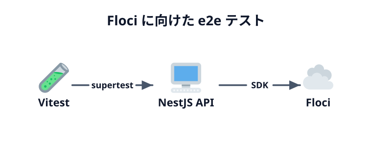

# e2e テストを Floci に向けて流す



ここまで curl で確かめてきたことを、自動のテストにします。認証は「モックにすると肝心なところを確かめられない」代表です。Floci があれば、本物と同じ API に向けたまま、何度でもテストを流せます。

このレクチャーで足すファイルは次のとおりです。テストは `test/` に分けて置き、API 本体（`src/`）には手を入れません。

::changes

## テストの道具を入れる

`handson/` で作業します。テストの実行には [Vitest](https://vitest.dev/) を、HTTP を呼ぶのには [supertest](https://github.com/ladjs/supertest) を使います。

```bash
npm install -D vitest vite supertest @types/supertest @nestjs/testing
```

テスト用の設定を置き、`package.json` に `test:e2e` を足します。`tsconfig.json` は、テストの中で `describe`・`it` を import せずに使えるよう、`types` に `vitest/globals` を足します。

::file{path="vitest.config.e2e.ts"}

::file{path="package.json"}

::file{path="tsconfig.json"}

## テストごとに新しい User Pool を作る

テストは `npm run setup` で作った User Pool を使いません。手で触っている User Pool とテストが混ざらないよう、**テストごとに新しい User Pool を作ります**。**`test/floci.ts`** の `createUserPool()` は、SDK で User Pool・App Client・admin グループを作り、アプリが読む環境変数に入れます。01-01 の `create-user-pool.sh` と同じことを SDK で書いたものです。

```ts
beforeEach(async () => {
  userPoolId = await createUserPool();
  const moduleRef = await Test.createTestingModule({ imports: [AppModule] }).compile();
  app = moduleRef.createNestApplication();
  await app.init();
});
```

設定（`registerAs`）は **モジュールを組み立てるときに** 読まれるので、環境変数を入れてから `compile()` します。テストごとに新しい User Pool を使うので、前のテストのユーザーが残っていても混ざりません。Floci 全体を消す必要もありません。

テストは `process.env` を書き換えるので、並列に流すと設定が混ざります。`vitest.config.e2e.ts` で `fileParallelism: false` にしています。

## 確認コードもテストで読む

サインアップの確認コードは、Floci の SES から読みます（[test/floci.ts](./handson/test/floci.ts) の `readVerificationCode()`）。

```ts
const { messages } = (await (await fetch(`${FLOCI}/_aws/ses`)).json()) as {
  // ...
};
const mail = messages.filter((m) => m.Destination.ToAddresses.includes(email)).at(-1);
const code = mail?.Body.text_part?.match(/\d{6}/)?.[0];
```

01-02 の `read-code.sh` と同じことを TypeScript で書いたものです。本物の Cognito ではできない（メールが実際に送られてしまう）ことが、ローカルではテストの中で完結します。

::file{path="test/floci.ts"}

## 何を確かめているか

**`test/auth.e2e-spec.ts`** のテスト:

- サインアップしただけではログインできない（403）
- パスワード違いと存在しないユーザーは、同じ 401・同じ本文
- アクセストークンで `/me` が読める。ID トークンでは読めない
- admin グループに入ると、更新したトークンから管理画面を使える
- 間違った確認コードは 400
- 前のテストのユーザーは残っていない

前のレクチャーまでに「設計として大事」と書いたことを、そのままテストにしています。

::file{path="test/auth.e2e-spec.ts"}

## 流す

Floci が動いていれば、API（`npm run start:dev`）を止めていても流せます。テストは自分で `AppModule` を組み立てるからです。

```bash
npm run test:e2e
```

```text
 ✓ test/auth.e2e-spec.ts (6 tests)
      Tests  6 passed (6)
```

テストは自分で User Pool を作るので、`setup.sh` に足す行はありません。

## このレクチャーを終えた handson/

::codeview

:::faq

### User Pool がどんどん増えますが、問題ありませんか？

Floci はメモリに持っているだけなので、作り直せば消えます（`npm run reset`）。CI では毎回まっさらな Floci を起動するので気にしなくて構いません。

### User Pool に `AutoVerifiedAttributes: ['email']` を付け忘れるとどうなりますか？

確認コードのメールが送られません。そのうえ Floci 2.4.0 では、その状態だとどんなコードでも確認が通ってしまいました。「間違ったコードは 400」のテストが落ちて気づけたので、テストで確かめておく価値がある例です。

:::
