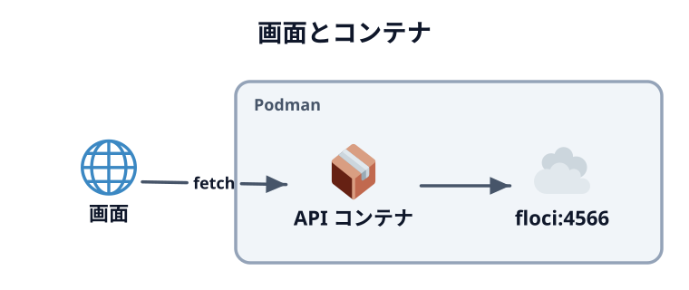

# 画面から使う・コンテナで動かす



最小の画面を付けて、ブラウザからサインアップ・ログイン・API の呼び出しをします。後半では API もコンテナに入れて動かし、そのときに起きる **`iss` のずれ** を直します。最後に、本番の Cognito に切り替えるときに何を変えればよいかを確かめます。

このレクチャーで足す・変えるファイルは次のとおりです。前半で画面（`public/`）、後半でコンテナ（`Containerfile`・`compose.yaml`）を足します。

::changes

## 準備

`handson/` で作業します。前のレクチャーから続けているなら、`source` の行だけで構いません。Floci を止めていたときは、起動してから `npm run setup` で前のレクチャーを終えた状態を作り直します。

```bash
npm run up
npm run setup              # 前のレクチャーまでに作ったものを作り直す
source ./env.sh && source ./.cognito.env
```

## 画面を配る

画面は `public/` に置いた HTML と JavaScript だけにし、NestJS の `ServeStaticModule` で API と同じオリジンから配ります。同じオリジンなので、CORS の設定は要りません。

```bash
npm install @nestjs/serve-static
```

`AppModule` に `ServeStaticModule` を足します。

::file{path="src/app.module.ts"}

## 画面を作る

**`public/index.html`** はサインアップ・確認・ログインの 3 つのフォームと、API を呼ぶボタンだけの画面です。

::file{path="public/index.html"}

**`public/main.js`** は、フォームの値を `fetch` で `/auth/*` に送り、返ってきたトークンを `sessionStorage` に置きます。`GET /me` などを呼ぶときは、アクセストークンを `Authorization: Bearer ...` に付けます。

```js
const headers = { 'content-type': 'application/json' };
if (tokens?.accessToken) headers.authorization = `Bearer ${tokens.accessToken}`;
```

::file{path="public/main.js"}

## ログアウトでトークンを取り消す

「ログアウト」は、手元のトークンを消す前に `POST /auth/logout` を呼び、リフレッシュトークンを Cognito で取り消します（`RevokeToken`）。消すだけにすると、もしトークンが盗まれていた場合、ログアウトしたあとも使われ続けます。`AuthService` と `AuthController` に 1 つずつ足します。

::file{path="src/auth/auth.service.ts"}

::file{path="src/auth/auth.controller.ts"}

## 画面から使う

```bash
npm run start:dev
```

<http://localhost:3000> を開きます。

1. サインアップする
2. <http://localhost:4566/_aws/ses> で確認コードを読み、確認する
3. ログインして `GET /me` を押す
4. `GET /admin/dashboard` は 403。`npm run make-admin <username>` のあと、ログインし直すと 200（alice は最初から 200 です）

開発者ツールの Network タブで、`/auth/login` の応答にトークンが入っていること、`/me` の要求に `Authorization: Bearer ...` が付いていることを確かめてください。

:::warning[トークンの置き場所]
この画面はトークンを `sessionStorage` に置いています。ページに XSS があると JavaScript から読まれてしまう場所です。いちばん危ないのは **リフレッシュトークン** で、既定で 30 日有効なので、一度盗まれると期限までアクセストークンを取り直され続けます（アクセストークンは 1 時間で切れます）。

練習なのでこうしていますが、本番では、トークンをブラウザに渡さずサーバー側で持ち、ブラウザとは httpOnly の Cookie のセッションでやり取りする形（BFF: Backend for Frontend）を検討してください。リフレッシュトークンの有効期限を短くすることもできます。
:::

## API をコンテナで動かす

**`Containerfile`** は、ビルド用と実行用の 2 段に分けたイメージです。1 段目で TypeScript をビルドし、2 段目には実行に要るもの（本番の依存・`dist/`・`public/`）だけを入れます。イメージに入れないものは **`.containerignore`** に書きます。手元の `.env` をイメージに焼き込まないためです。

::file{path="Containerfile"}

::file{path=".containerignore"}

`compose.yaml` に `api` サービスを足します。`profiles: ["api"]` にしてあり、指定したときだけ起動します（ふだんの `npm run up` では Floci だけが起動します）。`package.json` には、API のコンテナを起動・停止するコマンドを足し、`down` が API のコンテナも止めるようにします。

::file{path="compose.yaml"}

::file{path="package.json"}

`Containerfile` の `npm ci` は `package-lock.json` を使います。`npm install` をしていれば、`handson/` にできています。

```bash
npm run api:up         # podman compose --profile api up -d --build --wait
```

`npm run setup` をやり直したら、`npm run api:up` ももう一度実行します。`.env` の値が変わっていればコンテナが作り直され、新しい User Pool を読み込みます。

ホストで動かしている `npm run start:dev` は止めておいてください（同じ 3000 番を使います）。

API のコンテナを止めてホストの `npm run start:dev` に戻るときは `npm run api:down` を使います。`npm run down` も API のコンテナまでまとめて止めます。

### コンテナの中から見た Floci

コンテナの中の `localhost` はそのコンテナ自身です。API のコンテナから Floci には、compose のサービス名 `floci` で届きます。そこで `compose.yaml` の `api` サービスでは、エンドポイントを差し替えています。

```yaml
environment:
  COGNITO_ENDPOINT: http://floci:4566
  COGNITO_ISSUER: http://localhost:4566/${COGNITO_USER_POOL_ID}
  COGNITO_JWKS_URL: http://floci:4566/${COGNITO_USER_POOL_ID}/.well-known/jwks.json
```

`COGNITO_ENDPOINT` だけでよさそうに見えます。なぜ残りの 2 行が要るのか、一度外して確かめます。

### 2 行を外すと 401 になる

compose.yaml の `COGNITO_ISSUER` と `COGNITO_JWKS_URL` の行の先頭に `#` を付けてコメントにし、API のコンテナを作り直します。

```bash
npm run api:up
```

画面でログインし直して `GET /me` を押すと、401 `トークンを確かめられませんでした` になります。理由は API のログに出ています。

```bash
podman compose --profile api logs api | grep トークン
# WARN [CognitoJwtGuard] トークンを確かめられませんでした: unexpected "iss" claim value
```

トークンの中を見てみます。画面の「ログイン」の結果に出ている `accessToken` をコピーし、真ん中の部分を開きます。

```bash "{コピーしたアクセストークン}"
AT='{コピーしたアクセストークン}'
node -e "console.log(JSON.parse(Buffer.from(process.argv[1].split('.')[1], 'base64url')).iss)" "$AT"
# http://localhost:4566/ap-northeast-1_f06ce8963
```

Floci は、どこから呼ばれても `iss` を自分の基準 URL（`http://localhost:4566`）で書きます。一方 API は、`COGNITO_ISSUER` が無いと `COGNITO_ENDPOINT` から `iss` を `http://floci:4566/...` と組み立てるので、食い違います。

### 名前と住所を分ける

`iss` は **発行者の名前** で、鍵を取りに行く **住所** とは別物です。名前は `localhost:4566` のまま、住所だけをコンテナの中から届く `floci:4566` にします。`#` を外して元に戻し、もう一度作り直します。

```bash
npm run api:up
```

`${COGNITO_USER_POOL_ID}` は、compose が同じフォルダの `.env` から埋めます。ログインし直して `GET /me` を押すと、200 になります。

## 本番の Cognito に切り替える

コードは変えません。ホストで動かす（`npm run start:dev`）なら、`.env` をこうするだけです。

```bash "{本物の User Pool の ID}" "{本物のクライアント ID}"
AWS_REGION=ap-northeast-1
# COGNITO_ENDPOINT は書かない（SDK が本物の Cognito に向く）
COGNITO_USER_POOL_ID={本物の User Pool の ID}
COGNITO_CLIENT_ID={本物のクライアント ID}
```

- `iss` は `https://cognito-idp.ap-northeast-1.amazonaws.com/<プール ID>`、JWKS はその後ろの `/.well-known/jwks.json` になり、設定が自動で組み立てます
- `AWS_ACCESS_KEY_ID` などのダミーのキーは消します。この API が呼ぶ `SignUp`・`ConfirmSignUp`・`InitiateAuth` は、IAM の認証情報なしでクライアント ID だけで呼べる API です
- 本物の App Client でも `ALLOW_USER_PASSWORD_AUTH` を許しておく必要があります

:::warning[コンテナで動かすときは compose.yaml も変える]
compose.yaml の `api` サービスの `environment:` にある `COGNITO_ENDPOINT`・`COGNITO_ISSUER`・`COGNITO_JWKS_URL` の 3 行は、Floci に向けるためのものです。`environment:` に書いた値は `.env`（`env_file:`）より優先されるので、`.env` だけを本物に書き換えても、API は Floci に話しかけ続けます。本物に向けるときは、この 3 行も消してください。本番の compose ファイルを別に分けておくのも手です。
:::

## このレクチャーを終えた handson/

このレクチャーでも、Floci に残すものは増えていないので、`setup.sh` はそのままです。

::codeview

:::faq

### `npm run api:up` が終わらない・失敗します

初回はイメージのビルドに数分かかります。失敗したときは `podman compose --profile api logs api` でログを見てください。`.env` が無いと起動直後に「環境変数がありません」で止まります。

### Amplify を使う場合は？

Amplify（`aws-amplify`）の `signIn` は既定で SRP を使い、エンドポイントも本物の Cognito に固定されています。Floci に向けるには `Amplify.configure` で `userPoolEndpoint` を指定し、`signIn` の `authFlowType` を `USER_PASSWORD_AUTH` にします（Floci の SRP も試せますが、このハンズオンでは確かめていません）。

:::
