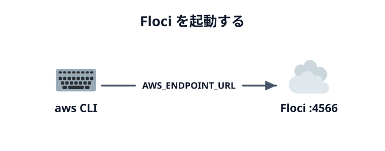
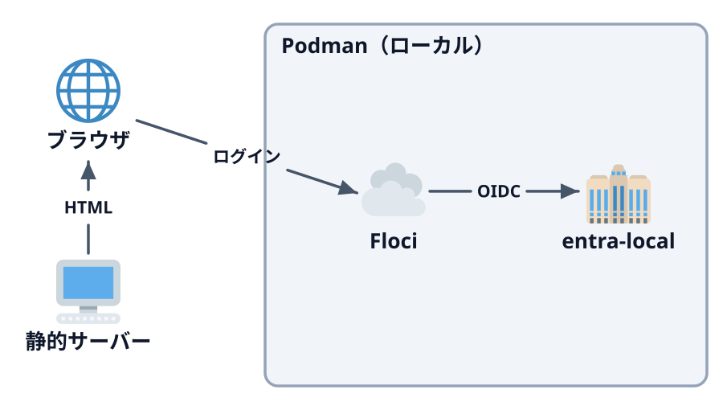

# Floci を起動する



[Floci](https://floci.io/) は、AWS のサービスを手元で真似するエミュレータです。MIT ライセンスで無料、アカウント登録も要りません。このハンズオンでは Floci の **Cognito** を使います。



Floci の Cognito は、User Pool・ユーザー・パスワード認証・グループ・JWKS に加えて、**Hosted UI（ログイン画面）と `/oauth2/authorize`・`/oauth2/token`** も持っています。このおかげで「Cognito が外部の IdP（Entra ID）にログインを任せる」流れまで、ローカルで最後まで通せます。

このレクチャーで作るファイルは次のとおりです。

::changes

## 作業用のフォルダを作る

このハンズオンでは、**`handson/` という 1 つのフォルダに、レクチャーごとにファイルを足していきます**。好きな場所に作って、その中に移ります。

```bash
mkdir handson
cd handson
```

## 起動するコンテナを書く

起動するコンテナを書く **`compose.yaml`** を作ります。いまは Floci だけです。

::file{path="compose.yaml"}

- イメージは `2.4.0` に固定しています。`latest` だと、ある日から挙動が変わることがあります
- ポートは **4566** です。`127.0.0.1:` を付けて、自分のパソコンからだけ届くようにしています。Floci は認証なしで API を受け付けるので、ほかのマシンから触られないようにするためです

## 起動する

`handson/` で、コンテナを起動します。`-d` は、コンテナを裏で動かし続ける指定です。

```bash
podman compose up -d
```

次のように出れば起動できています。初回はイメージの取得（`Pulled`）に少し時間がかかります。

```text
>>>> Executing external compose provider "/opt/homebrew/bin/docker-compose". Please see podman-compose(1) for how to disable this message. <<<<

[+] up 10/10
 ✔ Image docker.io/floci/floci:2.4.0 Pulled          9.6s
 ✔ Network handson_default           Created         0.0s
 ✔ Container handson-floci-1         Started         0.3s
```

1 行目の `>>>> Executing external compose provider ...` は、`podman compose` が docker-compose に処理を渡したという知らせで、エラーではありません。

## 動作確認する

Floci の health に問い合わせ、返ってきた JSON から Cognito（`cognito-idp`）の状態だけを `jq` で取り出します。

```bash
curl -s http://localhost:4566/_floci/health | jq '.services["cognito-idp"]'
# "running"
```

`"running"` と出れば起動しています。何も出ないときは、数秒待ってからもう一度打ってください。

## aws CLI の向き先を書く

aws CLI は、環境変数 `AWS_ENDPOINT_URL` があればそこに話しかけます。aws CLI を Floci に向ける設定を **`env.sh`** にまとめます。

::file{path="env.sh"}

Floci はキーの中身を確かめないので、ダミーの `test` で構いません。**本物の AWS のキーを入れないでください**（向き先を間違えたときに本物を触ってしまいます）。

## aws CLI で確かめる

`env.sh` を読み込み、Floci の Cognito に話しかけられるかを確かめます。ターミナルを開き直したときも、最初に `source ./env.sh` を打ちます。

```bash
source ./env.sh
aws cognito-idp list-user-pools --max-results 10
# { "UserPools": [] }
```

## データは消える

Floci は既定でデータをメモリに持ちます。コンテナを作り直すと、User Pool もユーザーも消えます。やり直したいときは作り直すのがいちばん早いです。

```bash
podman compose down
podman compose up -d
```

02-04 で、作ったものを作り直すスクリプト（`scripts/setup.sh`）を用意し、そのあとレクチャーごとに 1 行ずつ育てていきます。消えても `bash scripts/setup.sh` で、前のレクチャーを終えた状態に戻せます。

| コマンド | すること |
|---|---|
| `podman compose up -d` | `compose.yaml` にあるコンテナを全部起動する（Floci、05 からは entra-local も） |
| `podman compose down` | 止める。Floci のデータは消える |
| `bash scripts/setup.sh` | `scripts/setup.sh` を流し、ここまでのレクチャーで Floci に作ったもの（User Pool・ユーザー・グループ・IdP の登録）を作り直す（02-04 から） |

`setup` をやり直したら、開いている画面を読み込み直してください（User Pool の ID が変わるため）。entra-local（05）のデータだけはボリュームに残り、`podman compose down` でも消えません（消すときは `podman compose down -v`）。

## Floci の Cognito で使えるもの・使えないもの

このハンズオンを作るときに、実際に動かして確かめた結果です（Floci 2.4.0）。

| 機能 | 結果 |
|---|---|
| User Pool・App Client・グループ | 使える |
| パスワード認証（`USER_PASSWORD_AUTH`）・初回のパスワード変更（`NEW_PASSWORD_REQUIRED`） | 使える |
| サインアップと確認コード | 使える。確認メールは Floci の SES に届き、`http://localhost:4566/_aws/ses` で読める。違うコードは、User Pool の `AutoVerifiedAttributes` に `email` があるときだけ拒否される。無いと、どんなコードでも確認が通る |
| パスワードポリシー・`SECRET_HASH`・許可していない認証フローの拒否 | 本物と同じように拒否される |
| `PreventUserExistenceErrors` | 受け付けるが保存されず、効かない。存在しないユーザーは常に `UserNotFoundException` |
| discovery・JWKS | 使える。`iss` は `http://localhost:4566/<プール ID>` |
| Hosted UI（ログイン画面）・`/oauth2/authorize`・`/oauth2/token`・`/oauth2/revoke` | 使える。PKCE も確かめる。ブラウザから呼ぶには `FLOCI_SECURITY_EXTRA_CORS_ALLOWED_ORIGINS` で CORS を許す |
| 外部 IdP（OIDC）経由のログイン | 使える。登録のしかたに本物と違う点がある（[05-02](../../05-cognito-with-entra-id/02-federation/LECTURE.md) で扱う） |
| 外部 IdP（SAML）・Facebook・Apple | 使えない |

## このレクチャーを終えた handson/

::codeview{download="false"}

:::faq

### 待っても `curl` に何も返りません

`podman compose ps` で状態を、`podman compose logs floci` でログを見てください。ポート 4566 をほかのプログラム（LocalStack や別の Floci など）が使っていると起動できません。

### LocalStack や moto ではだめですか？

moto（Motoserver）でも User Pool やトークンの練習はできますが、Hosted UI と `/oauth2/*` が無いため、外部 IdP 経由のログインが通りません。また moto のトークンは `iss` が本物の AWS の URL のまま、署名鍵は全プール共通、ID トークンに `email` が入らない、と本物との差が大きいです。このハンズオンでは Floci に統一しています。

:::
