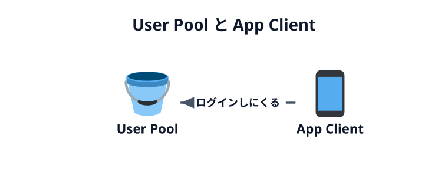

# User Pool と App Client を作る



Cognito でユーザーを管理する入れ物が **User Pool**、そこにログインしにくるアプリの登録が **App Client** です。このセクションでは aws CLI だけを使い、User Pool を作るところから、トークンを受け取って署名を確かめるところまでを一通りやります。

このレクチャーでは、まずコマンドを手で打って User Pool と App Client を作り、次に同じことをスクリプトにします。足すファイルは次のとおりです。

::changes

## Floci を起動する

前のレクチャーで用意した `handson/` で作業します。

```bash
cd handson
podman compose up -d
source ./env.sh
```

## User Pool を作る

パスワードポリシーを決めて User Pool を作ります。

```bash
aws cognito-idp create-user-pool \
  --pool-name practice \
  --policies 'PasswordPolicy={MinimumLength=8,RequireUppercase=true,RequireLowercase=true,RequireNumbers=true,RequireSymbols=false}' \
  --auto-verified-attributes email \
  --query UserPool.Id --output text
# ap-northeast-1_bba540037
```

- `--policies` … 8 文字以上・大文字・小文字・数字を必須にします
- `--auto-verified-attributes email` … サインアップしたらメールに確認コードを送る、という設定です。次のレクチャーで使います

返ってきた ID をシェル変数に入れておきます。`{ }` の所は、直前のコマンドで出た値に書き換えてから実行します（`{ }` ごと消します）。

```bash "{直前の結果で出た User Pool の ID}"
export POOL_ID={直前の結果で出た User Pool の ID}
# 例: export POOL_ID=ap-northeast-1_bba540037
```

## App Client を作る

```bash
aws cognito-idp create-user-pool-client \
  --user-pool-id "$POOL_ID" \
  --client-name practice-cli \
  --no-generate-secret \
  --explicit-auth-flows ALLOW_USER_PASSWORD_AUTH ALLOW_REFRESH_TOKEN_AUTH \
  --prevent-user-existence-errors ENABLED \
  --query UserPoolClient.ClientId --output text
# 708d6652cba84996a62ac8cdde
```

- `--no-generate-secret` … クライアントシークレットを作りません。ブラウザやスマホのアプリは秘密を隠しておけないので、シークレットを持たせないのが基本です
- `--explicit-auth-flows` … このクライアントに許すログインの方法です。`ALLOW_USER_PASSWORD_AUTH` はユーザー名とパスワードをそのまま送る方法、`ALLOW_REFRESH_TOKEN_AUTH` はトークンの更新です
- `--prevent-user-existence-errors ENABLED` … ログインに失敗したとき、ユーザーが存在しないのか、パスワードが違うのかを区別して返さないようにします（Floci では効きません。04-01 の FAQ で扱います）

```bash "{直前の結果で出たクライアント ID}"
export CLIENT_ID={直前の結果で出たクライアント ID}
# 例: export CLIENT_ID=708d6652cba84996a62ac8cdde
```

## 作ったものを確かめる

```bash
aws cognito-idp describe-user-pool --user-pool-id "$POOL_ID" \
  --query 'UserPool.{Name:Name,Policy:Policies.PasswordPolicy,AutoVerified:AutoVerifiedAttributes}'
aws cognito-idp describe-user-pool-client --user-pool-id "$POOL_ID" --client-id "$CLIENT_ID" \
  --query 'UserPoolClient.{Name:ClientName,Flows:ExplicitAuthFlows,Secret:ClientSecret}'
```

## スクリプトにする

Floci のデータはメモリにあるので、コンテナを止めると User Pool は消えます。そのたびに打ち直さなくて済むよう、いま打った 2 つのコマンドを **`scripts/create-user-pool.sh`** にします。

要点は 2 つです。

- コマンドの出力（ID）を `$(...)` で変数に受ける。手で `export` していた所が要らなくなります
- 最後に ID を **`.cognito.env`** に書き出す。この先のスクリプトは、ここから User Pool とクライアントの ID を読みます

```bash
cat > .cognito.env <<ENV
export POOL_ID=$POOL_ID
export CLIENT_ID=$CLIENT_ID
ENV
```

::file{path="scripts/create-user-pool.sh"}

`.cognito.env` は手元の環境ごとに中身が違うファイルなので、git に入れないよう **`.gitignore`** を作って書いておきます。このあとのレクチャーでも、トークンやシークレットを書いたファイルをここに足していきます。

::file{path=".gitignore"}

## 作り直すスクリプトを用意する

もう 1 つ、**`scripts/setup.sh`** を作ります。いまは `create-user-pool.sh` を呼ぶだけですが、これから **レクチャーを 1 つ終えるたびに、そのレクチャーで作ったものを作るスクリプトを 1 行ずつ足していきます**。こうしておくと、Floci を作り直しても `bash scripts/setup.sh` 1 回で「前のレクチャーを終えた状態」に戻れます。

::file{path="scripts/setup.sh"}

動かして確かめます。Floci を作り直して（User Pool が消える）、`setup` で作り直します。

```bash
podman compose down
podman compose up -d
bash scripts/setup.sh
source ./.cognito.env
echo "$POOL_ID $CLIENT_ID"
```

新しい ID が出れば完成です。ターミナルを開き直したときも、`source ./env.sh && source ./.cognito.env` で同じ値に戻せます。

## このレクチャーを終えた handson/

::codeview

:::faq

### シークレットありのクライアントにするとどうなりますか？

ログインのたびに `SECRET_HASH`（ユーザー名・クライアント ID・シークレットから作るハッシュ）を送る必要があります。送らないと `InvalidParameterException: ... SECRET_HASH is required` になります。Floci もこれを本物どおりに拒否します。サーバーの中だけで使うクライアントなら、シークレットありにする意味があります。

### `ALLOW_USER_PASSWORD_AUTH` を付け忘れるとどうなりますか？

`initiate-auth` が `USER_PASSWORD_AUTH flow not enabled for this client` で拒否されます。本物の Cognito の既定は SRP（パスワードそのものを送らない方式）だけを許す設定です。

### `bash: scripts/setup.sh: No such file or directory` と出ます

`handson/` の中で実行しているかを確かめてください。

:::
