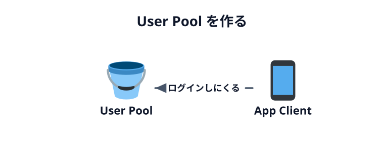

# User Pool を作る



Cognito でユーザーを管理する入れ物が **User Pool** です。aws CLI で User Pool を作ります。このレクチャーで作るファイルはありません。

## 準備

`handson/` で作業します。Floci を止めていたときは、起動してから `env.sh` を読み込みます。

```bash
podman compose up -d
source ./env.sh
```

## User Pool を作る

パスワードポリシーを決めて User Pool を作ります。

```bash
aws cognito-idp create-user-pool \
  --pool-name practice \
  --policies 'PasswordPolicy={MinimumLength=8,RequireUppercase=true,RequireLowercase=true,RequireNumbers=true,RequireSymbols=false}' \
  --auto-verified-attributes email \
  --query UserPool.Id --output text
# ap-northeast-1_bba540037
```

- `--policies` … 8 文字以上・大文字・小文字・数字を必須にします
- `--auto-verified-attributes email` … サインアップしたらメールに確認コードを送る、という設定です。03-01 で使います

返ってきた ID をシェル変数に入れておきます。`{ }` の所は、直前のコマンドで出た値に書き換えてから実行します（`{ }` ごと消します）。

```bash "{直前の結果で出た User Pool の ID}"
export POOL_ID={直前の結果で出た User Pool の ID}
# 例: export POOL_ID=ap-northeast-1_bba540037
```

## 作ったものを確かめる

```bash
aws cognito-idp describe-user-pool --user-pool-id "$POOL_ID" \
  --query 'UserPool.{Name:Name,Policy:Policies.PasswordPolicy,AutoVerified:AutoVerifiedAttributes}'
```

パスワードポリシーと `AutoVerified: ["email"]` が出れば完成です。Floci を止めると User Pool は消えますが、次のレクチャーで、作り直すスクリプトを用意します。
