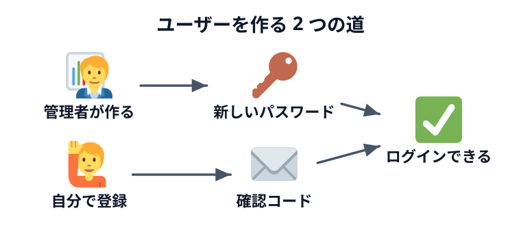

# ユーザーを作る



Cognito のユーザーの作り方は 2 通りあります。**管理者が作る**か、**ユーザーが自分でサインアップする**かです。どちらも、すぐにはログインできず、途中に 1 段階はさまります。その段階を実際に通ってみます。

このレクチャーで足すファイルは次のとおりです。

::changes

## 準備

`handson/` で作業します。前のレクチャーから続けているなら、`source` の行だけで構いません。Floci を止めていたときは、起動してから `bash scripts/setup.sh` で前のレクチャーを終えた状態（User Pool と App Client）を作り直します。

```bash
podman compose up -d
bash scripts/setup.sh              # 前のレクチャーまでに作ったものを作り直す
source ./env.sh && source ./.cognito.env
```

## 管理者がユーザーを作る

```bash
aws cognito-idp admin-create-user \
  --user-pool-id "$POOL_ID" \
  --username alice \
  --temporary-password 'Temp1234' \
  --user-attributes Name=email,Value=alice@example.com Name=email_verified,Value=true \
  --message-action SUPPRESS \
  --query User.UserStatus
# "FORCE_CHANGE_PASSWORD"
```

状態が `FORCE_CHANGE_PASSWORD` になりました。一時パスワードでログインしても、トークンは返らず **チャレンジ** が返ります。

```bash
aws cognito-idp initiate-auth \
  --client-id "$CLIENT_ID" \
  --auth-flow USER_PASSWORD_AUTH \
  --auth-parameters USERNAME=alice,PASSWORD=Temp1234 \
  --query '{Challenge:ChallengeName,Session:Session}'
```

`NEW_PASSWORD_REQUIRED` は「新しいパスワードを決めてください」という意味です。返ってきた `Session` を付けて、新しいパスワードで答えます。

```bash "{直前の結果で出た Session}"
SESSION={直前の結果で出た Session}
aws cognito-idp respond-to-auth-challenge \
  --client-id "$CLIENT_ID" \
  --challenge-name NEW_PASSWORD_REQUIRED \
  --session "$SESSION" \
  --challenge-responses USERNAME=alice,NEW_PASSWORD='Passw0rd!' \
  --query 'keys(AuthenticationResult)'
```

今度はトークン（`IdToken`・`AccessToken`・`RefreshToken`）が返ります。ポリシーを満たさないパスワード（`short` など）を送ると `InvalidPasswordException` になります。

## ユーザーが自分でサインアップする

```bash
aws cognito-idp sign-up \
  --client-id "$CLIENT_ID" \
  --username bob \
  --password 'Passw0rd!' \
  --user-attributes Name=email,Value=bob@example.com
```

`UserConfirmed: false` と、確認コードをメールで送ったこと（`CodeDeliveryDetails`）が返ります。このままログインすると `UserNotConfirmedException` で断られます。

### 確認コードを読む

本物の Cognito なら bob の受信箱にメールが届きます。Floci では、送ったメールが Floci の SES にたまっていて、HTTP で読めます。

```bash
curl -s http://localhost:4566/_aws/ses | head -c 600
# ... "Subject":"Your verification code","Body":{"text_part":"Your verification code is 821375." ...
```

6 桁のコードを抜き出すスクリプト **`scripts/read-code.sh`** を作ります。SES にたまったメールの一覧（JSON）から、宛先が一致する最新のメールを選び、本文から 6 桁の数字を取り出します。

::file{path="scripts/read-code.sh"}

`bash scripts/read-code.sh <メール>` で呼ぶと、コードだけが出ます。

```bash
CODE=$(bash scripts/read-code.sh bob@example.com)
aws cognito-idp confirm-sign-up --client-id "$CLIENT_ID" --username bob --confirmation-code "$CODE"
```

違うコード（`000000` など）を送ると `CodeMismatchException` になります。確認が済めば、bob もログインできます。

```bash
aws cognito-idp list-users --user-pool-id "$POOL_ID" \
  --query 'Users[].{Username:Username,Status:UserStatus}' --output table
```

## スクリプトにする

ここまでの手順を **`scripts/create-users.sh`** にまとめます。手で打ったコマンドを上から並べたものです。違うのは 2 か所だけです。

- `initiate-auth` の `Session` を `--query Session --output text` で変数に受け、`respond-to-auth-challenge` に渡す
- 確認コードを `bash scripts/read-code.sh` で読み、`confirm-sign-up` に渡す

::file{path="scripts/create-users.sh"}

`setup.sh` に 1 行足します。これで `bash scripts/setup.sh` が、User Pool を作ってから alice と bob を作るようになります。

::file{path="scripts/setup.sh"}

Floci を作り直して、確かめます。

```bash
podman compose down
podman compose up -d
bash scripts/setup.sh
```

最後に alice と bob が `CONFIRMED` で並べば完成です。

## このレクチャーを終えた handson/

::codeview

:::faq

### 管理者が「確認済み」にしてしまうことはできますか？

できます。`aws cognito-idp admin-confirm-sign-up --user-pool-id "$POOL_ID" --username bob` で、コードなしで確認済みになります。テストデータを作るときに便利です。

### 存在しないユーザーでログインすると、何が返りますか？

Floci は `UserNotFoundException` を返します。本物の Cognito では、App Client の `PreventUserExistenceErrors` が `ENABLED` なら、パスワード違いと同じ `NotAuthorizedException` が返り、ユーザーが存在するかを漏らしません。

02-01 では `--prevent-user-existence-errors ENABLED` を付けてクライアントを作りました。既定値は作り方で変わり、**コンソールで作ったクライアントは `ENABLED`、API や aws CLI で値を渡さずに作ったクライアントは `LEGACY`**（存在しなければ `UserNotFoundException`）です。Floci はこの設定を保存しますが、効きません（付けても `UserNotFoundException` を返します）。

02 からは、画面が Cognito を直接呼び、Cognito の応答がそのまま画面に届きます。ユーザーが存在するかを隠せるのは、この設定だけです。本物に向けるときは必ず `ENABLED` にしてください。

:::
