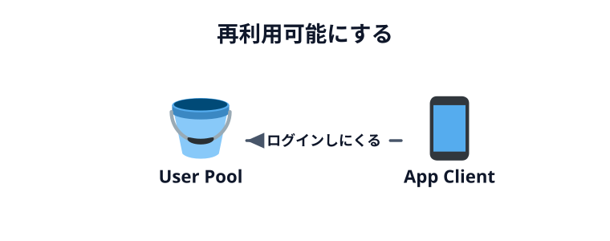

# 再利用可能にする



Floci のデータはメモリにあるので、コンテナを止めると User Pool も App Client も消えます。そのたびに打ち直さなくて済むよう、ここまで手で打ったことをスクリプトにして、いつでも作り直せるようにします。足すファイルは次のとおりです。

::changes

## 準備

`handson/` で作業します。

```bash
podman compose up -d
source ./env.sh
```

## User Pool と App Client を作るスクリプト

02-02 と 02-03 で打った 2 つのコマンドを **`scripts/create-user-pool.sh`** にします。

要点は 2 つです。

- コマンドの出力（ID）を `$(...)` で変数に受ける。手で `export` していた所が要らなくなります
- 最後に ID を **`.cognito.env`** に書き出す。この先のスクリプトは、ここから User Pool とクライアントの ID を読みます

```bash
cat > .cognito.env <<ENV
export POOL_ID=$POOL_ID
export CLIENT_ID=$CLIENT_ID
ENV
```

::file{path="scripts/create-user-pool.sh"}

`.cognito.env` は手元の環境ごとに中身が違うファイルなので、git に入れないよう **`.gitignore`** を作って書いておきます。このあとのレクチャーでも、トークンやシークレットを書いたファイルをここに足していきます。

::file{path=".gitignore"}

## 作り直すスクリプトを用意する

もう 1 つ、**`scripts/setup.sh`** を作ります。いまは `create-user-pool.sh` を呼ぶだけですが、これから **レクチャーを 1 つ終えるたびに、そのレクチャーで作ったものを作るスクリプトを 1 行ずつ足していきます**。こうしておくと、Floci を作り直しても `bash scripts/setup.sh` 1 回で「前のレクチャーを終えた状態」に戻れます。

::file{path="scripts/setup.sh"}

動かして確かめます。Floci を作り直して（User Pool が消える）、`setup` で作り直します。

```bash
podman compose down
podman compose up -d
bash scripts/setup.sh
source ./.cognito.env
echo "$POOL_ID $CLIENT_ID"
```

新しい ID が出れば完成です。ターミナルを開き直したときも、`source ./env.sh && source ./.cognito.env` で同じ値に戻せます。

## このレクチャーを終えた handson/

::codeview

:::faq

### `bash: scripts/setup.sh: No such file or directory` と出ます

`handson/` の中で実行しているかを確かめてください。

:::
