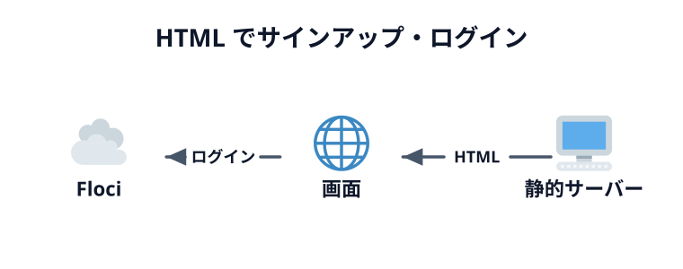

# HTML でサインアップ・ログインする



HTML と JavaScript だけの画面を作り、ブラウザから **Cognito に直接** サインアップ・確認・ログインします。ログインできたら、もらった ID トークンの中身を画面に出します。

```text
画面を配る   ブラウザ ◀──index.html・main.js・/config── 静的サーバー（node server.mjs、:3000）
ログイン     ブラウザ ──SignUp・ConfirmSignUp・InitiateAuth──▶ Cognito（Floci、:4566）
```

フレームワークは使いません。画面を配るサーバーも、Node の標準の API（`node:http`）だけで 40 行ほどで書きます。サーバーがすることは、ファイルを返すことと、画面に「どの User Pool に、どのクライアントとしてログインするか」を教えることだけです。ログインそのものは、ブラウザと Cognito の間で済みます。

このレクチャーで足す・変えるファイルは次のとおりです。

::changes

## 準備

`handson/` で作業します。Floci を止めていたときは、起動してから `npm run setup` で前のレクチャーを終えた状態を作り直します。

```bash
npm run up
npm run setup              # 前のレクチャーまでに作ったものを作り直す
```

## ブラウザから Floci を直接呼べるようにする

画面（`http://localhost:3000`）は、Cognito の API（`http://localhost:4566`）をブラウザから直接呼びます。オリジンが違うので、呼ばれる側の Floci が CORS を許す必要があります。`compose.yaml` の `floci` に、許すオリジンを足します。

::file{path="compose.yaml"}

本物の Cognito の API（`https://cognito-idp.<リージョン>.amazonaws.com`）は、最初からブラウザからの呼び出しに対応しています。

設定を変えたので Floci を作り直します。**作り直すと Floci のデータは消える** ので、`setup` をやり直します（ここで `setup.sh` を育ててきたことが効きます）。

```bash
npm run up
npm run setup
```

## 画面を配る静的サーバー

**`server.mjs`** は、`public/` のファイルを返すだけのサーバーです。

::file{path="server.mjs"}

- `/` が来たら `public/index.html` を、`/main.js` が来たら `public/main.js` を返します。`public/` の外（`../server.mjs` など）は返しません
- `/config` だけは特別で、01-01 で書き出した `.cognito.env` を読み、`issuer`（`http://localhost:4566/<プール ID>`）と `clientId` を JSON で返します。どれもブラウザに渡る値で、秘密ではありません
- `.cognito.env` はリクエストのたびに読み直すので、`npm run setup` で User Pool を作り直しても、サーバーを起動し直す必要はありません（画面は読み込み直してください）

`package.json` に `start` を足します。

::file{path="package.json"}

```bash
npm start
curl -s localhost:3000/config
# {"issuer":"http://localhost:4566/ap-northeast-1_xxxxxxxxx","clientId":"xxxxxxxxxxxxxxxxxxxxxxxxxx"}
```

:::note[Vite などでもよい]
静的なファイルを配れれば、サーバーは何でも構いません。Vite（`npx vite public`）や `npx serve` でも動きます。その場合は `/config` の代わりに、プール ID とクライアント ID を `main.js` に直接書いてください。このハンズオンでは、道具を増やさないことと、`setup` で ID が変わっても書き直さずに済むことから、Node の標準 API で書いています。
:::

## 画面を作る

**`public/index.html`** は、サインアップ・確認・ログインの 3 つのフォームと、ID トークンの中身を出す欄だけの画面です。

::file{path="public/index.html"}

**`public/main.js`** の中心は、Cognito の API を 1 つ呼ぶ関数です。AWS SDK や Amplify が中でしていることを、`fetch` でそのまま書いています。

```js
async function cognito(action, params) {
  const response = await fetch(cognitoEndpoint, {
    method: 'POST',
    headers: {
      'content-type': 'application/x-amz-json-1.1',
      'x-amz-target': `AWSCognitoIdentityProviderService.${action}`,
    },
    body: JSON.stringify({ ClientId: config.clientId, ...params }),
  });
  // ...
}
```

- 送り先は 1 か所で、どの操作かは `x-amz-target` ヘッダーで伝えます。01 で aws CLI が送っていたのと同じ形です
- 送り先（`cognitoEndpoint`）は、`/config` の `issuer` のオリジンです。Floci なら `http://localhost:4566`、本物なら `https://cognito-idp.<リージョン>.amazonaws.com` になります
- `SignUp`・`ConfirmSignUp`・`InitiateAuth`・`RevokeToken` は、AWS の認証情報（署名）なしで、クライアント ID だけで呼べる API です。ブラウザに秘密を置かずに済みます

ログインは、01-03 の `npm run login` と同じ `InitiateAuth`（`USER_PASSWORD_AUTH`）です。返ってきた ID トークンの真ん中（ペイロード）を Base64URL から戻し、画面に出します。01-03 の `decode-jwt.mjs` と同じで、署名は確かめていません（表示するだけなので）。

```js
const { ok, json } = await cognito('InitiateAuth', {
  AuthFlow: 'USER_PASSWORD_AUTH',
  AuthParameters: { USERNAME: username, PASSWORD: password },
});
```

「ログアウト」は、手元のトークンを消す前に `RevokeToken` でリフレッシュトークンを Cognito で取り消します。消すだけにすると、もしトークンが盗まれていた場合、ログアウトしたあとも使われ続けます（リフレッシュトークンは既定で 30 日有効です）。

::file{path="public/main.js"}

## 画面から使う

`npm start` を動かしたまま、<http://localhost:3000> を開きます。

1. サインアップする（例: `carol` / `carol@example.com` / `Passw0rd!`）
2. 確認の前にログインしてみる → `UserNotConfirmedException`
3. <http://localhost:4566/_aws/ses> で確認コードを読み、確認する
4. ログインする。「ID トークンの中身」に `cognito:username`・`email`・`iss`・`aud` などが出る
5. `alice` / `Passw0rd!` でもログインしてみる。`cognito:groups` に `admin` が入っている
6. 「ログアウト」を押す

開発者ツールの Network タブで、次を確かめてください。

- ログインの要求は `localhost:4566` に飛び、`localhost:3000`（静的サーバー）には飛んでいない。**パスワードはサーバーを通りません**
- 要求のヘッダーに `x-amz-target: AWSCognitoIdentityProviderService.InitiateAuth` が付いている
- `localhost:4566` への要求の前に、`OPTIONS` の要求（CORS の下調べ）が出ている

:::warning[エラーはそのまま画面に届く]
画面が Cognito を直接呼ぶので、Cognito のエラー（`UsernameExistsException`・`UserNotConfirmedException` など）はそのまま画面に届きます。言い換えると、画面を使わなくても、誰でも同じ API を呼んで同じ応答を見られます。

ユーザーが存在するかを隠せるのは、App Client の `PreventUserExistenceErrors: ENABLED`（01-01 で付けました）だけです。本物の Cognito では、存在しないユーザーへのログインも、パスワード違いと同じ `NotAuthorizedException` になります。**Floci ではこの設定が効かず**、`UserNotFoundException` が返ります。
:::

:::warning[トークンの置き場所]
この画面はトークンを `sessionStorage` に置いています。ページに XSS があると JavaScript から読まれてしまう場所です。いちばん危ないのは **リフレッシュトークン** で、一度盗まれると期限までアクセストークンを取り直され続けます。本番では、トークンをサーバー側で持ち、ブラウザとは httpOnly の Cookie のセッションでやり取りする形（BFF: Backend for Frontend）や、リフレッシュトークンの有効期限を短くすることを検討してください。
:::

:::note[パスワードを画面で受け取るのは練習のため]
この画面は、アプリ自身がパスワードの入力欄を持っています。本番では、ログイン画面ごと Cognito に任せる **Hosted UI**（次のレクチャー）を勧めます。アプリがパスワードに一切触らなくなり、多要素認証や外部 IdP（Entra ID）もそのまま使えるからです。ここでは、Cognito の API とトークンの流れを目で追うために、あえて自分で呼んでいます。
:::

## このレクチャーを終えた handson/

このレクチャーで Floci に残すものは増えていないので、`setup.sh` はそのままです。

::codeview

:::faq

### 画面を開いたら何も表示されません

`/config` が返す User Pool が Floci に無いと、画面の呼び出しは全部失敗します。Floci を作り直したときは `npm run setup` をやり直し、画面を読み込み直してください。開発者ツールの Console に CORS のエラーが出ているときは、`compose.yaml` に `FLOCI_SECURITY_EXTRA_CORS_ALLOWED_ORIGINS` を足したあとに `npm run up` で Floci を作り直したかを確かめてください。

### `npm start` で `EADDRINUSE` と出ます

ほかのプログラムがポート 3000 を使っています。[道具をそろえる](../../00-setup/01-tools/LECTURE.md) のコマンドで、待ち受けているプログラムを確かめてください。

### Amplify を使う場合は？

Amplify（`aws-amplify`）の `signIn` も、中では同じように Cognito の API を直接呼んでいます。ただし既定では SRP（パスワードそのものを送らない方式）を使い、送り先も本物の Cognito に固定されています。Floci に向けるには `Amplify.configure` で `userPoolEndpoint` を指定し、`signIn` の `authFlowType` を `USER_PASSWORD_AUTH` にします（このハンズオンでは確かめていません）。

### 本物の Cognito でも `USER_PASSWORD_AUTH` を使ってよいですか？

HTTPS の上でなら、パスワードは暗号化されて Cognito に届きます。ただ、ブラウザから使うなら、パスワードそのものを送らない SRP（`USER_SRP_AUTH`、Amplify の既定）や、Hosted UI（次のレクチャー）のほうが安全です。使わないログインの方法は、App Client の `ExplicitAuthFlows` から外しておきます。

:::
