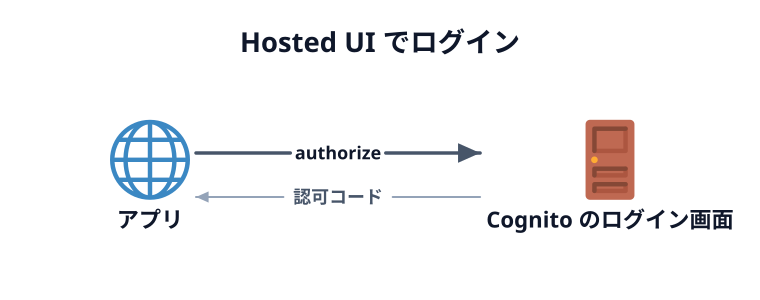

# Hosted UI でログインする



前のセクションでは、画面がパスワードを受け取り、API が Cognito に渡していました。このセクションでは逆に、**アプリはパスワードに一切触らず**、ログイン画面ごと Cognito に任せます。Cognito が用意するログイン画面を **Hosted UI**（マネージドログイン）と呼びます。

外部の IdP（Keycloak・Entra ID）にログインを任せる「フェデレーション」も、この Hosted UI の仕組みの上に乗っています。まず Cognito 自身のユーザーで、この流れを通します。

:::download
[サンプルコードをダウンロード](./project.zip)
:::

## 動かす

```bash
npm install
npm run floci:up
npm run setup        # User Pool・Hosted UI 用のクライアント・alice（admin）を作る
npm run start:dev
```

<http://localhost:3000> を開き、「Cognito のログイン画面へ」を押します。Floci のログイン画面に移るので、`alice` / `Passw0rd!` でサインインします。画面に戻ってきて、ID トークンの中身が表示されれば成功です。`GET /me` と `GET /admin/dashboard` も押してみてください。

## 認可コードフローと PKCE

ボタンを押してから戻ってくるまでに、次のことが起きています（開発者ツールの Network タブで追えます）。

1. 画面が `code_verifier`（ランダムな文字列）を作り、そのハッシュ `code_challenge` を付けて `/oauth2/authorize` へ移る
2. Cognito がログイン画面を出し、ユーザーがパスワードを入れる
3. Cognito が **認可コード** を付けて、登録された戻り先（`http://localhost:3000/?code=...`）へ戻す
4. 画面が認可コードと `code_verifier` を `/oauth2/token` に送り、トークンを受け取る

認可コードは URL に載るので、横取りされるかもしれません。PKCE では、最初に送ったハッシュの元（`code_verifier`）を知っている人しかコードをトークンに換えられません。Floci も、`code_verifier` が合わないと `invalid_grant` を返します。

[public/main.js](./public/main.js) は、この流れをライブラリなしで書いています。

```js
const verifier = randomString();
const challenge = base64url(await crypto.subtle.digest('SHA-256', new TextEncoder().encode(verifier)));
// ...
const url = new URL(discovery.authorization_endpoint);
url.search = new URLSearchParams({
  client_id: config.clientId, response_type: 'code', redirect_uri: redirectUri,
  scope: config.scope, state, code_challenge: challenge, code_challenge_method: 'S256',
});
location.assign(url);
```

認可・トークンのエンドポイントは、User Pool の discovery（`<iss>/.well-known/openid-configuration`）から読んでいます。Floci では `http://localhost:4566/cognito-idp/oauth2/authorize`、本物では `https://<ドメイン>.auth.<リージョン>.amazoncognito.com/oauth2/authorize` です。

## Hosted UI を使うクライアントの設定

[scripts/setup-cognito.sh](./scripts/setup-cognito.sh) のクライアントの作り方が、前のセクションと変わっています。

```bash
aws cognito-idp create-user-pool-client \
  --user-pool-id "$POOL_ID" \
  --client-name spa \
  --no-generate-secret \
  --supported-identity-providers COGNITO \
  --callback-urls http://localhost:3000/ \
  --logout-urls http://localhost:3000/ \
  --allowed-o-auth-flows code \
  --allowed-o-auth-scopes openid email profile \
  --allowed-o-auth-flows-user-pool-client
```

- `--supported-identity-providers COGNITO` … ログイン画面で使えるのは Cognito 自身のユーザー（次のレクチャーで IdP を足します）
- `--callback-urls` … ログイン後に戻ってよい先。ここに無い URL へは戻さない（コードを盗まれないため）
- `--allowed-o-auth-flows code` … 認可コードフローを許す

## ブラウザから Floci を直接呼ぶ

画面は `/oauth2/token` と discovery を **ブラウザから直接** 呼びます。オリジン（`localhost:3000` と `localhost:4566`）が違うので、Floci が CORS を許す必要があります。[compose.yaml](./compose.yaml) で許すオリジンを足しています。

```yaml
environment:
  FLOCI_SECURITY_EXTRA_CORS_ALLOWED_ORIGINS: http://localhost:3000
```

本物の Cognito のトークンエンドポイントは、最初から CORS に対応しています。

## ログアウトとトークンの置き場所

画面はもらったトークンを `sessionStorage` に置き、「ログアウト」で次の 3 つをします。

1. `/oauth2/revoke` にリフレッシュトークンを送って取り消す
2. 手元のトークンを消す
3. Cognito の `/logout` に移り、Hosted UI 側のログイン状態（Cookie）も消す

1 を省くと、トークンが盗まれていた場合、ログアウトしたあとも使われ続けます。リフレッシュトークンは既定で 30 日有効なので、その間ずっとアクセストークンを取り直せてしまいます。

:::warning[本番でのトークンの置き場所]
`sessionStorage` は、ページに XSS があると JavaScript から読まれてしまう場所です。この画面のようにブラウザが `/oauth2/token` を直接呼ぶ作りでは、httpOnly の Cookie に置くことはできません。本番では、トークンの交換をサーバー側で行い、ブラウザとは httpOnly の Cookie のセッションでやり取りする形（BFF: Backend for Frontend）を検討してください。
:::

## API は変わらない

API 側の Guard は、前のセクションの [CognitoJwtGuard](./src/auth/cognito-jwt.guard.ts) のままです。Hosted UI から出たトークンも、パスワード認証で出たトークンも、同じ User Pool・同じクライアントのアクセストークンだからです。変わったのは、`/auth/*`（パスワードを受け取る API）が無くなり、代わりに画面に設定を渡す `/config` が増えたことだけです。

:::faq

### ログアウトしたのに、次のログインでパスワードを聞かれません

Hosted UI 側にもログイン状態（Cookie）が残っているからです。この画面のログアウトは、トークンを捨てたあと Cognito の `/logout` に移って、そちらの状態も消しています。

### `state` は何のためにありますか？

ログイン画面から戻ってきた応答が、自分が出した要求への応答かを確かめるためです。別のサイトに仕込まれたリンクから、攻撃者の認可コードで戻されるのを防ぎます（CSRF 対策）。

### 画面を開いたら何も表示されません

User Pool が無いと `/config` は返っても discovery が読めません。Floci を作り直したときは `npm run setup` をやり直し、API を再起動してください。

:::
