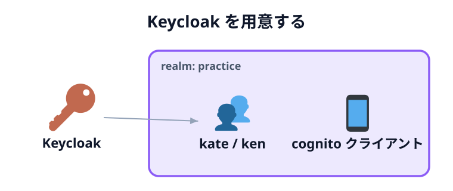

# Keycloak を用意する



Cognito にログインを任せてもらう側の IdP として、[Keycloak](https://www.keycloak.org/) を立てます。Keycloak は OpenID Connect（OIDC）に素直に従う IdP なので、「外部 IdP とのつなぎ方」の基本を学ぶのに向いています。社内の認証基盤や Google・Auth0 なども、同じ OIDC の考え方でつながります。

このレクチャーで足す・変えるファイルは次のとおりです。Keycloak はコンテナで動かすので、`compose.yaml` にサービスを 1 つ足します。

::changes

## Keycloak を足す

`compose.yaml` に `keycloak` サービスを足します。設定の意味は、下の「realm を読み込む」と「発行者の名前を固定する」で説明します。

::file{path="compose.yaml"}

Keycloak に読み込ませる realm（ユーザーとクライアントの定義）を `keycloak/realm-practice.json` に置きます。長いので、開いてコピーしてください。

::file{path="keycloak/realm-practice.json"}

discovery から、次のレクチャーで使う値を抜き出すスクリプト **`scripts/keycloak-endpoints.sh`** を作り、`package.json` に足します。

::file{path="scripts/keycloak-endpoints.sh"}

::file{path="package.json"}

## 起動する

`npm run up` は、`compose.yaml` にあるサービスを全部起動します。動いている Floci はそのままで、Keycloak だけが新しく起動します（Floci のデータも消えません）。

```bash
npm run up      # 初回は Keycloak のイメージの取得に数分かかる
npm run keycloak:endpoints
```

```text
issuer                   http://localhost:8080/realms/practice
authorization_endpoint   http://localhost:8080/realms/practice/protocol/openid-connect/auth
token_endpoint           http://localhost:8080/realms/practice/protocol/openid-connect/token
userinfo_endpoint        http://localhost:8080/realms/practice/protocol/openid-connect/userinfo
jwks_uri                 http://localhost:8080/realms/practice/protocol/openid-connect/certs
```

この 5 つが、次のレクチャーで Cognito に登録する値です。管理コンソールは <http://localhost:8080/admin/>（`admin` / `admin`）で開けます。

## realm を読み込む

Keycloak では、ユーザーとクライアントの入れ物を **realm** と呼びます。`keycloak/realm-practice.json` を起動時に読み込ませています（`--import-realm`）。

| 種類 | 名前 | 中身 |
|---|---|---|
| ユーザー | `kate` / `ken` | パスワードはどちらも `Passw0rd!` |
| クライアント | `cognito` | Cognito が Keycloak にログインを頼むときに名乗るクライアント。シークレットあり |

`cognito` クライアントの戻り先は、Cognito の **idpresponse** です。

```json
"redirectUris": ["http://localhost:4566/cognito-idp/oauth2/idpresponse"]
```

Keycloak でログインしたユーザーは、アプリではなくまず Cognito に戻ります。Cognito がそこで Keycloak のトークンを受け取り、自分のトークンに作り直してからアプリへ返します。本物の Cognito なら `https://<ドメイン>.auth.<リージョン>.amazoncognito.com/oauth2/idpresponse` になります。

<http://localhost:8080/realms/practice/account/> を開くと、`kate` でログインできることを確かめられます。

## 発行者の名前を固定する

`compose.yaml` の Keycloak の設定に、2 行入れてあります。

```yaml
KC_HOSTNAME: http://localhost:8080
KC_HOSTNAME_BACKCHANNEL_DYNAMIC: "true"
```

Keycloak は、呼ばれたホスト名でトークンの `iss` を変えます。ところが次のレクチャーでは、ブラウザは `localhost:8080` で、Floci はコンテナの中から `keycloak:8080` で Keycloak を呼びます。このままだと、Floci が受け取るトークンの `iss` が `http://keycloak:8080/...` になり、登録した発行者と合わなくなります。

- `KC_HOSTNAME` … 発行者の名前を `http://localhost:8080` に固定する
- `KC_HOSTNAME_BACKCHANNEL_DYNAMIC` … それでも、サーバー同士の通信（トークン・userinfo）は呼ばれたホスト名のまま受け付ける

## setup.sh はそのまま

Keycloak のユーザーとクライアントは realm のファイルから読み込まれ、Cognito（Floci）には何も作っていないので、`setup.sh` に足す行はありません。

## このレクチャーを終えた handson/

::codeview

:::faq

### realm の中身を変えたのに反映されません

`--import-realm` は、同じ名前の realm がすでにあると読み込みを飛ばします。`npm run down` でコンテナを消してから `npm run up` で起動し直してください（Keycloak はデータを残さない設定です）。Floci も消えるので、そのあと `npm run setup` をやり直します。

### `start-dev` のままで本番に使えますか？

使えません。`start-dev` は HTTP・組み込みの DB・キャッシュ無効などの開発用の設定です。本番では `start` と、HTTPS・外部の DB を設定します。

:::
