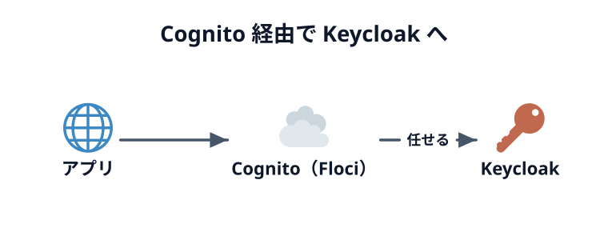
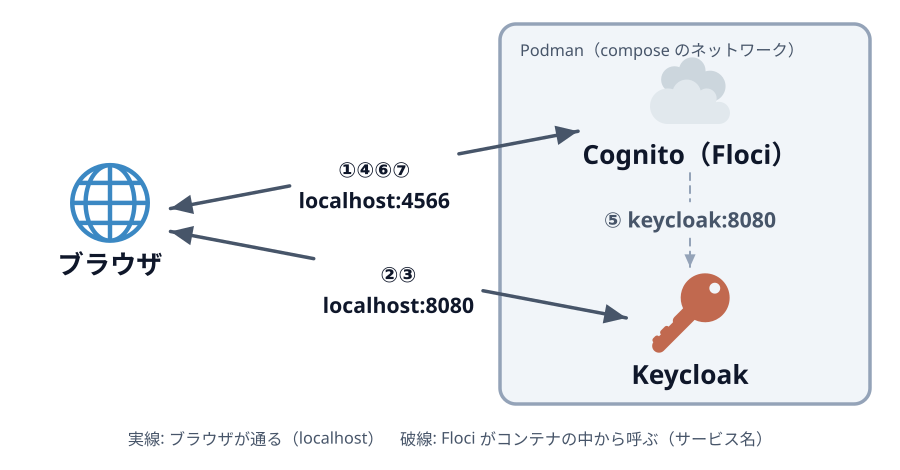

# Cognito 経由で Keycloak にログインする



Keycloak を Cognito の **外部 IdP** として登録し、「Keycloak でログイン」ボタンから Keycloak のユーザーでアプリに入れるようにします。アプリが受け取るのは、Keycloak のトークンではなく **Cognito のトークン** です。だから API は前のレクチャーのまま、何も変えずに動きます。

:::download
[サンプルコードをダウンロード](./project.zip)
:::

## 動かす

```bash
npm install
npm run up                  # Floci と Keycloak
npm run setup               # User Pool・Hosted UI 用のクライアント・alice
npm run register-keycloak   # Keycloak を外部 IdP として登録する
npm run start:dev
```

<http://localhost:3000> に「Keycloak でログイン」のボタンが増えています。押すと Keycloak のログイン画面に移るので、`kate` / `Passw0rd!` でサインインします。画面に戻ってきたら、ID トークンを見てください。

```json
{
  "cognito:username": "Keycloak_50a2c065-919d-400d-8da6-bfe889ca04b5",
  "email": "kate@example.com",
  "identities": "[{\"userId\":\"5727a305-...\",\"providerName\":\"Keycloak\",\"providerType\":\"OIDC\", ...}]",
  "iss": "http://localhost:4566/ap-northeast-1_1f3539781"
}
```

`iss` は Cognito（Floci）です。Keycloak のユーザーが、Cognito の User Pool の中に `Keycloak_<sub>` という名前で作られています。

## 何が起きているか



1. 画面が `identity_provider=Keycloak` を付けて Cognito の `/oauth2/authorize` へ移る
2. Cognito は自分のログイン画面を出さず、Keycloak の `authorize_url` へ転送する
3. ユーザーが Keycloak でパスワードを入れる
4. Keycloak が認可コードを付けて、Cognito の `/oauth2/idpresponse` へ戻す
5. Cognito が Keycloak のトークンエンドポイントでコードをトークンに換え、userinfo で属性を読む
6. Cognito が User Pool にユーザーを作り（2 回目からは同じユーザーを更新し）、**自分の** 認可コードを付けてアプリへ戻す
7. アプリは前のレクチャーと同じく、Cognito の `/oauth2/token` でトークンをもらう

5 は Cognito（Floci）と Keycloak のサーバー同士の通信で、ブラウザは関わりません。

## 外部 IdP を登録する

[scripts/register-keycloak.sh](./scripts/register-keycloak.sh) の中心はこの 1 コマンドです。

```bash
aws cognito-idp create-identity-provider \
  --user-pool-id "$POOL_ID" \
  --provider-name Keycloak \
  --provider-type OIDC \
  --provider-details "client_id=cognito,client_secret=cognito-local-secret,authorize_scopes=openid email profile,
      oidc_issuer=http://localhost:8080/realms/practice,attributes_request_method=GET,
      authorize_url=http://localhost:8080/realms/practice/protocol/openid-connect/auth,
      token_url=http://keycloak:8080/realms/practice/protocol/openid-connect/token,
      attributes_url=http://keycloak:8080/realms/practice/protocol/openid-connect/userinfo,
      jwks_uri=http://keycloak:8080/realms/practice/protocol/openid-connect/certs" \
  --attribute-mapping email=email,email_verified=email_verified,given_name=given_name,family_name=family_name,preferred_username=preferred_username,username=sub
```

（読みやすいように改行していますが、実際は 1 行です）

### エンドポイントを 2 種類の住所で書く

- `authorize_url` … **ブラウザ** が通るので `localhost:8080`
- `token_url`・`attributes_url`・`jwks_uri` … **Floci がコンテナの中から** 呼ぶので、compose のサービス名 `keycloak:8080`

本物の Cognito は AWS の中から呼ぶので、どれもインターネットから届く同じ URL にします。

### 本物の Cognito との違い

本物の Cognito は `oidc_issuer` だけを渡せば、登録のときに discovery を読みに行き、エンドポイントを自分で見つけます（届かなければ登録を拒否します）。Floci は登録のときに外へ問い合わせず、渡された値をそのまま覚えるだけなので、**エンドポイントを全部明示する** 必要があります。

### 属性のマッピング

`--attribute-mapping` は「Cognito の属性 = Keycloak の userinfo のクレーム」の対応です。`username=sub` で、Keycloak の `sub` を Cognito のユーザー名（`Keycloak_<sub>`）の元にしています。

### クライアントで Keycloak を選べるようにする

```bash
aws cognito-idp update-user-pool-client ... --supported-identity-providers COGNITO Keycloak ...
```

:::warning[UpdateUserPoolClient は全部を渡し直す]
`update-user-pool-client` は「渡さなかった設定を既定値に戻す」API です。IdP を足すつもりで `--supported-identity-providers` だけを渡すと、戻り先や OAuth の設定が消えます。スクリプトでは今の設定を全部渡し直しています。本物の Cognito も同じです。
:::

## Keycloak のユーザーを管理者にする

```bash
npm run users
npm run make-admin Keycloak_50a2c065-919d-400d-8da6-bfe889ca04b5   # 自分の出力に置き換える
```

ログインし直すと `GET /admin/dashboard` が 200 になります。Keycloak 側の役割（ロール）は、自動では Cognito のグループになりません。Cognito のグループを Cognito 側で付けるか、属性として持ち込んで（カスタム属性 + マッピング）、アプリや Lambda で扱います。

## コラム: アプリが Keycloak に直結する場合と比べる

Cognito を挟まず、アプリが Keycloak に直接ログインしにいく作りもできます。そうすると、この Cognito が肩代わりしていたことを、アプリが自分でやることになります。

| | Cognito を挟む | アプリが直結する |
|---|---|---|
| API が確かめるトークン | いつも Cognito のトークン | IdP ごとに違う（`iss`・`aud`・ロールの場所が違う） |
| IdP を増やす | Cognito に登録するだけ。API は変えない | API の検証を IdP ごとに増やす |
| ユーザーの台帳 | Cognito の User Pool にまとまる | IdP ごとに分かれる |
| 自前のパスワードユーザーとの混在 | そのまま混ぜられる | 別に作る |

:::faq

### `Identity provider token exchange failed` と表示されます

Cognito（Floci）が Keycloak のトークンエンドポイントでコードを換えられなかった、という意味です。次を確かめてください。

- `token_url` が `keycloak:8080` になっているか（`localhost` だと Floci のコンテナ自身を指してしまう）
- Keycloak のクライアントシークレットと、登録した `client_secret` が同じか
- ほかのプログラム（別の Floci や LocalStack）が 4566 番を使っていないか（`lsof -nP -iTCP:4566 -sTCP:LISTEN`）

### `Identity provider claims request failed` と表示されます

userinfo の呼び出しに失敗しています。Keycloak の `KC_HOSTNAME` を外すと、Floci が受け取るトークンの `iss` が `http://keycloak:8080/...` になり、userinfo に拒否されてこのエラーになります。

### 同じ人が 2 回ログインすると、ユーザーが 2 人になりませんか？

なりません。Cognito は `Keycloak_<sub>` で同じユーザーを探し、属性を更新します（`npm run users` で確かめられます）。

:::
