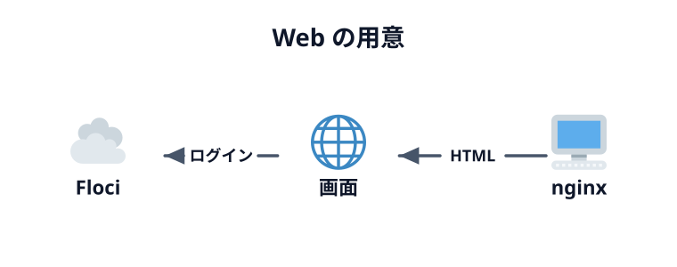

# Web の用意



HTML と JavaScript だけの画面を、Podman の nginx のコンテナで配ります。このレクチャーでは、画面が「どの User Pool に、どのクライアントとしてログインするか」を読み込んで表示するところまでを用意します。サインアップとログインは、次のレクチャーから足していきます。

```text
画面を配る   ブラウザ ◀──index.html・main.js・config.json── nginx のコンテナ（:3000）
```

フレームワークは使いません。画面は `public/` に置いたファイルだけで、nginx がそのまま配ります。「どの User Pool に、どのクライアントとしてログインするか」は、`setup` が書き出す `public/config.json` で画面に渡します。

このレクチャーで足す・変えるファイルは次のとおりです。

::changes

## 準備

`handson/` で作業します。Floci を止めていたときは、起動してから `bash scripts/setup.sh` で前のレクチャーを終えた状態を作り直します。

```bash
podman compose up -d
bash scripts/setup.sh              # 前のレクチャーまでに作ったものを作り直す
```

## 画面を作る

このあと、サインアップ・確認コード・ログインと画面が増えていきます。どの画面でも使う部分は、先に 2 つのファイルにまとめておきます。

- **`public/style.css`** … どの画面でも使う見た目
- **`public/cognito.js`** … `config.json` を読み、Cognito の API の入口（`issuer` のオリジン）を求めます。Floci なら `http://localhost:4566`、本物なら `https://cognito-idp.<リージョン>.amazonaws.com` になります

::file{path="public/style.css"}

::file{path="public/cognito.js"}

トップの画面 **`public/index.html`** は、いまは Cognito の API の入口を出す 1 行だけです。**`public/main.js`** が `cognito.js` から入口を受け取って、画面に出します。

::file{path="public/index.html"}

::file{path="public/main.js"}

## 画面に設定を渡す

画面は、どの User Pool に、どのクライアントとしてログインするかを `public/config.json` から読みます。`create-user-pool.sh` の最後に、`.cognito.env` と同じ値を `public/config.json` にも書き出す数行を足します。

::file{path="scripts/create-user-pool.sh"}

- `issuer` は `http://localhost:4566/<プール ID>`（本物なら `https://cognito-idp.<リージョン>.amazonaws.com/<プール ID>`）、`clientId` はクライアント ID です。どれもブラウザに渡る値で、秘密ではありません
- `setup` で User Pool を作り直すたびに書き直されます。画面は読み込み直すだけで、新しい値を使います

`public/config.json` は手元の環境ごとに中身が違うので、`.gitignore` に足します。

::file{path=".gitignore"}

## Floci と画面を起動する

`compose.yaml` に 2 つ足します。

- `floci` に、ブラウザからの呼び出しを許すオリジン（CORS）。画面（`http://localhost:3000`）は Cognito の API（`http://localhost:4566`）をブラウザから直接呼びます。オリジンが違うので、呼ばれる側の Floci が許す必要があります。本物の Cognito の API は、最初からブラウザからの呼び出しに対応しています
- `public/` をそのまま配る nginx のコンテナ `web`。`./public` をコンテナの中の nginx の公開フォルダにつなぎ、ポート 3000 で配ります

::file{path="compose.yaml"}

起動します。Floci は設定が変わったので作り直されます。**作り直すと Floci のデータは消える** ので、`setup` をやり直します（ここで `setup.sh` を育ててきたことが効きます）。この `setup` で `public/config.json` も書き出されます。

```bash
podman compose up -d
bash scripts/setup.sh
```

## 動作確認する

画面に渡す設定が配られているかを確かめます。

```bash
curl -s localhost:3000/config.json
# { "issuer": "http://localhost:4566/ap-northeast-1_xxxxxxxxx", "clientId": "xxxxxxxxxxxxxxxxxxxxxxxxxx" }
```

<http://localhost:3000> を開き、「Cognito の API: http://localhost:4566」と出れば完成です。

## このレクチャーを終えた handson/

::codeview

:::faq

### 画面を開いたら何も表示されません

`config.json` が無いときは、画面の上に「config.json がありません」と出ます。`bash scripts/setup.sh` を流してから、読み込み直してください。`config.json` に書かれた User Pool が Floci に無いときも、画面の呼び出しは全部失敗します。Floci を作り直したときは `bash scripts/setup.sh` をやり直し、画面を読み込み直してください。開発者ツールの Console に CORS のエラーが出ているときは、`compose.yaml` に `FLOCI_SECURITY_EXTRA_CORS_ALLOWED_ORIGINS` を足したあとに `podman compose up -d` で Floci を作り直したかを確かめてください。

### `podman compose up -d` で、ポート 3000 が使えないと出ます

ほかのプログラムがポート 3000 を使っています。[準備](../../01-setup/01-environment/LECTURE.md) のコマンドで、待ち受けているプログラムを確かめてください。


### ファイルを変えたのに、画面が変わりません

macOS の Podman では、`public/` のファイルを置き換えてから nginx が新しい中身を返すまでに、数秒かかることがあります（エディタによっては、保存のときにファイルを置き換えます）。数秒待ってから、画面を読み込み直してください。
:::
