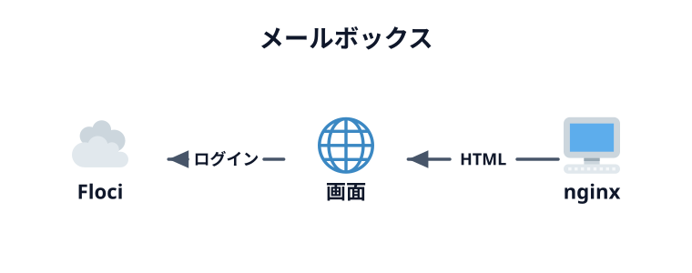

# メールボックス



サインアップすると、Cognito は確認コードを書いたメールを送ります。Floci はそのメールを実際には送らず、手元にためておきます。ためたメールを読む画面（メールボックス）を、サインアップより先に作っておきます。

このレクチャーで足す・変えるファイルは次のとおりです。

::changes

## 準備

`handson/` で作業します。Floci を止めていたときは、起動してから `bash scripts/setup.sh` で前のレクチャーを終えた状態を作り直します。

```bash
podman compose up -d
bash scripts/setup.sh              # 前のレクチャーまでに作ったものを作り直す
```

## 画面を作る

Floci は、Cognito が送るメールを実際には送らず、手元にためておきます（`http://localhost:4566/_aws/ses` で JSON の一覧が読めます）。確認コードを読めるよう、ためたメールを表で出す画面 **`public/mail.html`** を作ります。本物の Cognito にはこの一覧は無く、メールはそのまま利用者に届きます。

::file{path="public/mail.html"}

**`public/mail.js`** が、メールの一覧を読んで表に並べます。

::file{path="public/mail.js"}

- `lib/config.js` から Cognito の API の入口（`http://localhost:4566`）を受け取り、`/_aws/ses` を読みます
- 新しいメールが上に来るよう、一覧を逆順に並べます

トップの画面に、メールボックスへのリンクを足します。

::file{path="public/index.html"}

## 画面から使う

<http://localhost:3000> を開き（開いていたら読み込み直し）、「メールボックス」を開きます。まだ誰もサインアップしていないので、表は空です。次のレクチャーでサインアップすると、ここに確認コードのメールが届きます。

## このレクチャーを終えた handson/

このレクチャーで Floci に残すものは増えていないので、`setup.sh` はそのままです。

::codeview
