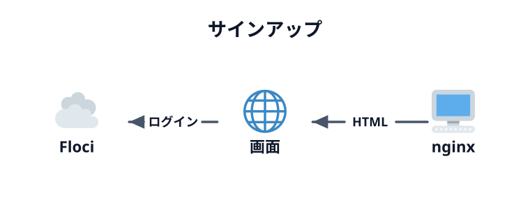

# サインアップ



画面から **Cognito に直接** サインアップし、メールに届いた確認コードで確認します。

```text
サインアップ   ブラウザ ──SignUp・ConfirmSignUp──▶ Cognito（Floci、:4566）
```

このレクチャーで足す・変えるファイルは次のとおりです。

::changes

## 準備

`handson/` で作業します。Floci を止めていたときは、起動してから `bash scripts/setup.sh` で前のレクチャーを終えた状態を作り直します。

```bash
podman compose up -d
bash scripts/setup.sh              # 前のレクチャーまでに作ったものを作り直す
```

## 画面を作る

サインアップの画面と、メールに届いた確認コードを入れる画面を、別々に作ります。

まず、2 つの画面で使う関数を **`public/cognito.js`** に足します。中心は、Cognito の API を 1 つ呼ぶ関数 `cognito()` です。AWS SDK や Amplify が中でしていることを、`fetch` でそのまま書いています。

```js
async function cognito(action, params) {
  const response = await fetch(cognitoEndpoint, {
    method: 'POST',
    headers: {
      'content-type': 'application/x-amz-json-1.1',
      'x-amz-target': `AWSCognitoIdentityProviderService.${action}`,
    },
    body: JSON.stringify({ ClientId: config.clientId, ...params }),
  });
  // ...
}
```

- 送り先は 1 か所で、どの操作かは `x-amz-target` ヘッダーで伝えます。02 で aws CLI が送っていたのと同じ形です
- 送り先（`cognitoEndpoint`）は、`config.json` の `issuer` のオリジンです。Floci なら `http://localhost:4566`、本物なら `https://cognito-idp.<リージョン>.amazonaws.com` になります
- `SignUp`・`ConfirmSignUp`・`InitiateAuth`・`RevokeToken` は、AWS の認証情報（署名）なしで、クライアント ID だけで呼べる API です。ブラウザに秘密を置かずに済みます
- 応答は、画面の「Cognito の応答」の欄（`#output`）にそのまま出します

::file{path="public/cognito.js"}

**`public/signup.html`** は、サインアップの画面です。`SignUp` が成功したら、確認コードを入れる画面へ移ります（ユーザー名を URL に付けて渡します）。

::file{path="public/signup.html"}

**`public/confirm.html`** は、メールに届いた確認コードを入れる画面です。Floci に届いたメールの読み場所へのリンクも置きます。

::file{path="public/confirm.html"}

トップの画面に、2 つの画面へのリンクを足します。

::file{path="public/index.html"}

## 画面から使う

<http://localhost:3000> を開きます（開いていたら読み込み直し）。

1. 「サインアップ」を開き、登録する（例: `carol` / `carol@example.com` / `Passw0rd!`）。「メールを確認する」の画面に移り、ユーザー名が入っている
2. 画面のリンクから <http://localhost:4566/_aws/ses> を開いて確認コードを読み、入れて確認する。「Cognito の応答」に `ConfirmSignUp → 200` が出る
3. 「サインアップ」に戻り、同じユーザー名でもう一度登録してみる → `UsernameExistsException`

開発者ツールの Network タブで、次を確かめてください。

- 要求は `localhost:4566` に飛んでいる
- 要求のヘッダーに `x-amz-target: AWSCognitoIdentityProviderService.SignUp` が付いている
- `localhost:4566` への要求の前に、`OPTIONS` の要求（CORS の下調べ）が出ている

`carol` は `setup` では作られません。Floci を作り直したときは、ここでサインアップし直してください。

## このレクチャーを終えた handson/

このレクチャーで Floci に残すものは増えていないので、`setup.sh` はそのままです。

::codeview

:::faq

### Amplify を使う場合は？

Amplify（`aws-amplify`）の `signIn` も、中では同じように Cognito の API を直接呼んでいます。ただし既定では SRP（パスワードそのものを送らない方式）を使い、送り先も本物の Cognito に固定されています。Floci に向けるには `Amplify.configure` で `userPoolEndpoint` を指定し、`signIn` の `authFlowType` を `USER_PASSWORD_AUTH` にします（このハンズオンでは確かめていません）。

:::
