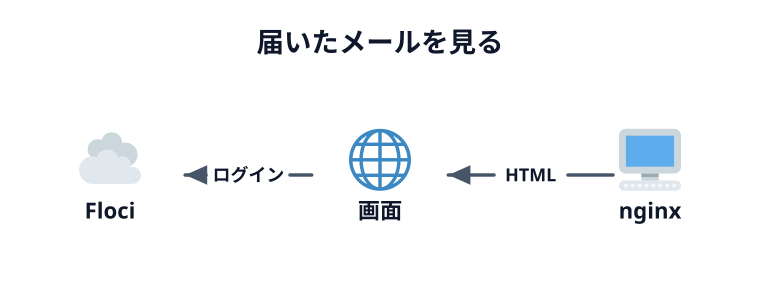

# 届いたメールを見る



前のレクチャーでサインアップすると、Cognito は確認コードを書いたメールを送りました。そのメールを画面で読めるようにします。足すファイルは次のとおりです。

::changes

## 準備

`handson/` で作業します。Floci を止めていたときは、起動してから `bash scripts/setup.sh` で前のレクチャーを終えた状態を作り直します。

```bash
podman compose up -d
bash scripts/setup.sh              # 前のレクチャーまでに作ったものを作り直す
```

## 画面を作る

Floci は、Cognito が送るメールを実際には送らず、手元にためておきます（`http://localhost:4566/_aws/ses` で JSON の一覧が読めます）。確認コードを読めるよう、ためたメールを表で出す画面 **`public/mail.html`** を作ります。本物の Cognito にはこの一覧は無く、メールはそのまま利用者に届きます。

::file{path="public/mail.html"}

- `cognito.js` から Cognito の API の入口（`http://localhost:4566`）を受け取り、`/_aws/ses` を読みます
- 新しいメールが上に来るよう、一覧を逆順に並べます

トップの画面に、メールの画面へのリンクを足します。

::file{path="public/index.html"}

## 画面から使う

<http://localhost:3000> を開き（開いていたら読み込み直し）、「届いたメール」を開きます。前のレクチャーでサインアップした宛先（`carol@example.com`）に、件名 `Your verification code`、本文 `Your verification code is 123456.` のようなメールが出れば完成です。

Floci を作り直したあとなどでメールが無いときは、もう一度サインアップしてから「読み込み直す」を押してください。

## このレクチャーを終えた handson/

::codeview
