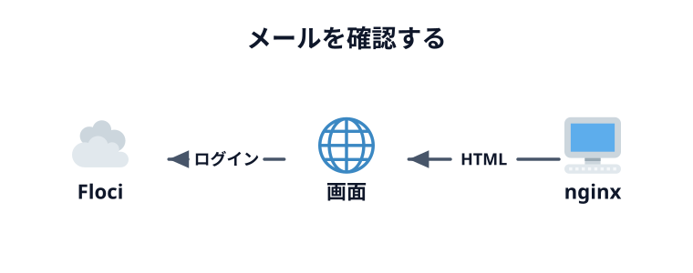

# メールを確認する



メールに届いた確認コードを入れて、サインアップを確定させます（`ConfirmSignUp`）。サインアップのあと、この画面へ自動で移るようにもします。足す・変えるファイルは次のとおりです。

::changes

## 準備

`handson/` で作業します。Floci を止めていたときは、起動してから `bash scripts/setup.sh` で前のレクチャーを終えた状態を作り直します。

```bash
podman compose up -d
bash scripts/setup.sh              # 前のレクチャーまでに作ったものを作り直す
```

## 画面を作る

**`public/confirm.html`** は、メールに届いた確認コードを入れる画面です。URL に `?username=...` が付いていれば、ユーザー名を入れておきます。

::file{path="public/confirm.html"}

**`public/signup.html`** は、`SignUp` が成功したら、確認の画面へ移るように変えます（ユーザー名を URL に付けて渡します）。

::file{path="public/signup.html"}

トップの画面に、確認の画面へのリンクを足します。

::file{path="public/index.html"}

## 画面から使う

<http://localhost:3000> を開きます（開いていたら読み込み直し）。

1. トップの「メールを確認する」を開く。03-02 でサインアップした `carol` と、違うコード（例: `000000`）を入れて「確認する」を押す → `ConfirmSignUp → 失敗` と `CodeMismatchException`
2. 「届いたメール」で `carol@example.com` 宛ての確認コードを読み、入れ直して「確認する」を押す → `ConfirmSignUp → 成功`
3. 「サインアップ」で別の名前を登録する（例: `dave` / `dave@example.com` / `Passw0rd!`）。「メールを確認する」の画面に自動で移り、ユーザー名が入っている

`carol` は `setup` では作られません。Floci を作り直したときは、サインアップからやり直してください。

## このレクチャーを終えた handson/

このレクチャーで Floci に残すものは増えていないので、`setup.sh` はそのままです。

::codeview
