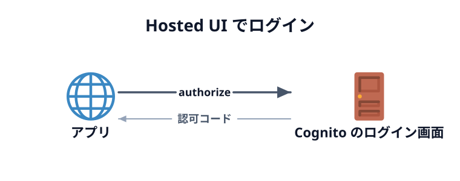

# Hosted UI でログインする



前のレクチャーでは、画面がパスワードの入力欄を持ち、Cognito の API に直接送っていました。このレクチャーでは、**アプリはパスワードに一切触らず**、ログイン画面ごと Cognito に任せます。Cognito が用意するログイン画面を **Hosted UI**（マネージドログイン）と呼びます。

外部の IdP（Entra ID）にログインを任せる「フェデレーション」（05）も、この Hosted UI の仕組みの上に乗っています。まず Cognito 自身のユーザーで、この流れを通します。

前のレクチャーで作った画面に **「Cognito のログイン画面へ」のボタンを足します**。パスワードのフォームはそのまま残し、2 つのログインの方法を並べて見比べられるようにします。足す・変えるファイルは次のとおりです。

::changes

## 準備

`handson/` で作業します。前のレクチャーから続けているなら、`source` の行だけで構いません。Floci を止めていたときは、起動してから `bash scripts/setup.sh` で前のレクチャーを終えた状態を作り直します。

```bash
podman compose up -d
bash scripts/setup.sh              # 前のレクチャーまでに作ったものを作り直す
source ./env.sh && source ./.cognito.env
```

## クライアントに Hosted UI の設定を足す

02-03 で作った App Client は、パスワードを受け取るログイン（`USER_PASSWORD_AUTH`）だけを許しています。Hosted UI を使うには、認可コードフローと、ログイン後に戻ってよい先（コールバック URL）を足します。

```bash
aws cognito-idp update-user-pool-client \
  --user-pool-id "$POOL_ID" --client-id "$CLIENT_ID" \
  --explicit-auth-flows ALLOW_USER_PASSWORD_AUTH ALLOW_REFRESH_TOKEN_AUTH \
  --prevent-user-existence-errors ENABLED \
  --supported-identity-providers COGNITO \
  --callback-urls http://localhost:3000/ \
  --logout-urls http://localhost:3000/ \
  --allowed-o-auth-flows code \
  --allowed-o-auth-scopes openid email profile \
  --allowed-o-auth-flows-user-pool-client
```

- `--supported-identity-providers COGNITO` … ログイン画面で使えるのは Cognito 自身のユーザー（05-04 で Entra ID を足します）
- `--callback-urls` … ログイン後に戻ってよい先。ここに無い URL へは戻さない（コードを盗まれないため）
- `--allowed-o-auth-flows code` … 認可コードフローを許す

:::warning[UpdateUserPoolClient は全部を渡し直す]
`update-user-pool-client` は「渡さなかった設定を既定値に戻す」API です。Hosted UI の設定だけを渡すと、02-03 で付けた `--explicit-auth-flows` が消えて、パスワードでのログイン（CLI・画面のフォーム）ができなくなります。`--prevent-user-existence-errors` も既定値に戻ります。足したい設定だけでなく、今の設定を全部渡し直します。本物の Cognito も同じです。
:::

これを **`scripts/update-client.sh`** にします。05-04 で外部 IdP を足したときに、このスクリプトをもう一度流します。そのとき IdP の一覧を書き直さなくて済むよう、`--supported-identity-providers` には User Pool に登録してある IdP を全部並べるようにしてあります（今は 1 つも無いので `COGNITO` だけです）。

::file{path="scripts/update-client.sh"}

`setup.sh` にも 1 行足します。

::file{path="scripts/setup.sh"}

```bash
bash scripts/update-client.sh
```

## 画面にボタンを足す

`public/index.html` に「Hosted UI でログイン」の欄を足します。

::file{path="public/index.html"}

## 認可コードフローと PKCE

ボタンを押してから戻ってくるまでに、次のことが起きています（開発者ツールの Network タブで追えます）。

1. 画面が `code_verifier`（ランダムな文字列）を作り、そのハッシュ `code_challenge` を付けて `/oauth2/authorize` へ移る
2. Cognito がログイン画面を出し、ユーザーがパスワードを入れる
3. Cognito が **認可コード** を付けて、登録された戻り先（`http://localhost:3000/?code=...`）へ戻す
4. 画面が認可コードと `code_verifier` を `/oauth2/token` に送り、トークンを受け取る

認可コードは URL に載るので、横取りされるかもしれません。PKCE では、最初に送ったハッシュの元（`code_verifier`）を知っている人しかコードをトークンに換えられません。Floci も、`code_verifier` が合わないと `invalid_grant` を返します。

`public/main.js` の後ろに、この流れをライブラリなしで足します。

```js
const verifier = randomString();
const challenge = base64url(await crypto.subtle.digest('SHA-256', new TextEncoder().encode(verifier)));
const state = randomString();
// ...
const params = {
  client_id: config.clientId,
  response_type: 'code',
  redirect_uri: redirectUri,
  scope: 'openid email profile',
  state,
  code_challenge: challenge,
  code_challenge_method: 'S256',
};
// ...
const url = new URL(discovery.authorization_endpoint);
url.search = new URLSearchParams(params);
location.assign(url);
```

認可・トークンのエンドポイントは、User Pool の discovery（`<iss>/.well-known/openid-configuration`）から読んでいます。Floci では `http://localhost:4566/cognito-idp/oauth2/authorize`、本物では `https://<ドメイン>.auth.<リージョン>.amazoncognito.com/oauth2/authorize` です。

トークンエンドポイントの応答は `id_token` のような snake_case なので、パスワードでログインしたときと同じ形（`idToken`）にそろえて持ちます。こうしておくと、ID トークンの中身を出す部分とログアウトは、前のレクチャーのまま使えます。

::file{path="public/main.js"}

## 動かす

<http://localhost:3000> を開き（開いていたら読み込み直し）、「Cognito のログイン画面へ」を押します。Floci のログイン画面に移るので、03-02 で画面からサインアップした `carol` / `Passw0rd!` でサインインします（Floci を作り直したときは、03-02 の手順で画面からサインアップし直してください）。画面に戻ってきて、ID トークンの中身が表示されれば成功です。下の「パスワードでログイン」のフォームも、これまでどおり使えます。

2 つの方法でログインして、ID トークンの中身を見比べてください。どちらも同じ User Pool・同じクライアントが出したトークンなので、`iss` と `aud` は同じです。アプリから見ると、どちらの方法でログインしたかは区別しなくて済みます。

## ログアウトとトークンの置き場所

画面はもらったトークンを `sessionStorage` に置き、「ログアウト」で次の 3 つをします。

1. `RevokeToken`（前のレクチャーで作ったもの）でリフレッシュトークンを取り消す。Hosted UI でもらったトークンも同じクライアントのものなので、同じ API で取り消せます（`/oauth2/revoke` を呼んでも同じです）
2. 手元のトークンを消す
3. Cognito の `/logout` に移り、Hosted UI 側のログイン状態（Cookie）も消す（このレクチャーで足した部分）

1 を省くと、トークンが盗まれていた場合、ログアウトしたあとも使われ続けます。リフレッシュトークンは既定で 30 日有効なので、その間ずっとアクセストークンを取り直せてしまいます。

:::warning[本番でのトークンの置き場所]
`sessionStorage` は、ページに XSS があると JavaScript から読まれてしまう場所です（前のレクチャーの注意と同じです）。この画面のようにブラウザが `/oauth2/token` を直接呼ぶ作りでは、httpOnly の Cookie に置くことはできません。本番では、トークンの交換をサーバー側で行い、ブラウザとは httpOnly の Cookie のセッションでやり取りする形（BFF: Backend for Frontend）を検討してください。
:::

## パスワードのフォームは残す？

本番で Hosted UI に寄せるなら、パスワードのフォームは消し、App Client の `ExplicitAuthFlows` から `ALLOW_USER_PASSWORD_AUTH` も外せます。アプリがパスワードに一切触らなくなるのが、Hosted UI のいちばんの利点です。このハンズオンでは、見比べるためと、04 で CLI からパスワードでログインするために残しています。

## このレクチャーを終えた handson/

::codeview

:::faq

### ログアウトしたのに、次のログインでパスワードを聞かれません

Hosted UI 側にもログイン状態（Cookie）が残っているからです。この画面のログアウトは、トークンを捨てたあと Cognito の `/logout` に移って、そちらの状態も消しています。

### `state` は何のためにありますか？

ログイン画面から戻ってきた応答が、自分が出した要求への応答かを確かめるためです。別のサイトに仕込まれたリンクから、攻撃者の認可コードで戻されるのを防ぎます（CSRF 対策）。

### 画面を開いたら何も表示されません

`config.json` に書かれた User Pool が Floci に無いと、discovery が読めません。Floci を作り直したときは `bash scripts/setup.sh` をやり直し、画面を読み込み直してください（前のレクチャーの FAQ も参照）。

:::
