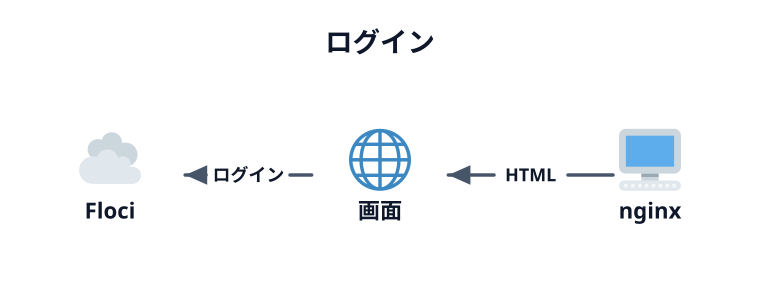

# ログイン



画面からパスワードでログインし、受け取ったトークンを保存して、ログイン中の画面に移ります。ログイン中の画面には、誰でログインしているかと ID トークンの中身を出し、ログアウトもできるようにします。

```text
ログイン     ブラウザ ──InitiateAuth──▶ Cognito（Floci、:4566）
ログアウト   ブラウザ ──RevokeToken──▶ Cognito（Floci、:4566）
```

このレクチャーで足す・変えるファイルは次のとおりです。

::changes

## 準備

`handson/` で作業します。Floci を止めていたときは、起動してから `bash scripts/setup.sh` で前のレクチャーを終えた状態を作り直します。

```bash
podman compose up -d
bash scripts/setup.sh              # 前のレクチャーまでに作ったものを作り直す
```

## 画面を置く

ログインの画面（`login.html`）と、ログイン中の画面（`home.html`）を置きます。

::download{dir="public"}

上のボタンで、このレクチャーを終えた `public/` をダウンロードし、`handson/` の中で展開して上書きします（`setup` が書き出す `public/config.json` は ZIP に入っていないので、そのまま残ります）。

ログインは、aws CLI の `initiate-auth` と同じ `InitiateAuth`（`USER_PASSWORD_AUTH`）です（`login.js`）。

```js
const result = await client.send(new InitiateAuthCommand({
  ClientId: config.clientId,
  AuthFlow: 'USER_PASSWORD_AUTH',
  AuthParameters: { USERNAME: username, PASSWORD: password },
}));
```

- 成功したら、受け取ったトークンを保存して、ログイン中の画面へ移ります。トークンは、どの画面からも読めるように `sessionStorage` に置きます（**`public/lib/tokens.js`** の `saveTokens`・`getTokens`）
- ログイン中の画面（`home.js`）は、保存したトークンがあれば、`cognito:username` と ID トークンの中身を出します。中身は、ID トークンの真ん中（ペイロード）を Base64URL から戻して読みます（`tokens.js` の `decodeJwt`）。署名は確かめていません（表示するだけなので）。トークンの中身と署名の確かめ方は、05 でコマンドを使って詳しく見ます
- 「ログアウト」は、手元のトークンを消す前に `RevokeToken` でリフレッシュトークンを Cognito で取り消します。消すだけにすると、もしトークンが盗まれていた場合、ログアウトしたあとも使われ続けます（リフレッシュトークンは既定で 30 日有効です）

## 画面から使う

<http://localhost:3000> の「ログイン」を開きます（開いていたら読み込み直し）。

1. 前のレクチャーでサインアップして確認した `carol` / `Passw0rd!` でログインする。ログイン中の画面に移り、「carol としてログイン中」と、ID トークンの中身（`cognito:username`・`email`・`iss`・`aud` など）が出る
2. 画面を読み込み直しても、ログイン中のまま（開発者ツールの Application タブの Session Storage に `tokens` が入っている）
3. 「ログアウト」を押す。ログインの画面に戻る。トップから「ログイン中の画面」を開くと、「ログインしていません」と出る
4. パスワードを間違えてログインしてみる → 「ユーザー名かパスワードが違います」と出る（Network タブの応答は `NotAuthorizedException`）
5. いないユーザー名でログインしてみる → 同じく「ユーザー名かパスワードが違います」と出る（応答は `UserNotFoundException`）
6. 「サインアップ」で新しく登録し、確認せずにログインしてみる → 「メールの確認が済んでいません…」と出る（応答は `UserNotConfirmedException`）

開発者ツールの Network タブで、次を確かめてください。

- ログインの要求は `localhost:4566` に飛び、`localhost:3000`（画面を配る nginx）には飛んでいない。**パスワードはサーバーを通りません**
- 要求のヘッダーに `x-amz-target: AWSCognitoIdentityProviderService.InitiateAuth` が付いている

:::warning[エラーは画面を通らずに届く]
画面が Cognito を直接呼ぶので、Cognito のエラー（`UsernameExistsException`・`UserNotFoundException` など）はブラウザにそのまま届きます。この画面は、いないユーザーでもパスワード違いと同じ文を出していますが、Network タブを見れば元の例外が分かります。言い換えると、画面を使わなくても、誰でも同じ API を呼んで同じ応答を見られます。

ユーザーが存在するかを隠せるのは、App Client の `PreventUserExistenceErrors: ENABLED`（02-03 で付けました）だけです。本物の Cognito では、存在しないユーザーへのログインも、パスワード違いと同じ `NotAuthorizedException` になります。**Floci ではこの設定が効かず**、`UserNotFoundException` が返ります。
:::

:::warning[トークンの置き場所]
この画面はトークンを `sessionStorage` に置いています。ページに XSS があると JavaScript から読まれてしまう場所です。いちばん危ないのは **リフレッシュトークン** で、一度盗まれると期限までアクセストークンを取り直され続けます。本番では、トークンをサーバー側で持ち、ブラウザとは httpOnly の Cookie のセッションでやり取りする形（BFF: Backend for Frontend）や、リフレッシュトークンの有効期限を短くすることを検討してください。
:::

:::note[パスワードを画面で受け取るのは練習のため]
この画面は、アプリ自身がパスワードの入力欄を持っています。本番では、ログイン画面ごと Cognito に任せる **Hosted UI**（03-05 で説明します）を勧めます。アプリがパスワードに一切触らなくなり、多要素認証や外部 IdP（Entra ID）もそのまま使えるからです。ここでは、Cognito の API とトークンの流れを目で追うために、あえて自分で呼んでいます。
:::

## このレクチャーを終えた handson/

このレクチャーで Floci に残すものは増えていないので、`setup.sh` はそのままです。

::codeview

:::faq

### 本物の Cognito でも `USER_PASSWORD_AUTH` を使ってよいですか？

HTTPS の上でなら、パスワードは暗号化されて Cognito に届きます。ただ、ブラウザから使うなら、パスワードそのものを送らない SRP（`USER_SRP_AUTH`、Amplify の既定）や、Hosted UI（03-05）のほうが安全です。使わないログインの方法は、App Client の `ExplicitAuthFlows` から外しておきます。

:::
