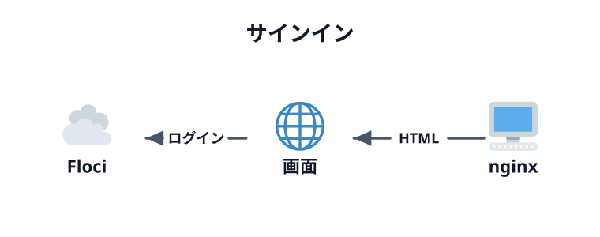

# サインイン



画面からパスワードでサインインし、トークンを受け取って保存します。

```text
サインイン   ブラウザ ──InitiateAuth──▶ Cognito（Floci、:4566）
```

このレクチャーで足す・変えるファイルは次のとおりです。

::changes

## 準備

`handson/` で作業します。Floci を止めていたときは、起動してから `bash scripts/setup.sh` で前のレクチャーを終えた状態を作り直します。

```bash
podman compose up -d
bash scripts/setup.sh              # 前のレクチャーまでに作ったものを作り直す
```

## 画面を作る

ログインは、aws CLI の `initiate-auth` と同じ `InitiateAuth`（`USER_PASSWORD_AUTH`）です。返ってきた ID トークンの真ん中（ペイロード）を Base64URL から戻し、画面に出します。署名は確かめていません（表示するだけなので）。トークンの中身と署名の確かめ方は、05 でコマンドを使って詳しく見ます。

```js
const result = await client.send(new InitiateAuthCommand({
  ClientId: config.clientId,
  AuthFlow: 'USER_PASSWORD_AUTH',
  AuthParameters: { USERNAME: username, PASSWORD: password },
}));
```

受け取ったトークンを、どの画面からも読めるように `sessionStorage` に保存します。保存と読み出しの関数を **`public/cognito.js`** に足します。

::file{path="public/cognito.js"}

**`public/signin.html`** は、サインインの画面です。成功したら、トークンを保存します。

::file{path="public/signin.html"}

トップの画面に、サインインの画面へのリンクを足します。

::file{path="public/index.html"}

## 画面から使う

<http://localhost:3000> の「サインイン」を開きます（開いていたら読み込み直し）。

1. 前のレクチャーでサインアップして確認した `carol` / `Passw0rd!` でサインインする。「Cognito の応答」に `InitiateAuth → 成功` と `AuthenticationResult`（`IdToken`・`AccessToken`・`RefreshToken`）が出る
2. パスワードを間違えてサインインしてみる → `NotAuthorizedException`
3. 「サインアップ」で新しく登録し、確認せずにサインインしてみる → `UserNotConfirmedException`

開発者ツールの Network タブで、次を確かめてください。

- サインインの要求は `localhost:4566` に飛び、`localhost:3000`（画面を配る nginx）には飛んでいない。**パスワードはサーバーを通りません**
- 要求のヘッダーに `x-amz-target: AWSCognitoIdentityProviderService.InitiateAuth` が付いている

:::warning[エラーはそのまま画面に届く]
画面が Cognito を直接呼ぶので、Cognito のエラー（`UsernameExistsException`・`UserNotConfirmedException` など）はそのまま画面に届きます。言い換えると、画面を使わなくても、誰でも同じ API を呼んで同じ応答を見られます。

ユーザーが存在するかを隠せるのは、App Client の `PreventUserExistenceErrors: ENABLED`（02-03 で付けました）だけです。本物の Cognito では、存在しないユーザーへのログインも、パスワード違いと同じ `NotAuthorizedException` になります。**Floci ではこの設定が効かず**、`UserNotFoundException` が返ります。
:::

:::warning[トークンの置き場所]
この画面はトークンを `sessionStorage` に置いています。ページに XSS があると JavaScript から読まれてしまう場所です。いちばん危ないのは **リフレッシュトークン** で、一度盗まれると期限までアクセストークンを取り直され続けます。本番では、トークンをサーバー側で持ち、ブラウザとは httpOnly の Cookie のセッションでやり取りする形（BFF: Backend for Frontend）や、リフレッシュトークンの有効期限を短くすることを検討してください。
:::

:::note[パスワードを画面で受け取るのは練習のため]
この画面は、アプリ自身がパスワードの入力欄を持っています。本番では、ログイン画面ごと Cognito に任せる **Hosted UI**（03-06 で説明します）を勧めます。アプリがパスワードに一切触らなくなり、多要素認証や外部 IdP（Entra ID）もそのまま使えるからです。ここでは、Cognito の API とトークンの流れを目で追うために、あえて自分で呼んでいます。
:::

## このレクチャーを終えた handson/

このレクチャーで Floci に残すものは増えていないので、`setup.sh` はそのままです。

::codeview

:::faq

### 本物の Cognito でも `USER_PASSWORD_AUTH` を使ってよいですか？

HTTPS の上でなら、パスワードは暗号化されて Cognito に届きます。ただ、ブラウザから使うなら、パスワードそのものを送らない SRP（`USER_SRP_AUTH`、Amplify の既定）や、Hosted UI（03-06）のほうが安全です。使わないログインの方法は、App Client の `ExplicitAuthFlows` から外しておきます。

:::
