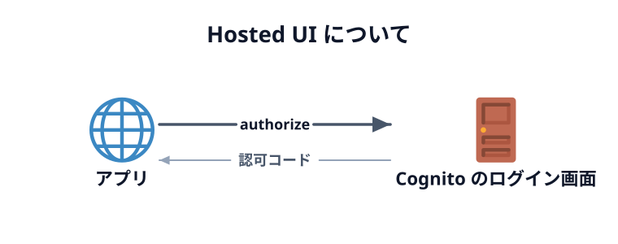

# Hosted UI について



ここまでは、サインアップ・ログインの画面を自分で作り、Cognito の API を直接呼びました。Cognito には、ログイン画面そのものを Cognito が用意する **Hosted UI**（マネージドログイン）もあります。このハンズオンでは Cognito 自身のユーザーには使いませんが、04 で Entra ID のユーザーでログインするときに、同じ仕組みを使います。

## Hosted UI とは

アプリは Cognito のログイン画面（`/oauth2/authorize`）へ移るだけで、パスワードを入れる画面は Cognito が出します。ログインが終わると、Cognito は **認可コード** を付けてアプリに戻し、アプリはそのコードをトークンに換えます（認可コードフロー）。

| | 自分で作る画面（03） | Hosted UI |
|---|---|---|
| パスワードを受け取るのは | アプリの画面 | Cognito の画面 |
| 呼ぶもの | `SignUp`・`InitiateAuth` などの API | `/oauth2/authorize` と `/oauth2/token` |
| 多要素認証・外部 IdP（Entra ID など） | 自分で作る | Cognito の画面がそのまま扱う |

本番では、アプリがパスワードに一切触らずに済む Hosted UI を勧めます。

## このハンズオンで Cognito のユーザーに使わない理由

Floci の Hosted UI には、ログインの画面しかありません。サインアップ・確認コード・パスワードを忘れたときの画面が無いので、03 の流れ（メールボックス → サインアップ → ログイン）を Hosted UI だけでは通せません。本物の Cognito の Hosted UI には、これらの画面があります。

## 試してみる

画面のコードは足さずに、コマンドとブラウザだけで、Floci の Hosted UI でログインしてみます。03-03 でサインアップして確認した `carol` を使います。

### 準備

```bash
podman compose up -d
source ./env.sh && source ./.cognito.env
```

### App Client に認可コードフローを許す

02-03 で作った App Client は、パスワードを受け取るログイン（`USER_PASSWORD_AUTH`）だけを許しています。認可コードフローと、ログインのあとに戻ってよい先（コールバック URL）を足します。

```bash
aws cognito-idp update-user-pool-client \
  --user-pool-id "$POOL_ID" --client-id "$CLIENT_ID" \
  --explicit-auth-flows ALLOW_USER_PASSWORD_AUTH ALLOW_REFRESH_TOKEN_AUTH \
  --prevent-user-existence-errors ENABLED \
  --supported-identity-providers COGNITO \
  --callback-urls http://localhost:3000/ \
  --logout-urls http://localhost:3000/ \
  --allowed-o-auth-flows code \
  --allowed-o-auth-scopes openid email profile \
  --allowed-o-auth-flows-user-pool-client
```

| オプション | 設定する値 | 意味 |
|---|---|---|
| `--user-pool-id` / `--client-id` | `"$POOL_ID"` / `"$CLIENT_ID"` | どの App Client を変えるか |
| `--explicit-auth-flows` | `ALLOW_USER_PASSWORD_AUTH ALLOW_REFRESH_TOKEN_AUTH` | 今の設定（パスワードでのログインと更新）。渡し直さないと消える |
| `--prevent-user-existence-errors` | `ENABLED` | 今の設定。渡し直さないと既定値に戻る |
| `--supported-identity-providers` | `COGNITO` | 使ってよい IdP。`COGNITO` は User Pool 自身のユーザー |
| `--callback-urls` | `http://localhost:3000/` | ログインのあとに戻ってよい先。ここに無い URL へは戻さない（認可コードを盗まれないため） |
| `--logout-urls` | `http://localhost:3000/` | ログアウトのあとに戻ってよい先 |
| `--allowed-o-auth-flows` | `code` | 認可コードフローを許す |
| `--allowed-o-auth-scopes` | `openid email profile` | 渡してよいスコープ。ID トークンにメールや名前を載せる |
| `--allowed-o-auth-flows-user-pool-client` | （値なし） | この App Client で、上の OAuth の設定を使うことを有効にする |

`update-user-pool-client` は「渡さなかった設定を既定値に戻す」API なので、今の設定（`--explicit-auth-flows` など）も全部渡し直します。この設定は `setup.sh` には入れていないので、Floci を作り直すと元に戻ります（04-04 で、もう一度設定します）。

### ログインの URL を作る

PKCE の値を作ります。`VERIFIER`（ランダムな文字列）は手元に残し、そのハッシュ `CHALLENGE` だけを URL に付けます。

```bash
VERIFIER=$(openssl rand -hex 32)
CHALLENGE=$(printf '%s' "$VERIFIER" | openssl dgst -sha256 -binary | openssl base64 -A | tr '+/' '-_' | tr -d '=')
echo "http://localhost:4566/cognito-idp/oauth2/authorize?response_type=code&client_id=$CLIENT_ID&redirect_uri=http%3A%2F%2Flocalhost%3A3000%2F&scope=openid+email+profile&code_challenge=$CHALLENGE&code_challenge_method=S256"
```

| 値 | 作り方・中身 | 意味 |
|---|---|---|
| `VERIFIER` | `openssl rand -hex 32`（ランダムな 64 文字） | 手元に残す合言葉（`code_verifier`）。あとでトークンに換えるときに送る |
| `CHALLENGE` | `VERIFIER` の SHA-256 を base64url にしたもの | `VERIFIER` のハッシュ（`code_challenge`）。こちらだけを先に渡す |

URL に付けるパラメータは次のとおりです。

| パラメータ | 設定する値 | 意味 |
|---|---|---|
| `response_type` | `code` | 認可コードを返してもらう |
| `client_id` | `$CLIENT_ID` | どの App Client としてログインするか |
| `redirect_uri` | `http://localhost:3000/`（URL の中なので `%3A%2F%2F...` と書く） | ログインのあとに戻る先。App Client の `--callback-urls` と同じでないと断られる |
| `scope` | `openid email profile` | 欲しい情報。`openid` で ID トークンがもらえる |
| `code_challenge` | `$CHALLENGE` | `VERIFIER` のハッシュ |
| `code_challenge_method` | `S256` | ハッシュの作り方（SHA-256） |

### ブラウザでログインする

出てきた URL をブラウザで開きます。Floci のログイン画面（Hosted UI）が出るので、`carol` / `Passw0rd!` でログインします。ログインが終わると、トップ（`http://localhost:3000/?code=...`）に戻ってきます。アドレス欄の `code=` のあとの値が **認可コード** です。

### 認可コードをトークンに換える

認可コードと `VERIFIER` を、トークンのエンドポイントに送ります。`{ }` の所は、アドレス欄の値に書き換えてから実行します（`{ }` ごと消します）。

```bash "{アドレス欄の code= のあとの値}"
CODE={アドレス欄の code= のあとの値}
curl -s -X POST http://localhost:4566/cognito-idp/oauth2/token \
  -H 'content-type: application/x-www-form-urlencoded' \
  -d grant_type=authorization_code \
  -d client_id="$CLIENT_ID" \
  -d code="$CODE" \
  --data-urlencode redirect_uri=http://localhost:3000/ \
  -d code_verifier="$VERIFIER" | jq 'keys'
# ["access_token", "expires_in", "id_token", "refresh_token", "token_type"]
```

| 送る値 | 設定する値 | 意味 |
|---|---|---|
| `-X POST` と `content-type` | `application/x-www-form-urlencoded` | フォームの形で送る（トークンのエンドポイントの決まり） |
| `grant_type` | `authorization_code` | 認可コードをトークンに換える |
| `client_id` | `$CLIENT_ID` | どの App Client か |
| `code` | `$CODE` | ブラウザで受け取った認可コード |
| `redirect_uri` | `http://localhost:3000/` | ログインの URL に付けたのと同じ戻り先。違うと断られる |
| `code_verifier` | `$VERIFIER` | 手元に残した合言葉。`CHALLENGE` の元になった値でないと断られる |

パスワードはアプリ（`localhost:3000`）を一度も通らず、アプリが受け取ったのは認可コードだけです。そのコードも、`VERIFIER` を知らなければトークンに換えられません。同じコードでもう一度送ると、`invalid_grant`（一度しか使えない）になります。

## 04 で使うところ

Entra ID のユーザーでログインするときは、アプリは `/oauth2/authorize` に `identity_provider=EntraID` を付けて移ります。Cognito は自分のログイン画面を飛ばして、Entra のサインイン画面へ回します。Entra でのサインインが終わると、Cognito が認可コードを付けてアプリに戻します。この認可コードフロー（と PKCE）の書き方は、04-04 で扱います。
