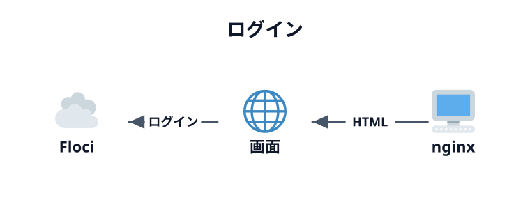

# ログイン



サインインして受け取ったトークンを使って、ログイン中の画面を作ります。誰でログインしているかと ID トークンの中身を出し、サインアウトもできるようにします。

このレクチャーで足す・変えるファイルは次のとおりです。

::changes

## 準備

`handson/` で作業します。Floci を止めていたときは、起動してから `bash scripts/setup.sh` で前のレクチャーを終えた状態を作り直します。

```bash
podman compose up -d
bash scripts/setup.sh              # 前のレクチャーまでに作ったものを作り直す
```

## 画面を作る

ID トークンの真ん中（ペイロード）を Base64URL から戻して読む関数を、**`public/cognito.js`** に足します。署名は確かめていません（表示するだけなので）。トークンの中身と署名の確かめ方は、04 でコマンドを使って詳しく見ます。

::file{path="public/cognito.js"}

**`public/home.html`** は、ログイン中の画面です。保存したトークンがあれば、`cognito:username` と ID トークンの中身を出します。

「サインアウト」は、手元のトークンを消す前に `RevokeToken` でリフレッシュトークンを Cognito で取り消します。消すだけにすると、もしトークンが盗まれていた場合、サインアウトしたあとも使われ続けます（リフレッシュトークンは既定で 30 日有効です）。

::file{path="public/home.html"}

サインインの画面は、成功したらログイン中の画面へ移るように変えます。

::file{path="public/signin.html"}

トップの画面に、ログイン中の画面へのリンクを足します。

::file{path="public/index.html"}

## 画面から使う

<http://localhost:3000> の「サインイン」を開きます（開いていたら読み込み直し）。

1. `carol` / `Passw0rd!` でサインインする。ログイン中の画面に移り、「carol としてログイン中」と、ID トークンの中身（`cognito:username`・`email`・`iss`・`aud` など）が出る
2. 画面を読み込み直しても、ログイン中のまま（トークンは `sessionStorage` に残っている）
3. 「サインアウト」を押す。サインインの画面に戻る
4. トップから「ログイン中の画面」を開くと、「ログインしていません」と出る

## このレクチャーを終えた handson/

このレクチャーで Floci に残すものは増えていないので、`setup.sh` はそのままです。

::codeview
