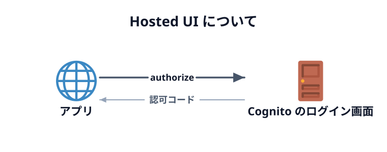

# Hosted UI について

ここまでは、サインアップ・サインインの画面を自分で作り、Cognito の API を直接呼びました。Cognito には、ログイン画面そのものを Cognito が用意する **Hosted UI**（マネージドログイン）もあります。このハンズオンでは Cognito 自身のユーザーには使いませんが、05 で Entra ID のユーザーでサインインするときに、同じ仕組みを使います。

## Hosted UI とは

アプリは Cognito のログイン画面（`/oauth2/authorize`）へ移るだけで、パスワードを入れる画面は Cognito が出します。ログインが終わると、Cognito は **認可コード** を付けてアプリに戻し、アプリはそのコードをトークンに換えます（認可コードフロー）。

| | 自分で作る画面（03） | Hosted UI |
|---|---|---|
| パスワードを受け取るのは | アプリの画面 | Cognito の画面 |
| 呼ぶもの | `SignUp`・`InitiateAuth` などの API | `/oauth2/authorize` と `/oauth2/token` |
| 多要素認証・外部 IdP（Entra ID など） | 自分で作る | Cognito の画面がそのまま扱う |

本番では、アプリがパスワードに一切触らずに済む Hosted UI を勧めます。

## このハンズオンで Cognito のユーザーに使わない理由

Floci の Hosted UI には、ログインの画面しかありません。サインアップ・確認コード・パスワードを忘れたときの画面が無いので、03 の流れ（メールボックス → サインアップ → サインイン → ログイン）を Hosted UI だけでは通せません。本物の Cognito の Hosted UI には、これらの画面があります。

## 05 で使うところ

Entra ID のユーザーでサインインするときは、アプリは `/oauth2/authorize` に `identity_provider=EntraID` を付けて移ります。Cognito は自分のログイン画面を飛ばして、Entra のサインイン画面へ回します。Entra でのサインインが終わると、Cognito が認可コードを付けてアプリに戻します。この認可コードフロー（と PKCE）の書き方は、05-04 で扱います。
