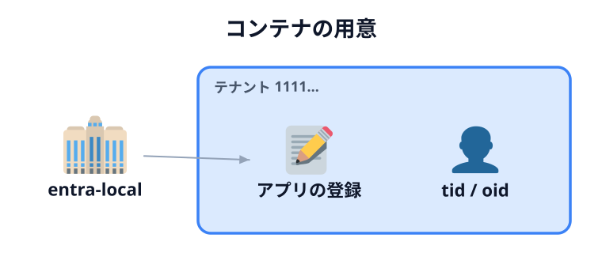

# entra-local を用意する



Microsoft Entra ID（旧 Azure AD）を外部 IdP にする練習をします。本物の Entra テナントを使わず、手元で Entra ID を真似する [entra-local](https://github.com/cmaneu/entra-local) を使います。

## Entra ID はローカルで再現できるか

entra-local は、MSAL（Microsoft の認証ライブラリ）が話す OIDC / OAuth 2.0 の範囲を真似します。

| 再現できる | 再現できない |
|---|---|
| discovery・JWKS・authorize・token・userinfo | SAML 2.0（Cognito に SAML で登録する練習はできない） |
| 認可コード（+ PKCE）・クライアントクレデンシャル・リフレッシュ・デバイスコード | MFA・条件付きアクセス・同意画面 |
| アプリの登録・シークレット・ユーザー・グループ | マルチテナント（テナントは 1 つだけ） |
| `tid`・`oid` など Entra 特有のクレーム | Graph API の大部分 |

本物と違う点もあります。entra-local の userinfo は `oid` を返しますが、本物の Entra の userinfo は返しません（`oid` は ID トークンにだけ入る）。

Cognito に OIDC で登録する練習には十分です。

:::danger[ローカル専用の道具です]
entra-local は、管理 API に認証が無く、シードのユーザーとパスワードが公開されている「わざと緩い」道具です。自分のパソコンの中だけで使い、本物のパスワードを入れないでください。compose でも `127.0.0.1` にだけ公開しています。
:::

:::download
[サンプルコードをダウンロード](./project.zip)
:::

## 起動する

```bash
npm run up          # Floci と entra-local
npm run endpoints
```

```text
issuer                   http://localhost:8443/11111111-1111-1111-1111-111111111111/v2.0
authorization_endpoint   http://localhost:8443/11111111-1111-1111-1111-111111111111/oauth2/v2.0/authorize
token_endpoint           http://localhost:8443/11111111-1111-1111-1111-111111111111/oauth2/v2.0/token
userinfo_endpoint        http://localhost:8443/graph/oidc/userinfo
jwks_uri                 http://localhost:8443/11111111-1111-1111-1111-111111111111/discovery/v2.0/keys
```

`11111111-...` が **テナント ID** です。本物の Entra でも、URL の途中にテナント ID が入り、`/v2.0` で終わる issuer になります。管理ポータルは <http://localhost:8443/> で開けます。

[compose.yaml](./compose.yaml) の entra-local の設定:

```yaml
image: ghcr.io/cmaneu/entra-local:0.1.1
platform: linux/amd64
environment:
  TLS_ENABLED: "false"
  PUBLIC_ORIGIN: http://localhost:8443
  REQUIRE_PASSWORD: "true"
```

- `platform: linux/amd64` … amd64 向けのイメージしか無いため。Apple Silicon の Mac ではエミュレーションで動き、起動に少し時間がかかります
- `TLS_ENABLED: "false"` … entra-local は既定で自己署名証明書の HTTPS で動きます。次のレクチャーで Floci がコンテナの中から entra-local を呼ぶとき、証明書を信頼させる手間を省くために HTTP にしています（本物の Entra は必ず HTTPS です）
- `REQUIRE_PASSWORD: "true"` … 既定はアカウントを選ぶだけでサインインできます。本物に近づけるため、パスワードを求めます

:::::platform
::::macos
Apple Silicon の Mac は、`podman machine` の仮想マシンに amd64 のエミュレーションが入っているので、そのまま動きます（手元では起動まで 10 秒ほど）。
::::
::::windows-linux
ARM のパソコン（Raspberry Pi・ARM の VM・Windows on ARM の WSL2 など）では、amd64 のエミュレーションを先に入れないと `exec format error` で起動しません。x86_64（amd64）のパソコンなら、この手順は要りません。

```bash
sudo apt-get install -y qemu-user-static
```
::::
:::::

エミュレーションの下では起動もヘルスチェックも遅くなるので、compose.yaml のヘルスチェックは待ち時間を長め（`start_period: 60s`・`timeout: 15s`）にしてあります。それでも `container is unhealthy` で止まるときは、`podman compose logs entra-local` でログを見てください。

## アプリを登録する

Entra では、Entra にログインを頼むアプリを **アプリの登録** として登録し、クライアント ID とシークレットをもらいます。ここでは「Cognito」を 1 つのアプリとして登録します（[scripts/register-app.sh](./scripts/register-app.sh)）。

```bash
npm run register-app
# 登録しました（クライアント ID: 542d7c9b-...）。シークレットは .entra.env にあります
```

スクリプトの中では、entra-local の管理 API に次のように登録しています（スクリプトがやるので、自分で打つ必要はありません）。

```bash
curl -X POST http://localhost:8443/admin/api/apps -H 'content-type: application/json' -d '{
  "displayName": "Cognito (Floci)",
  "isConfidential": true,
  "redirectUris": [{ "uri": "http://localhost:4566/cognito-idp/oauth2/idpresponse", "type": "web" }]
}'
```

- `isConfidential: true` … サーバー（Cognito）がシークレットを持つアプリ
- リダイレクト URI … Keycloak のときと同じく、Cognito の **idpresponse**

シークレットの値は、作ったときに一度だけ返ります（本物の Entra と同じです）。スクリプトはそれを `.entra.env` に控えています。このファイルはリポジトリに入れません。

## ユーザーを作って、トークンの中身を見る

```bash
npm run create-user taro '山田 太郎'      # taro@entralocal.dev / Passw0rd!
npm run preview-token taro@entralocal.dev
```

`preview-token` は、entra-local の管理 API で「このアプリに、このユーザーがサインインしたら出る ID トークン」を見せてくれます（`claims` の部分）。

```json
"claims": {
  "iss": "http://localhost:8443/11111111-1111-1111-1111-111111111111/v2.0",
  "sub": "7AVwZdeJEDtlOYPBd5JlCISHoby578la6SIPMq3Q27Q",
  "aud": "542d7c9b-2abd-4c55-9788-6dba155eaba0",
  "tid": "11111111-1111-1111-1111-111111111111",
  "oid": "82de800f-ad8c-42ac-bfef-bda7a2aa40ea",
  "name": "山田 太郎",
  "preferred_username": "taro@entralocal.dev",
  "email": "taro@entralocal.dev",
  "ver": "2.0",
  ...
}
```

Entra 特有のクレーム:

- `tid` … テナント ID。どの組織のユーザーか
- `oid` … ユーザーのオブジェクト ID。**テナントの中で、そのユーザーにずっと同じ値**
- `sub` … OIDC の標準のユーザー ID。ただし Entra では **アプリごとに違う値** になる（pairwise）
- `preferred_username` … サインインに使う名前（UPN）。人が読むためのもので、変わることがある

### `sub` はアプリごとに変わる

アプリをもう 1 つ登録して、同じ taro のトークンを見比べます。`register-app` は `.entra.env` を書き換えるので、今のアプリ（A）の控えを別の名前で残してから登録します。

```bash
cp .entra.env .entra.a.env          # アプリ A の控え
rm .entra.env && npm run register-app   # アプリ B を登録（.entra.env は B になる）

npm run preview-token taro@entralocal.dev | grep -E '"(aud|sub|oid)"'                       # B
ENTRA_ENV=.entra.a.env npm run preview-token taro@entralocal.dev | grep -E '"(aud|sub|oid)"'  # A
```

```text
B  "sub": "uqTHzCX6JXcJFCb5-L3lRrPXqRtQHv0jVVFJHrRAA70"  "aud": "462a0ca8-..."  "oid": "82de800f-ad8c-42ac-bfef-bda7a2aa40ea"
A  "sub": "7AVwZdeJEDtlOYPBd5JlCISHoby578la6SIPMq3Q27Q"  "aud": "542d7c9b-..."  "oid": "82de800f-ad8c-42ac-bfef-bda7a2aa40ea"
```

`aud`（どのアプリ向けか）と一緒に `sub` も変わり、`oid` は同じです。

アプリをまたいで「同じ人」を見分けたいなら `oid`（と `tid`）を使います。次のレクチャーで、`oid` を Cognito の属性に持ち込みます。

:::faq

### HTTPS のまま使えませんか？

使えますが、Floci のコンテナに entra-local の自己署名証明書を信頼させる必要があります（このハンズオンでは試していません）。証明書は entra-local の管理ポータルの「Trust the certificate」からダウンロードできます。

### データを消したいときは？

ユーザーやアプリ登録は、entra-local のデータボリュームに SQLite で残ります。`npm run reset`（`podman compose down -v` してから起動し直す）でボリュームごと消えます。残っている間は、`npm run register-app` は登録済みのアプリを使い続け、`npm run create-user` は既にいるユーザーを表示するだけなので、手順を上から流し直しても止まりません。

:::
