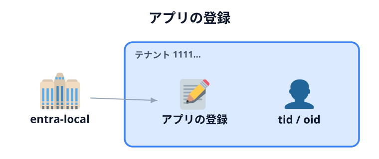

# アプリの登録



Entra ID に、ログインを頼むアプリ（ここでは Cognito）を登録します。足す・変えるファイルは次のとおりです。

::changes

## 準備

`handson/` で作業します。Floci を止めていたときは、起動して entra-local が応答するのを確かめてから、`bash scripts/setup.sh` で前のレクチャーを終えた状態を作り直します。

```bash
podman compose up -d
curl -s http://localhost:8443/health   # "status":"ok" が返ってから次へ
bash scripts/setup.sh
```

## アプリを登録する

Entra では、Entra にログインを頼むアプリを **アプリの登録** として登録し、クライアント ID とシークレットをもらいます。ここでは「Cognito」を 1 つのアプリとして登録します。本物の Entra ならポータルの画面で操作するところを、entra-local の管理 API に送ります。

```bash
APP_ID=$(curl -s -X POST http://localhost:8443/admin/api/apps -H 'content-type: application/json' -d '{
  "displayName": "Cognito (Floci)",
  "isConfidential": true,
  "redirectUris": [{ "uri": "http://localhost:4566/cognito-idp/oauth2/idpresponse", "type": "web" }]
}' | jq -r .id)
echo "$APP_ID"
```

- `isConfidential: true` … サーバー（Cognito）がシークレットを持つアプリ
- リダイレクト URI … Cognito の **idpresponse**。Entra でのサインインが終わると、ブラウザはアプリではなく Cognito に戻ります。Cognito はそこで Entra のトークンを受け取り、自分のトークンに換えてからアプリに戻します

## シークレットを作る

Cognito が Entra にトークンをもらいに行くときの合言葉（クライアントシークレット）を作ります。

```bash
SECRET=$(curl -s -X POST "http://localhost:8443/admin/api/apps/$APP_ID/secrets" -H 'content-type: application/json' \
  -d '{"displayName":"cognito"}' | jq -r .secretText)
echo "$SECRET"
```

シークレットの値は、作ったときに一度だけ返ります（本物の Entra と同じです）。あとから読み直せないので、クライアント ID と一緒に **`.entra.env`** に控えます。

```bash
cat > .entra.env <<ENV
export ENTRA_TENANT_ID=11111111-1111-1111-1111-111111111111
export ENTRA_CLIENT_ID=$APP_ID
export ENTRA_CLIENT_SECRET=$SECRET
ENV
cat .entra.env
```

`.entra.env` にはシークレットが入るので、`.gitignore` に足します（次のレクチャーで作るアプリの控え `.entra.a.env` なども入れないよう、`.entra.*.env` も足します）。

::file{path=".gitignore"}

管理ポータル <http://localhost:8443/> の「App registrations」にも、登録したアプリが出ます。

## このレクチャーを終えた handson/

::codeview
