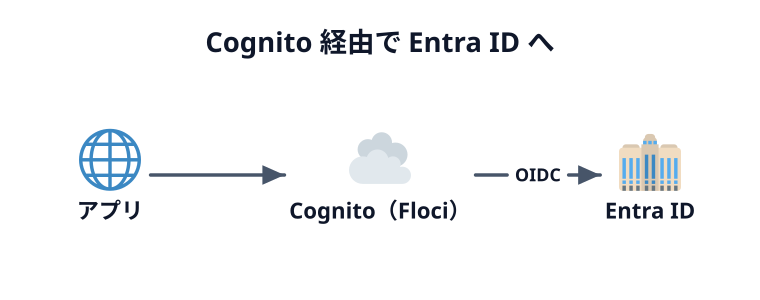

# Cognito 経由で Entra ID にログインする



entra-local を Cognito の外部 IdP（OIDC）として登録し、「EntraID でログイン」で Entra のユーザーをアプリに入れます。やることは Keycloak のときとほぼ同じです。違いは Entra に特有の部分、とくに **ユーザーを何で見分けるか** です。

このレクチャーで足す・変えるファイルは次のとおりです。Keycloak のときと同じく、API と画面には手を入れません。

::changes

## 準備

`handson/` で作業します。前のレクチャーから続けているなら、`source` の行だけで構いません。Floci を止めていたときは、起動してから `npm run setup` で前のレクチャーを終えた状態を作り直します。

```bash
npm run up
npm run setup              # 前のレクチャーまでに作ったものを作り直す
source ./env.sh && source ./.cognito.env
```

## 外部 IdP を登録する

**`scripts/register-entra.sh`** を作ります。中心は、Keycloak のときと同じ `create-identity-provider` です。値は 04-01 で控えた `.entra.env` から読みます。

```bash
aws cognito-idp create-identity-provider \
  --user-pool-id "$POOL_ID" \
  --provider-name EntraID \
  --provider-type OIDC \
  --provider-details "client_id=$ENTRA_CLIENT_ID,client_secret=$ENTRA_CLIENT_SECRET,
      authorize_scopes=openid email profile,
      oidc_issuer=http://localhost:8443/$ENTRA_TENANT_ID/v2.0,attributes_request_method=GET,
      authorize_url=http://localhost:8443/$ENTRA_TENANT_ID/oauth2/v2.0/authorize,
      token_url=http://entra-local:8443/$ENTRA_TENANT_ID/oauth2/v2.0/token,
      attributes_url=http://entra-local:8443/graph/oidc/userinfo,
      jwks_uri=http://entra-local:8443/$ENTRA_TENANT_ID/discovery/v2.0/keys" \
  --attribute-mapping email=email,name=name,preferred_username=preferred_username,custom:entra_oid=oid,username=sub
```

- `oidc_issuer` は **v2.0 の、自分のテナントの issuer** にします。Entra には `common`（どのテナントでも可）というエンドポイントもありますが、Cognito に登録するのは自分のテナントのものです
- ブラウザが通る `authorize_url` だけ `localhost`、Floci がコンテナの中から呼ぶものはサービス名 `entra-local`。考え方は Keycloak と同じです

## `oid` を持ち込む

前のレクチャーで見たとおり、Entra の `sub` はアプリごとに変わります。本物の Cognito のユーザー名 `EntraID_<sub>` も、Entra にとっての「Cognito というアプリ」向けの値です。あとで別のアプリから同じ人を探したくなったとき、`sub` では見つかりません。

そこで、テナントの中で変わらない `oid` をカスタム属性 `custom:entra_oid` に持ち込みます。

1. User Pool にカスタム属性を足す。01-01 で作った User Pool に、あとから足します（`register-entra.sh` の最初）
   ```bash
   aws cognito-idp add-custom-attributes --user-pool-id "$POOL_ID" \
     --custom-attributes Name=entra_oid,AttributeDataType=String,Mutable=true
   ```
2. 属性のマッピングで `oid` を入れる: `custom:entra_oid=oid`
3. App Client で読み取りを許す: `--read-attributes ... custom:entra_oid`（`update-client.sh` に足す）

`register-entra.sh` の全体です。最後に、Keycloak のときと同じく `update-client.sh` と `write-api-env.sh` を呼びます。

::file{path="scripts/register-entra.sh"}

`update-client.sh` には、読み取りを許す属性を足します。

::file{path="scripts/update-client.sh"}

`list-users.sh` には、`custom:entra_oid` の列を足します。

::file{path="scripts/list-users.sh"}

`package.json` に `register-entra` を、`setup.sh` に 1 行足します。

::file{path="package.json"}

::file{path="scripts/setup.sh"}

## 動かす

```bash
npm run register-entra
npm run start:dev          # 起動していたら、止めて起動し直す（.env を読み直すため）
```

<http://localhost:3000> に「EntraID でログイン」のボタンが増えています（Keycloak のボタンもそのまま並びます）。押して、entra-local のサインイン画面で `taro@entralocal.dev` / `Passw0rd!` を入れます。戻ってきたら ID トークンを見てください。

```json nofile
{
  "cognito:username": "EntraID_272c8101-ef40-41cb-bd40-ed64f04a6546",
  "custom:entra_oid": "daa6ae20-6153-4193-a9f7-9f8cc48bbf34",
  "name": "山田 太郎",
  "preferred_username": "taro@entralocal.dev",
  "email": "taro@entralocal.dev",
  "iss": "http://localhost:4566/ap-northeast-1_16130330b"
}
```


:::warning[本物の Entra の userinfo には `oid` が無い]
entra-local は userinfo（`/graph/oidc/userinfo`）でも `oid` を返すので、ここではそこから入ります。本物の Entra ID の userinfo が返すのは `sub`・`name`・`family_name`・`given_name`・`picture`・`email` だけで、`oid` は **ID トークンにしか入りません**（`profile` スコープが必要）。本物の Cognito で `custom:entra_oid` が埋まるかは、Cognito が ID トークンのクレームもマッピングに使うかにかかっており、このハンズオンでは確かめていません。本物のテナントにつないだら、まず `npm run users` で `custom:entra_oid` が入っているかを確かめてください。
:::

```bash
npm run users
```

```text
|        Email        |               EntraOid                 |  Status    |                   Username                     |
|  alice@example.com  |  None                                  |  CONFIRMED |  alice                                         |
|  taro@entralocal.dev|  daa6ae20-6153-4193-a9f7-9f8cc48bbf34  |  CONFIRMED |  EntraID_272c8101-ef40-41cb-bd40-ed64f04a6546  |
```

:::notice[カスタム属性は足せるが、変えられない]
Cognito のカスタム属性は、あとから足すことはできますが、一度作ると名前も型も変えられず、消すこともできません。本番の User Pool では、名前を慎重に決めてから足してください。
:::

## Entra 固有の落とし穴

本物の Entra ID につなぐときに踏みやすいところです。entra-local で再現できるものと、できないものがあります。

- **テナントごとの issuer と `common`** … `https://login.microsoftonline.com/<テナント ID>/v2.0` が issuer です。`common` や `organizations` のエンドポイントで発行されたトークンも、`iss` には個々のテナント ID が入ります。Cognito に登録する `oidc_issuer` は自分のテナントのものにします
- **`email` が来ないことがある** … Entra の `email` は、ユーザーにメールアドレスが設定されていないと入りません。必ずある `preferred_username`（UPN）と混同しないこと。Cognito の属性で `email` を必須にしていると、ログインに失敗する人が出ます
- **`email` で人を結び付けない** … Entra の `email` は、ユーザーやテナントの管理者が設定できる値で、そのアドレスを持っていることは確かめられていません。Cognito でも、外部 IdP から入れた `email` は既定で未確認の扱いです。既存のユーザーとの結び付け（`AdminLinkProviderForUser` など）や、アプリでの人の特定には `email` を使わず、`oid`（と `tid`）か Cognito の `sub` を使ってください。別人のアドレスを名乗った Entra のユーザーに、アカウントを乗っ取られるおそれがあります
- **グループの overage** … `groups` クレームを有効にしても、所属が多い（ID トークンで 200 を超える）ユーザーでは一覧の代わりに「Graph で引いてください」という印（`_claim_names`）が入ります。entra-local でも `groupOverageLimit` で再現できます
- **シークレットの期限切れ** … Entra のクライアントシークレットには期限があります（既定は 6 か月〜2 年）。切れると Cognito からのトークン交換が失敗し、全員がログインできなくなります。期限を管理しておくこと

## このレクチャーを終えた handson/

これで `handson/` は完成です。01-01 の `create-user-pool.sh` 1 つから始まって、Cognito のユーザー・トークン・API・画面・コンテナ・Keycloak・Entra ID と、1 つずつ足してきました。`setup.sh` を開くと、その順番がそのまま並んでいます。

::codeview

:::faq

### entra-local のサインイン画面で「Invalid redirect URI」と出ます

アプリの登録のリダイレクト URI と、Cognito（Floci）が送ってくる `redirect_uri`（`http://localhost:4566/cognito-idp/oauth2/idpresponse`）が 1 文字でも違うと拒否されます。`.entra.env` を消してから `npm run entra:register-app` で登録し直し、`npm run register-entra` で Cognito 側の登録も新しいクライアント ID とシークレットに合わせます。そのあと API を起動し直してください。

### Entra のアプリロールやグループで認可したいときは？

本物の Entra では、アプリロールをユーザーに割り当てると ID トークンの `roles` クレームに入ります。属性のマッピングでカスタム属性に持ち込めば、API で読めます。entra-local もアプリロールの定義はできますが、ユーザーへの割り当てまではこのハンズオンでは試していません。

:::
