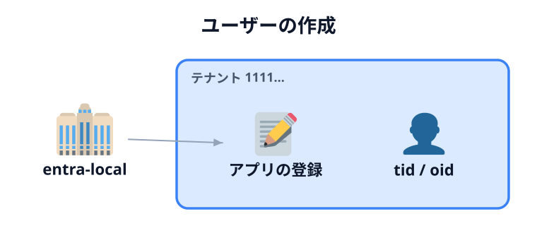

# ユーザーの作成



entra-local にユーザーを作り、そのユーザーがサインインしたら出るトークンの中身を見ます。このレクチャーで作るファイルはありません。

## 準備

`handson/` で作業します。Floci を止めていたときは、起動して entra-local が応答するのを確かめてから、`bash scripts/setup.sh` で前のレクチャーを終えた状態を作り直します。

```bash
podman compose up -d
curl -s http://localhost:8443/health   # "status":"ok" が返ってから次へ
bash scripts/setup.sh
```

## ユーザーを作る

entra-local の管理 API で、ユーザー `taro@entralocal.dev` を作ります。

```bash
USER_ID=$(curl -s -X POST http://localhost:8443/admin/api/users -H 'content-type: application/json' -d '{
  "userPrincipalName": "taro@entralocal.dev",
  "displayName": "山田 太郎",
  "mail": "taro@entralocal.dev",
  "password": "Passw0rd!"
}' | jq -r .id)
echo "$USER_ID"
```

entra-local のデータはボリュームに残るので、2 回目は「既にいる」と断られます。そのときは、作ってあるユーザーの ID を読みます。

```bash
USER_ID=$(curl -s "http://localhost:8443/admin/api/users?search=taro@entralocal.dev" | jq -r '.value[0].id')
```

## トークンの中身を見る

entra-local の管理 API は、「このアプリに、このユーザーがサインインしたら出る ID トークン」を見せてくれます。前のレクチャーで控えた `.entra.env` からアプリのクライアント ID を読みます。

```bash
source ./.entra.env
curl -s -X POST "http://localhost:8443/admin/api/apps/$ENTRA_CLIENT_ID/token-preview" -H 'content-type: application/json' \
  -d "{\"userId\":\"$USER_ID\",\"tokenType\":\"idToken\"}" | jq .claims
```

出てくるのがトークンの中身です。

```json nofile
{
  "iss": "http://localhost:8443/11111111-1111-1111-1111-111111111111/v2.0",
  "sub": "7AVwZdeJEDtlOYPBd5JlCISHoby578la6SIPMq3Q27Q",
  "aud": "542d7c9b-2abd-4c55-9788-6dba155eaba0",
  "tid": "11111111-1111-1111-1111-111111111111",
  "oid": "82de800f-ad8c-42ac-bfef-bda7a2aa40ea",
  "name": "山田 太郎",
  "preferred_username": "taro@entralocal.dev",
  "email": "taro@entralocal.dev",
  "ver": "2.0",
  ...
}
```

Entra 特有のクレーム:

- `tid` … テナント ID。どの組織のユーザーか
- `oid` … ユーザーのオブジェクト ID。**テナントの中で、そのユーザーにずっと同じ値**
- `sub` … OIDC の標準のユーザー ID。ただし Entra では **アプリごとに違う値** になる（pairwise）
- `preferred_username` … サインインに使う名前（UPN）。人が読むためのもので、変わることがある

## `sub` はアプリごとに変わる

アプリをもう 1 つ（B）登録して、同じ taro のトークンを見比べます。見比べるだけなので、シークレットは作りません。

```bash
APP_B=$(curl -s -X POST http://localhost:8443/admin/api/apps -H 'content-type: application/json' \
  -d '{"displayName":"App B","isConfidential":true}' | jq -r .id)

for APP in "$ENTRA_CLIENT_ID" "$APP_B"; do
  curl -s -X POST "http://localhost:8443/admin/api/apps/$APP/token-preview" -H 'content-type: application/json' \
    -d "{\"userId\":\"$USER_ID\",\"tokenType\":\"idToken\"}" | jq -c '.claims | {aud, sub, oid}'
done
```

```text
{"aud":"542d7c9b-...","sub":"7AVwZdeJEDtlOYPBd5JlCISHoby578la6SIPMq3Q27Q","oid":"82de800f-ad8c-42ac-bfef-bda7a2aa40ea"}
{"aud":"462a0ca8-...","sub":"uqTHzCX6JXcJFCb5-L3lRrPXqRtQHv0jVVFJHrRAA70","oid":"82de800f-ad8c-42ac-bfef-bda7a2aa40ea"}
```

`aud`（どのアプリ向けか）と一緒に `sub` も変わり、`oid` は同じです。

アプリをまたいで「同じ人」を見分けたいなら `oid`（と `tid`）を使います。次のレクチャーで、`oid` を Cognito の属性に持ち込みます。

