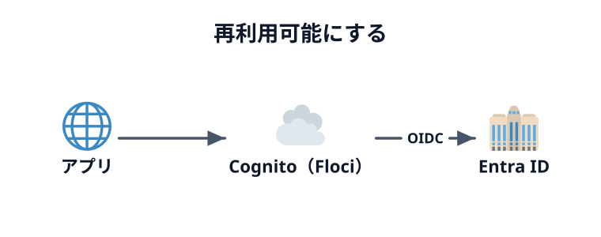

# 再利用可能にする



04-02〜04-04 で手で打ったコマンドを、スクリプトにします。Floci を作り直すと、User Pool と一緒に IdP の登録や App Client の設定も消えます。entra-local のアプリとユーザーはボリュームに残りますが、`podman compose down -v` で消したときにも戻せるようにします。最後に `setup.sh` に足して、`bash scripts/setup.sh` 1 回で、Entra ID でログインできる状態まで作り直せるようにします。

足すファイルは次のとおりです。

::changes

## 準備

`handson/` で作業します。

```bash
podman compose up -d
curl -s http://localhost:8443/health   # "status":"ok" が返ってから次へ
source ./env.sh
```

## アプリを登録するスクリプト

04-02 のアプリの登録とシークレットの作成を **`scripts/entra-register-app.sh`** にします。entra-local のデータはボリュームに残るので、`.entra.env` に控えたアプリがまだあれば、登録し直さずにそれを使います（流すたびに同じ名前のアプリが増えないように）。

::file{path="scripts/entra-register-app.sh"}

## ユーザーを作るスクリプト

04-03 のユーザーの作成を **`scripts/entra-create-user.sh`** にします。既にいるときは作らずに、そのユーザーを表示します。

::file{path="scripts/entra-create-user.sh"}

## IdP を登録するスクリプト

04-04 の App Client の設定の変更を **`scripts/update-client.sh`** にします。`--supported-identity-providers` には、User Pool に登録してある IdP を全部並べます。IdP が増えても、書き直さずに流し直すだけで済みます。

::file{path="scripts/update-client.sh"}

04-04 のカスタム属性の追加と IdP の登録を **`scripts/register-entra.sh`** にします。カスタム属性はあれば足さず、IdP は登録済みなら `update-identity-provider` で上書きします。最後に `update-client.sh` を呼びます。

::file{path="scripts/register-entra.sh"}

## setup.sh に足す

3 つのスクリプトを `setup.sh` に足します。どれも、既にあれば作らずに使うので、何度流しても構いません。

::file{path="scripts/setup.sh"}

## 動作確認する

Floci を作り直して（User Pool・IdP の登録・App Client の設定が消える）、`setup` で作り直します。

```bash
podman compose down
podman compose up -d
curl -s http://localhost:8443/health   # "status":"ok" が返ってから次へ
bash scripts/setup.sh
```

最後に `EntraID を登録しました` と出れば完成です。<http://localhost:3000> の「ログイン」を開き（開いていたら読み込み直し）、「Entra ID でログイン」で `taro@entralocal.dev` / `Passw0rd!` を入れると、ログイン中の画面に移ります。

:::note[Entra のサインインが残っているとき]
前のレクチャーで Entra にサインインしたままだと、パスワードを聞かれずにそのまま戻ってきます（04-04 の FAQ を参照）。
:::

## このレクチャーを終えた handson/

::codeview

:::faq

### `bash scripts/setup.sh` が entra-local のところで止まります

entra-local がまだ起動しきっていないことがあります。`curl -s http://localhost:8443/health` で `"status":"ok"` が返るのを確かめてから、もう一度流してください。

:::
