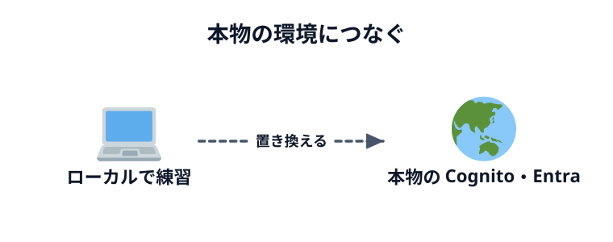

# 本物の Entra テナントと Cognito につなぐ（任意）



ここまでの練習を、本物の Entra ID テナントと本物の Cognito で組むときの手順をまとめます。AWS アカウントと Entra テナントの管理者権限が必要です。

:::warning[このページの手順は確かめていません]
このハンズオンを作るときに、本物の環境では動かしていません。ローカルで確かめた手順を、AWS と Microsoft の公式の設定項目に置き換えたものです。画面の名前や既定値は変わることがあります。
:::

## ローカルとの対応

| ローカル | 本物 |
|---|---|
| Floci の `http://localhost:4566` | `https://cognito-idp.<region>.amazonaws.com` |
| Floci の Hosted UI（`/cognito-idp/oauth2/*`） | `https://<ドメイン>.auth.<region>.amazoncognito.com/oauth2/*` |
| entra-local の `http://localhost:8443/<テナント>` | `https://login.microsoftonline.com/<テナント>` |
| `authorize_url` などを明示 | `oidc_issuer` だけで、Cognito が discovery を読む |
| サービス名（`entra-local:8443`）と `localhost` の使い分け | どれもインターネットから届く同じ URL |

## 1. Cognito を用意する

1. User Pool を作る。カスタム属性 `custom:entra_oid`（String・変更可）を足す
2. **ドメイン** を作る（Cognito のプレフィックスドメインなら `https://<プレフィックス>.auth.<region>.amazoncognito.com`）
3. App Client を作る。シークレットなし、認可コードフロー、スコープ `openid email profile`、コールバック URL にアプリの URL。aws CLI で作るなら `--prevent-user-existence-errors ENABLED` を付ける（付けないと `LEGACY` になり、存在しないユーザーで `UserNotFoundException` が返る）

## 2. Entra でアプリを登録する

1. Entra 管理センター →「アプリの登録」→「新規登録」
2. サポートされているアカウントの種類: 「この組織ディレクトリのみ」（シングルテナント）
3. リダイレクト URI（Web）: `https://<プレフィックス>.auth.<region>.amazoncognito.com/oauth2/idpresponse`
4. 「証明書とシークレット」でクライアントシークレットを作り、**値** を控える（画面を離れると二度と見えない）。期限を決め、更新の予定を立てる
5. 「概要」のアプリケーション（クライアント）ID と、ディレクトリ（テナント）ID を控える
6. 必要なら「トークン構成」で `email` などの省略可能な要求を足す

## 3. Cognito に Entra を登録する

```bash
aws cognito-idp create-identity-provider \
  --user-pool-id <プール ID> \
  --provider-name EntraID \
  --provider-type OIDC \
  --provider-details "client_id=<アプリケーション ID>,client_secret=<シークレット>,authorize_scopes=openid email profile,oidc_issuer=https://login.microsoftonline.com/<テナント ID>/v2.0,attributes_request_method=GET" \
  --attribute-mapping email=email,name=name,preferred_username=preferred_username,custom:entra_oid=oid,username=sub
```

続けて、App Client の `--supported-identity-providers` に `EntraID` を足します（ほかの設定も全部渡し直します）。

`custom:entra_oid=oid` は、entra-local では userinfo から入りました。本物の Entra の userinfo は `oid` を返さず、`oid` は ID トークンにだけ入ります。ログインしたあと、Cognito のユーザーに `custom:entra_oid` が入っているかを確かめてください（未確認の点です）。

## 4. アプリを向け直す

画面が読む `public/config.json` を、本物の User Pool とクライアントの値にします。

```json
{ "issuer": "https://cognito-idp.ap-northeast-1.amazonaws.com/ap-northeast-1_xxxxxxxxx", "clientId": "xxxxxxxxxxxxxxxxxxxxxxxxxx" }
```

画面は discovery から本物の Hosted UI のエンドポイントを読むので、`public/` の変更は要りません。App Client のコールバック URL に `http://localhost:3000/` を入れておけば、手元の画面から本物の Cognito と Entra でログインできます。`identity_provider=EntraID` を使うので、IdP の名前は `EntraID` で登録してください。

## SAML で登録する場合

Entra は SAML でも Cognito とつなげます（ローカルの Floci と entra-local はどちらも SAML に未対応なので、このハンズオンでは練習できません）。OIDC との主な違い:

| | OIDC | SAML |
|---|---|---|
| Entra 側 | アプリの登録 | エンタープライズアプリケーション（SAML シングルサインオン） |
| Cognito に渡すもの | クライアント ID・シークレット・issuer | フェデレーションメタデータの URL か XML |
| Entra の識別子（エンティティ ID） | 使わない | `urn:amazon:cognito:sp:<プール ID>` |
| 応答 URL | `.../oauth2/idpresponse` | `.../saml2/idpresponse` |
| 属性 | userinfo のクレーム名（`oid` など） | SAML 属性の URI（`http://schemas.microsoft.com/identity/claims/objectidentifier` など） |
| シークレットの期限切れ | あり | 無い代わりに、署名証明書の期限切れがある |
