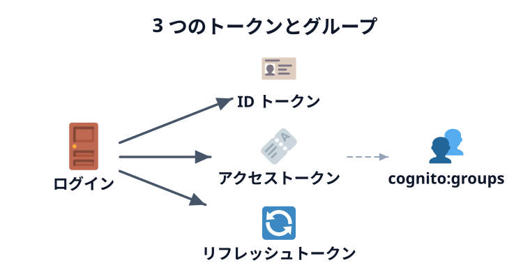

# トークンを読む・グループを使う



ログインに成功すると、Cognito は 3 つのトークンを返します。中身を開いて、それぞれ何のためのものかを確かめます。後半では **グループ** を作り、トークンにグループが載ることを確かめます。

このレクチャーで足すファイルは次のとおりです。ログインとトークンを読むための小さな道具が 2 つと、グループを作るスクリプトです。

::changes

## 準備

`handson/` で作業します。前のレクチャーから続けているなら、`source` の行だけで構いません。Floci を止めていたときは、起動してから `bash scripts/setup.sh` で前のレクチャーを終えた状態を作り直します。

```bash
podman compose up -d
curl -s http://localhost:8443/health   # "status":"ok" が返ってから次へ（entra-local は起動に数秒かかる）
bash scripts/setup.sh              # 前のレクチャーまでに作ったものを作り直す
source ./env.sh && source ./.cognito.env
```

## 3 つのトークン

| トークン | 誰が読むか | 用途 |
|---|---|---|
| ID トークン | アプリ（ログインした画面） | 「誰がログインしたか」を知る。名前やメールが入る |
| アクセストークン | API | 「この API を呼んでよいか」を判断する |
| リフレッシュトークン | アプリ → Cognito | ID・アクセストークンの期限が切れたら、新しいものをもらう |

ID トークンとアクセストークンは **JWT** です。`.` で区切った 3 つの部分（ヘッダー・ペイロード・署名）からなり、前の 2 つは base64url で符号化した JSON です。

## トークンを開く

ログインのたびに長いコマンドを打たなくて済むよう、道具を 2 つ作ります。

1 つ目は **`scripts/login.sh`** です。`initiate-auth` でログインし、返ってきたトークン一式（`AuthenticationResult`）を **`.tokens.json`** に保存します。ユーザー名とパスワードは引数（`$1`・`$2`）で受けます。

::file{path="scripts/login.sh"}

2 つ目は **`scripts/decode-jwt.sh`** です。JWT を `.` で 3 つに分け、前の 2 つを base64url から戻して表示します。署名は確かめません（読むだけです）。

::file{path="scripts/decode-jwt.sh"}

- JSON を扱うのは jq です。`split(".")` で 3 つに分け、`@base64d` で base64 を戻し、`fromjson` で JSON として読みます
- base64url は、普通の base64 の `+` と `/` を URL で使える `-` と `_` に替えたものです。`gsub` で戻してから `@base64d` に渡します
- `iat`・`auth_time`・`exp` は UNIX 秒なので、`todate` で読める形にして横に添えます

`.tokens.json` を `.gitignore` に足します（トークンは手元にだけ置くものです）。

::file{path=".gitignore"}

alice でログインし、ID トークンを開きます。

```bash
bash scripts/login.sh alice 'Passw0rd!'
jq -r .IdToken .tokens.json | bash scripts/decode-jwt.sh
```

`jq -r .IdToken .tokens.json` は、`.tokens.json` の `IdToken` を引用符なしで取り出します。

```json nofile
{
  "header": { "alg": "RS256", "typ": "JWT", "kid": "ap-northeast-1_1644239d1" },
  "payload": {
    "sub": "e1f9945e-1e10-4577-a0eb-2ec360231189",
    "token_use": "id",
    "iss": "http://localhost:4566/ap-northeast-1_1644239d1",
    "aud": "299bc23b813f4b93ac5a7165e6",
    "cognito:username": "alice",
    "email": "alice@example.com",
    "email_verified": true,
    "exp": 1794554293,
    "exp (読める形)": "2026-11-13T05:58:13Z"
  }
}
```

主なクレーム:

- `sub` … ユーザーの変わらない ID。ユーザー名は変えられることがあるので、データベースで人を指すときは `sub` を使います
- `iss` … 発行者。どの User Pool が出したトークンかを表します
- `aud` … 宛先。ID トークンでは App Client の ID です
- `token_use` … `id` か `access`。ID トークンとアクセストークンを取り違えないための印です
- `exp` … 有効期限（UNIX 秒）。スクリプトが読める形を横に添えています

アクセストークンも開いてみます。

```bash
jq -r .AccessToken .tokens.json | bash scripts/decode-jwt.sh
```

アクセストークンには `aud` がありません。代わりに `client_id` と `scope` が入ります。`email` も入りません。API に渡すのはこちらなので、API は「誰か」を `sub` と `username` で知ることになります。

## グループを作る

グループは、ユーザーをまとめて権限を付けるための仕組みです。admin グループを作って alice を入れます。

```bash
aws cognito-idp create-group --user-pool-id "$POOL_ID" --group-name admin --description '管理者'
aws cognito-idp admin-add-user-to-group --user-pool-id "$POOL_ID" --username alice --group-name admin
aws cognito-idp admin-list-groups-for-user --user-pool-id "$POOL_ID" --username alice --query 'Groups[].GroupName'
```

もう一度ログインして、トークンを開きます。

```bash
bash scripts/login.sh alice 'Passw0rd!'
jq -r .AccessToken .tokens.json | bash scripts/decode-jwt.sh
```

ID トークンにもアクセストークンにも `"cognito:groups": ["admin"]` が入りました。API はこれを見て「管理者だけが使える操作」を許すかを決めます（次のセクションで実装します）。

:::notice[グループの変更が効くのは、次のトークンから]
グループを変えても、すでに配ったトークンの中身は変わりません。トークンは「発行したときの情報」の写しだからです。新しいグループが効くのは、ログインし直すかトークンを更新したあとです。
:::

## スクリプトにする

グループを作って alice を入れる 2 つのコマンドを **`scripts/create-groups.sh`** にし、`setup.sh` に 1 行足します。

::file{path="scripts/create-groups.sh"}

::file{path="scripts/setup.sh"}

```bash
podman compose down
podman compose up -d
bash scripts/setup.sh     # 最後に alice のグループ（["admin"]）が出る
```

## このレクチャーを終えた handson/

::codeview

:::faq

### トークンの中身はだれでも読めるのですか？

はい。JWT のペイロードは暗号化されておらず、base64url を戻せば誰でも読めます。署名は「改ざんされていない」ことを保証するだけです。パスワードや秘密の情報をクレームに入れてはいけません。

### カスタム属性はトークンに入りますか？

App Client の「読み取りを許す属性」に含めていれば、ID トークンに `custom:xxx` の形で入ります。Entra ID のセクションで実際に使います。

:::
