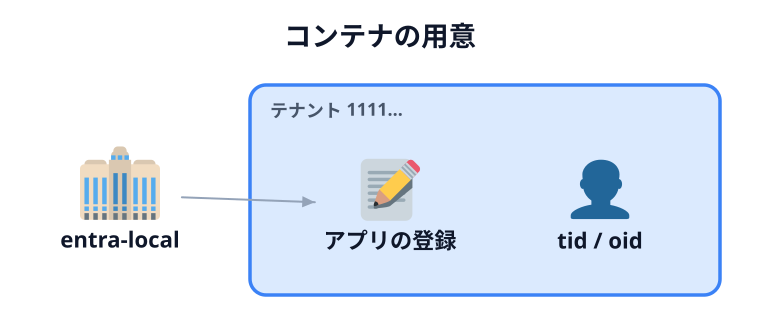

# コンテナの用意



Microsoft Entra ID（旧 Azure AD）を外部 IdP にする練習をします。本物の Entra テナントを使わず、手元で Entra ID を真似する [entra-local](https://github.com/cmaneu/entra-local) を使います。

## Entra ID はローカルで再現できるか

entra-local は、MSAL（Microsoft の認証ライブラリ）が話す OIDC / OAuth 2.0 の範囲を真似します。

| 再現できる | 再現できない |
|---|---|
| discovery・JWKS・authorize・token・userinfo | SAML 2.0（Cognito に SAML で登録する練習はできない） |
| 認可コード（+ PKCE）・クライアントクレデンシャル・リフレッシュ・デバイスコード | MFA・条件付きアクセス・同意画面 |
| アプリの登録・シークレット・ユーザー・グループ | マルチテナント（テナントは 1 つだけ） |
| `tid`・`oid` など Entra 特有のクレーム | Graph API の大部分 |

本物と違う点もあります。entra-local の userinfo は `oid` を返しますが、本物の Entra の userinfo は返しません（`oid` は ID トークンにだけ入る）。

Cognito に OIDC で登録する練習には十分です。

:::danger[ローカル専用の道具です]
entra-local は、管理 API に認証が無く、シードのユーザーとパスワードが公開されている「わざと緩い」道具です。自分のパソコンの中だけで使い、本物のパスワードを入れないでください。compose でも `127.0.0.1` にだけ公開しています。
:::

このレクチャーでは、`compose.yaml` に entra-local を足して起動します。足す・変えるファイルは次のとおりです。

::changes

## entra-local を足す

`compose.yaml` に `entra-local` サービスと、データを残すボリュームを足します。設定の意味は下で説明します。

::file{path="compose.yaml"}

discovery から登録に使う値を抜き出す **`scripts/entra-endpoints.sh`** を作ります。

::file{path="scripts/entra-endpoints.sh"}

## 起動する

`podman compose up -d` で、Floci はそのまま、entra-local が新しく起動します。

```bash
podman compose up -d
```

## 動作確認する

entra-local の health に問い合わせます。

```bash
curl -s http://localhost:8443/health
```

`"status":"ok"` が返れば起動しています。entra-local は起動に数秒かかるので、何も返らないときは、数秒待ってからもう一度打ってください。

起動したら、登録に使う値を discovery から抜き出します。

```bash
bash scripts/entra-endpoints.sh
```

```text
issuer                   http://localhost:8443/11111111-1111-1111-1111-111111111111/v2.0
authorization_endpoint   http://localhost:8443/11111111-1111-1111-1111-111111111111/oauth2/v2.0/authorize
token_endpoint           http://localhost:8443/11111111-1111-1111-1111-111111111111/oauth2/v2.0/token
userinfo_endpoint        http://localhost:8443/graph/oidc/userinfo
jwks_uri                 http://localhost:8443/11111111-1111-1111-1111-111111111111/discovery/v2.0/keys
```

`11111111-...` が **テナント ID** です。本物の Entra でも、URL の途中にテナント ID が入り、`/v2.0` で終わる issuer になります。管理ポータルは <http://localhost:8443/> で開けます。

`compose.yaml` の entra-local の設定:

```yaml
image: ghcr.io/cmaneu/entra-local:0.1.1
platform: linux/amd64
environment:
  TLS_ENABLED: "false"
  PUBLIC_ORIGIN: http://localhost:8443
  REQUIRE_PASSWORD: "true"
```

- `platform: linux/amd64` … amd64 向けのイメージしか無いため。Apple Silicon の Mac ではエミュレーションで動き、起動に少し時間がかかります
- `TLS_ENABLED: "false"` … entra-local は既定で自己署名証明書の HTTPS で動きます。05-04 で Floci がコンテナの中から entra-local を呼ぶとき、証明書を信頼させる手間を省くために HTTP にしています（本物の Entra は必ず HTTPS です）
- `REQUIRE_PASSWORD: "true"` … 既定はアカウントを選ぶだけでサインインできます。本物に近づけるため、パスワードを求めます

:::::platform
::::macos
Apple Silicon の Mac は、`podman machine` の仮想マシンに amd64 のエミュレーションが入っているので、そのまま動きます（手元では起動まで 10 秒ほど）。
::::
::::windows-linux
ARM のパソコン（Raspberry Pi・ARM の VM・Windows on ARM の WSL2 など）では、amd64 のエミュレーションを先に入れないと `exec format error` で起動しません。x86_64（amd64）のパソコンなら、この手順は要りません。

```bash
sudo apt-get install -y qemu-user-static
```
::::
:::::

1 分ほど待っても `curl` に何も返らないときは、`podman compose logs entra-local` でログを見てください。

## このレクチャーを終えた handson/

::codeview

:::faq

### HTTPS のまま使えませんか？

使えますが、Floci のコンテナに entra-local の自己署名証明書を信頼させる必要があります（このハンズオンでは試していません）。証明書は entra-local の管理ポータルの「Trust the certificate」からダウンロードできます。

### データを消したいときは？

ユーザーやアプリ登録は、entra-local のデータボリュームに SQLite で残ります。`podman compose down` では消えません。消すときは `podman compose down -v` でボリュームごと消し、`podman compose up -d`・`bash scripts/setup.sh` で作り直します。残っている間は、`bash scripts/entra-register-app.sh` は登録済みのアプリを使い続け、`bash scripts/entra-create-user.sh` は既にいるユーザーを表示するだけなので、手順を上から流し直しても止まりません。

:::
