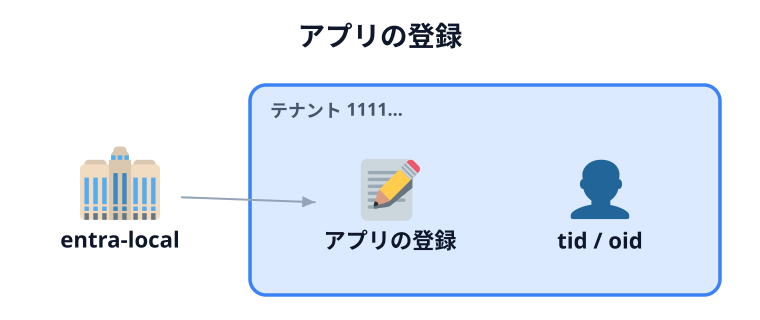

# アプリの登録



Entra ID に、ログインを頼むアプリ（ここでは Cognito）を登録します。足す・変えるファイルは次のとおりです。

::changes

## 準備

`handson/` で作業します。Floci を止めていたときは、起動して entra-local が応答するのを確かめてから、`bash scripts/setup.sh` で前のレクチャーを終えた状態を作り直します。

```bash
podman compose up -d
curl -s http://localhost:8443/health   # "status":"ok" が返ってから次へ
bash scripts/setup.sh
```

## アプリを登録する

Entra では、Entra にログインを頼むアプリを **アプリの登録** として登録し、クライアント ID とシークレットをもらいます。ここでは「Cognito」を 1 つのアプリとして登録します。本物の Entra ならポータルの画面で操作するところを、entra-local の管理 API に送ります。中心はこのリクエストです。

```bash
curl -X POST http://localhost:8443/admin/api/apps -H 'content-type: application/json' -d '{
  "displayName": "Cognito (Floci)",
  "isConfidential": true,
  "redirectUris": [{ "uri": "http://localhost:4566/cognito-idp/oauth2/idpresponse", "type": "web" }]
}'
```

- `isConfidential: true` … サーバー（Cognito）がシークレットを持つアプリ
- リダイレクト URI … Cognito の **idpresponse**。Entra でのサインインが終わると、ブラウザはアプリではなく Cognito に戻ります。Cognito はそこで Entra のトークンを受け取り、自分のトークンに換えてからアプリに戻します

シークレットの値は、作ったときに一度だけ返ります（本物の Entra と同じです）。登録とシークレットの発行をまとめた **`scripts/entra-register-app.sh`** を作り、クライアント ID とシークレットを **`.entra.env`** に控えます。entra-local のデータはボリュームに残るので、もう一度流しても、登録済みのアプリがあればそれを使い続けるようにしてあります。

::file{path="scripts/entra-register-app.sh"}

`.entra.env` にはシークレットが入るので、`.gitignore` に足します（次のレクチャーで作るアプリの控え `.entra.a.env` なども入れないよう、`.entra.*.env` も足します）。

::file{path=".gitignore"}

```bash
bash scripts/entra-register-app.sh
# 登録しました（クライアント ID: 542d7c9b-...）。シークレットは .entra.env にあります
```

## setup.sh に足す

アプリの登録は entra-local のボリュームに残るので、Floci を作り直しても消えません。それでも、ボリュームまで消したとき（`podman compose down -v`）に戻せるよう、`setup.sh` に足しておきます。既に登録してあれば作らずに使うので、何度流しても構いません。

::file{path="scripts/setup.sh"}

## このレクチャーを終えた handson/

::codeview
