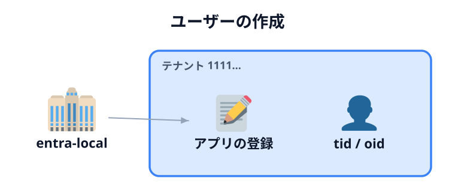

# ユーザーの作成



entra-local にユーザーを作り、そのユーザーがサインインしたら出るトークンの中身を見ます。足す・変えるファイルは次のとおりです。

::changes

## 準備

`handson/` で作業します。Floci を止めていたときは、起動して entra-local が応答するのを確かめてから、`bash scripts/setup.sh` で前のレクチャーを終えた状態を作り直します。

```bash
podman compose up -d
curl -s http://localhost:8443/health   # "status":"ok" が返ってから次へ
bash scripts/setup.sh
```

## ユーザーを作る

ユーザーを作る **`scripts/entra-create-user.sh`** と、トークンの中身を見る **`scripts/entra-preview-token.sh`** を作ります。`entra-preview-token.sh` は、entra-local の管理 API で「このアプリに、このユーザーがサインインしたら出る ID トークン」を見せてくれます。

::file{path="scripts/entra-create-user.sh"}

::file{path="scripts/entra-preview-token.sh"}

```bash
bash scripts/entra-create-user.sh taro '山田 太郎'      # taro@entralocal.dev / Passw0rd!
bash scripts/entra-preview-token.sh taro@entralocal.dev
```

`claims` の部分がトークンの中身です。

```json nofile
"claims": {
  "iss": "http://localhost:8443/11111111-1111-1111-1111-111111111111/v2.0",
  "sub": "7AVwZdeJEDtlOYPBd5JlCISHoby578la6SIPMq3Q27Q",
  "aud": "542d7c9b-2abd-4c55-9788-6dba155eaba0",
  "tid": "11111111-1111-1111-1111-111111111111",
  "oid": "82de800f-ad8c-42ac-bfef-bda7a2aa40ea",
  "name": "山田 太郎",
  "preferred_username": "taro@entralocal.dev",
  "email": "taro@entralocal.dev",
  "ver": "2.0",
  ...
}
```

Entra 特有のクレーム:

- `tid` … テナント ID。どの組織のユーザーか
- `oid` … ユーザーのオブジェクト ID。**テナントの中で、そのユーザーにずっと同じ値**
- `sub` … OIDC の標準のユーザー ID。ただし Entra では **アプリごとに違う値** になる（pairwise）
- `preferred_username` … サインインに使う名前（UPN）。人が読むためのもので、変わることがある

## `sub` はアプリごとに変わる

アプリをもう 1 つ登録して、同じ taro のトークンを見比べます。`entra-register-app.sh` は `.entra.env` を書き換えるので、今のアプリ（A）の控えを別の名前で残してから登録します。

```bash
cp .entra.env .entra.a.env          # アプリ A の控え
rm .entra.env && bash scripts/entra-register-app.sh   # アプリ B を登録（.entra.env は B になる）

bash scripts/entra-preview-token.sh taro@entralocal.dev | grep -E '"(aud|sub|oid)"'                       # B
ENTRA_ENV=.entra.a.env bash scripts/entra-preview-token.sh taro@entralocal.dev | grep -E '"(aud|sub|oid)"'  # A
```

```text
B  "sub": "uqTHzCX6JXcJFCb5-L3lRrPXqRtQHv0jVVFJHrRAA70"  "aud": "462a0ca8-..."  "oid": "82de800f-ad8c-42ac-bfef-bda7a2aa40ea"
A  "sub": "7AVwZdeJEDtlOYPBd5JlCISHoby578la6SIPMq3Q27Q"  "aud": "542d7c9b-..."  "oid": "82de800f-ad8c-42ac-bfef-bda7a2aa40ea"
```

`aud`（どのアプリ向けか）と一緒に `sub` も変わり、`oid` は同じです。

アプリをまたいで「同じ人」を見分けたいなら `oid`（と `tid`）を使います。次のレクチャーで、`oid` を Cognito の属性に持ち込みます。

## setup.sh に足す

ユーザーも entra-local のボリュームに残ります。ボリュームまで消したときに戻せるよう、`setup.sh` に足しておきます。既にいれば作らないので、何度流しても構いません。

::file{path="scripts/setup.sh"}

## このレクチャーを終えた handson/

::codeview
