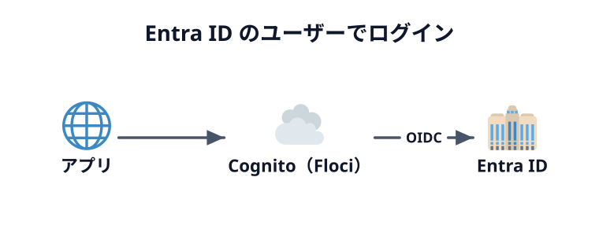

# Entra ID にあるユーザーで Cognito にログイン



entra-local を Cognito の外部 IdP（OIDC）として登録し、サインインの画面の「Entra ID でサインイン」で Entra のユーザーをアプリに入れます。仕組みは 03-06 で説明した Hosted UI（認可コードフロー）の上に乗っていて、Cognito のログイン画面の代わりに Entra のサインイン画面に回ります。気をつけるのは Entra に特有の部分、とくに **ユーザーを何で見分けるか** です。

このレクチャーで足す・変えるファイルは次のとおりです。

::changes

## 準備

`handson/` で作業します。前のレクチャーから続けているなら、`source` の行だけで構いません。Floci を止めていたときは、起動してから `bash scripts/setup.sh` で前のレクチャーを終えた状態を作り直します。

```bash
podman compose up -d
curl -s http://localhost:8443/health   # "status":"ok" が返ってから次へ（entra-local は起動に数秒かかる）
bash scripts/setup.sh              # 前のレクチャーまでに作ったものを作り直す
source ./env.sh && source ./.cognito.env
```

## App Client に Hosted UI の設定を足す

Entra ID でのサインインは、03-06 で説明した Hosted UI の仕組み（認可コードフロー）の上に乗っています。02-03 で作った App Client は、パスワードを受け取るサインイン（`USER_PASSWORD_AUTH`）だけを許しているので、認可コードフローと、サインインのあとに戻ってよい先（コールバック URL）を足します。

```bash
aws cognito-idp update-user-pool-client \
  --user-pool-id "$POOL_ID" --client-id "$CLIENT_ID" \
  --explicit-auth-flows ALLOW_USER_PASSWORD_AUTH ALLOW_REFRESH_TOKEN_AUTH \
  --prevent-user-existence-errors ENABLED \
  --supported-identity-providers COGNITO \
  --callback-urls http://localhost:3000/ \
  --logout-urls http://localhost:3000/ \
  --allowed-o-auth-flows code \
  --allowed-o-auth-scopes openid email profile \
  --allowed-o-auth-flows-user-pool-client
```

- `--supported-identity-providers COGNITO` … 使ってよい IdP。このあと `EntraID` を足します
- `--callback-urls` … ログイン後に戻ってよい先。ここに無い URL へは戻さない（コードを盗まれないため）
- `--allowed-o-auth-flows code` … 認可コードフローを許す

:::warning[UpdateUserPoolClient は全部を渡し直す]
`update-user-pool-client` は「渡さなかった設定を既定値に戻す」API です。Hosted UI の設定だけを渡すと、02-03 で付けた `--explicit-auth-flows` が消えて、パスワードでのログイン（CLI・画面のフォーム）ができなくなります。`--prevent-user-existence-errors` も既定値に戻ります。足したい設定だけでなく、今の設定を全部渡し直します。本物の Cognito も同じです。
:::

これを **`scripts/update-client.sh`** にします。`--supported-identity-providers` には、User Pool に登録してある IdP を全部並べます。`custom:entra_oid` をトークンに載せるための読み取りの許可（`--read-attributes`）も、ここで渡します（下の「`oid` を持ち込む」で説明します）。

::file{path="scripts/update-client.sh"}

## 外部 IdP を登録する

**`scripts/register-entra.sh`** を作ります。中心は `create-identity-provider` です。値は 05-02 で控えた `.entra.env` から読みます。

```bash
aws cognito-idp create-identity-provider \
  --user-pool-id "$POOL_ID" \
  --provider-name EntraID \
  --provider-type OIDC \
  --provider-details "client_id=$ENTRA_CLIENT_ID,client_secret=$ENTRA_CLIENT_SECRET,
      authorize_scopes=openid email profile,
      oidc_issuer=http://localhost:8443/$ENTRA_TENANT_ID/v2.0,attributes_request_method=GET,
      authorize_url=http://localhost:8443/$ENTRA_TENANT_ID/oauth2/v2.0/authorize,
      token_url=http://entra-local:8443/$ENTRA_TENANT_ID/oauth2/v2.0/token,
      attributes_url=http://entra-local:8443/graph/oidc/userinfo,
      jwks_uri=http://entra-local:8443/$ENTRA_TENANT_ID/discovery/v2.0/keys" \
  --attribute-mapping email=email,name=name,preferred_username=preferred_username,custom:entra_oid=oid,username=sub
```

- `oidc_issuer` は **v2.0 の、自分のテナントの issuer** にします。Entra には `common`（どのテナントでも可）というエンドポイントもありますが、Cognito に登録するのは自分のテナントのものです
- ブラウザが通る `authorize_url` だけ `localhost`、Floci がコンテナの中から呼ぶものはサービス名 `entra-local` にします。コンテナの中から見ると、`localhost` は Floci 自身だからです

## `oid` を持ち込む

前のレクチャーで見たとおり、Entra の `sub` はアプリごとに変わります。本物の Cognito のユーザー名 `EntraID_<sub>` も、Entra にとっての「Cognito というアプリ」向けの値です。あとで別のアプリから同じ人を探したくなったとき、`sub` では見つかりません。

そこで、テナントの中で変わらない `oid` をカスタム属性 `custom:entra_oid` に持ち込みます。

1. User Pool にカスタム属性を足す。02-02 で作った User Pool に、あとから足します（`register-entra.sh` の最初）
   ```bash
   aws cognito-idp add-custom-attributes --user-pool-id "$POOL_ID" \
     --custom-attributes Name=entra_oid,AttributeDataType=String,Mutable=true
   ```
2. 属性のマッピングで `oid` を入れる: `custom:entra_oid=oid`
3. App Client で読み取りを許す: `--read-attributes ... custom:entra_oid`（上の `update-client.sh` で渡しています）

`register-entra.sh` の全体です。最後に `update-client.sh` を呼び、App Client で EntraID を選べるようにします（`update-client.sh` は、User Pool に登録してある IdP を全部並べます）。

::file{path="scripts/register-entra.sh"}

`list-users.sh` には、`custom:entra_oid` の列を足します。

::file{path="scripts/list-users.sh"}

`setup.sh` に 1 行足します。

::file{path="scripts/setup.sh"}

## 認可コードフローと PKCE

「Entra ID でサインイン」を押してから戻ってくるまでに、次のことが起きています（開発者ツールの Network タブで追えます）。

1. 画面が `code_verifier`（ランダムな文字列）を作り、そのハッシュ `code_challenge` を付けて `/oauth2/authorize` へ移る
2. Cognito が Entra ID のサインイン画面へ回し、ユーザーが Entra のパスワードを入れる
3. Cognito が **認可コード** を付けて、登録された戻り先（`http://localhost:3000/?code=...`）へ戻す
4. 画面が認可コードと `code_verifier` を `/oauth2/token` に送り、トークンを受け取る

認可コードは URL に載るので、横取りされるかもしれません。PKCE では、最初に送ったハッシュの元（`code_verifier`）を知っている人しかコードをトークンに換えられません。Floci も、`code_verifier` が合わないと `invalid_grant` を返します。

`public/cognito.js` の後ろに、この流れをライブラリなしで足します。

```js
const verifier = randomString();
const challenge = base64url(await crypto.subtle.digest('SHA-256', new TextEncoder().encode(verifier)));
const state = randomString();
// ...
const params = {
  client_id: config.clientId,
  response_type: 'code',
  redirect_uri: redirectUri,
  scope: 'openid email profile',
  state,
  code_challenge: challenge,
  code_challenge_method: 'S256',
};
// ...
const url = new URL(discovery.authorization_endpoint);
url.search = new URLSearchParams(params);
location.assign(url);
```

認可・トークンのエンドポイントは、User Pool の discovery（`<iss>/.well-known/openid-configuration`）から読んでいます。Floci では `http://localhost:4566/cognito-idp/oauth2/authorize`、本物では `https://<ドメイン>.auth.<リージョン>.amazoncognito.com/oauth2/authorize` です。

トークンエンドポイントの応答は `id_token` のような snake_case なので、パスワードでサインインしたときと同じ形（`idToken`）にそろえて保存します。こうしておくと、ログイン中の画面（`home.html`）は 03-05 のまま使えます。

- `hostedLogin('EntraID')` … `identity_provider=EntraID`（`register-entra.sh` の `--provider-name`）を付けて `/oauth2/authorize` へ移ります。Cognito は自分のログイン画面を飛ばして、Entra のサインイン画面へ直行します
- `handleCallback()` … 戻ってきた `?code=...` を `code_verifier` と一緒に `/oauth2/token` へ送り、トークンを保存します
- `hostedLogout()` … Cognito の `/logout` に移り、Hosted UI 側のログイン状態（Cookie）も消します

::file{path="public/cognito.js"}

サインインの画面に「Entra ID でサインイン」のボタンを足します。

::file{path="public/signin.html"}

Entra ID から戻ってくる先（コールバック URL）はトップ（`http://localhost:3000/`）です。トップで認可コードをトークンに換え、ログイン中の画面へ移ります。

::file{path="public/index.html"}

::file{path="public/main.js"}

ログイン中の画面のサインアウトでは、手元のトークンを消したあと、Cognito の `/logout` にも移ります。

::file{path="public/home.html"}

:::warning[本番でのトークンの置き場所]
`sessionStorage` は、ページに XSS があると JavaScript から読まれてしまう場所です（前のレクチャーの注意と同じです）。この画面のようにブラウザが `/oauth2/token` を直接呼ぶ作りでは、httpOnly の Cookie に置くことはできません。本番では、トークンの交換をサーバー側で行い、ブラウザとは httpOnly の Cookie のセッションでやり取りする形（BFF: Backend for Frontend）を検討してください。
:::

## 動かす

```bash
bash scripts/register-entra.sh
```

<http://localhost:3000> の「サインイン」を開き（開いていたら読み込み直し）、「Entra ID でサインイン」を押します。entra-local のサインイン画面で `taro@entralocal.dev` / `Passw0rd!` を入れます。トップに戻り、ログイン中の画面に移ったら、ID トークンを見てください。

開発者ツールの Network タブでは、`localhost:3000` → `localhost:4566/.../oauth2/authorize` → `localhost:8443/.../authorize`（Entra）→ `localhost:4566/.../oauth2/idpresponse` → `localhost:3000/?code=...` と移るのが見えます。Entra のトークンを受け取るのは Cognito で、画面が受け取るのは **Cognito のトークン** です。

```json nofile
{
  "cognito:username": "EntraID_272c8101-ef40-41cb-bd40-ed64f04a6546",
  "custom:entra_oid": "daa6ae20-6153-4193-a9f7-9f8cc48bbf34",
  "name": "山田 太郎",
  "preferred_username": "taro@entralocal.dev",
  "email": "taro@entralocal.dev",
  "iss": "http://localhost:4566/ap-northeast-1_16130330b"
}
```


:::warning[本物の Entra の userinfo には `oid` が無い]
entra-local は userinfo（`/graph/oidc/userinfo`）でも `oid` を返すので、ここではそこから入ります。本物の Entra ID の userinfo が返すのは `sub`・`name`・`family_name`・`given_name`・`picture`・`email` だけで、`oid` は **ID トークンにしか入りません**（`profile` スコープが必要）。本物の Cognito で `custom:entra_oid` が埋まるかは、Cognito が ID トークンのクレームもマッピングに使うかにかかっており、このハンズオンでは確かめていません。本物のテナントにつないだら、まず `bash scripts/list-users.sh` で `custom:entra_oid` が入っているかを確かめてください。
:::

```bash
bash scripts/list-users.sh
```

```text
|        Email        |               EntraOid                 |  Status    |                   Username                     |
|  alice@example.com  |  None                                  |  CONFIRMED |  alice                                         |
|  taro@entralocal.dev|  daa6ae20-6153-4193-a9f7-9f8cc48bbf34  |  CONFIRMED |  EntraID_272c8101-ef40-41cb-bd40-ed64f04a6546  |
```

:::notice[カスタム属性は足せるが、変えられない]
Cognito のカスタム属性は、あとから足すことはできますが、一度作ると名前も型も変えられず、消すこともできません。本番の User Pool では、名前を慎重に決めてから足してください。
:::

## Entra 固有の落とし穴

本物の Entra ID につなぐときに踏みやすいところです。entra-local で再現できるものと、できないものがあります。

- **テナントごとの issuer と `common`** … `https://login.microsoftonline.com/<テナント ID>/v2.0` が issuer です。`common` や `organizations` のエンドポイントで発行されたトークンも、`iss` には個々のテナント ID が入ります。Cognito に登録する `oidc_issuer` は自分のテナントのものにします
- **`email` が来ないことがある** … Entra の `email` は、ユーザーにメールアドレスが設定されていないと入りません。必ずある `preferred_username`（UPN）と混同しないこと。Cognito の属性で `email` を必須にしていると、ログインに失敗する人が出ます
- **`email` で人を結び付けない** … Entra の `email` は、ユーザーやテナントの管理者が設定できる値で、そのアドレスを持っていることは確かめられていません。Cognito でも、外部 IdP から入れた `email` は既定で未確認の扱いです。既存のユーザーとの結び付け（`AdminLinkProviderForUser` など）や、アプリでの人の特定には `email` を使わず、`oid`（と `tid`）か Cognito の `sub` を使ってください。別人のアドレスを名乗った Entra のユーザーに、アカウントを乗っ取られるおそれがあります
- **グループの overage** … `groups` クレームを有効にしても、所属が多い（ID トークンで 200 を超える）ユーザーでは一覧の代わりに「Graph で引いてください」という印（`_claim_names`）が入ります。entra-local でも `groupOverageLimit` で再現できます
- **シークレットの期限切れ** … Entra のクライアントシークレットには期限があります（既定は 6 か月〜2 年）。切れると Cognito からのトークン交換が失敗し、全員がログインできなくなります。期限を管理しておくこと

## このレクチャーを終えた handson/

これで `handson/` は完成です。02-04 の `create-user-pool.sh` 1 つから始まって、画面・Cognito のユーザー・トークン・Entra ID と、1 つずつ足してきました。`setup.sh` を開くと、その順番がそのまま並んでいます。

::codeview

:::faq

### entra-local のサインイン画面で「Invalid redirect URI」と出ます

アプリの登録のリダイレクト URI と、Cognito（Floci）が送ってくる `redirect_uri`（`http://localhost:4566/cognito-idp/oauth2/idpresponse`）が 1 文字でも違うと拒否されます。`.entra.env` を消してから `bash scripts/entra-register-app.sh` で登録し直し、`bash scripts/register-entra.sh` で Cognito 側の登録も新しいクライアント ID とシークレットに合わせます。

### サインアウトしたのに、「Entra ID でサインイン」でパスワードを聞かれません

画面のサインアウトが消すのは、手元のトークンと Cognito のログイン状態だけです。Entra 側のサインイン（entra-local の Cookie）は残っているので、Entra はそのまま Cognito に戻します。本物の Entra ID と Cognito でも同じで、Cognito の `/logout` は外部 IdP のサインインを終わらせません。

別のユーザーで試したいときは、Entra のサインアウトの入口（discovery の `end_session_endpoint`）を開いてから、もう一度押してください。

```text
http://localhost:8443/11111111-1111-1111-1111-111111111111/oauth2/v2.0/logout
```

本番で Entra からもサインアウトさせたいときは、Cognito の `/logout` のあとに、この入口（`https://login.microsoftonline.com/<テナント ID>/oauth2/v2.0/logout`）へ移します。

### `state` は何のためにありますか？

ログイン画面から戻ってきた応答が、自分が出した要求への応答かを確かめるためです。別のサイトに仕込まれたリンクから、攻撃者の認可コードで戻されるのを防ぎます（CSRF 対策）。

### Entra のアプリロールやグループで認可したいときは？

本物の Entra では、アプリロールをユーザーに割り当てると ID トークンの `roles` クレームに入ります。属性のマッピングでカスタム属性に持ち込めば、Cognito のトークンで読めます。entra-local もアプリロールの定義はできますが、ユーザーへの割り当てまではこのハンズオンでは試していません。

:::
